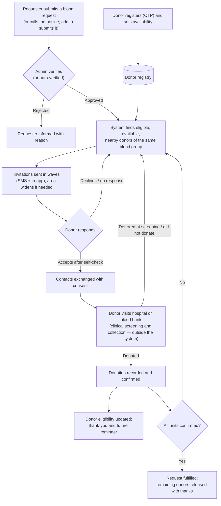

# Business Requirements Document (BRD)

## Blood Donor Management System (BDMS) — MVP

| Item | Detail |
|---|---|
| Document | Business Requirements Document (BRD) |
| Product | Blood Donor Management System (BDMS) — working name |
| Version | 1.1 — Draft for review |
| Date | 14 November 2026 |
| Document owner | [Product Owner] |
| Sponsor | [Operating Organization] |
| Status | Draft |
| Related documents | [Product Requirements Document (PRD)](02-PRD.md) · [Software Requirements Specification (SRS)](03-SRS.md) · [Technical Design Document (TDD)](04-TDD-MERN.md) |

### Revision history

| Version | Date | Author | Changes |
|---|---|---|---|
| 0.1 | — | Product team | Initial MVP concept note (input to this document) |
| 1.0 | 14 Nov 2026 | [Author] | First complete BRD derived from the MVP concept |
| 1.1 | 14 Nov 2026 | [Author] | Technology (MERN) and visual identity (red, black, white; destimax.com design reference) constraints added |

### Approvals

| Role | Name | Signature | Date |
|---|---|---|---|
| Project Sponsor | | | |
| Product Owner | | | |
| Medical Advisor | | | |
| Legal / Compliance Advisor | | | |
| Operations Lead | | | |
| Technical Lead | | | |

---

## Table of contents

1. [Executive summary](#1-executive-summary)
2. [Business context and problem statement](#2-business-context-and-problem-statement)
3. [Business objectives and success metrics](#3-business-objectives-and-success-metrics)
4. [Scope](#4-scope)
5. [Stakeholders](#5-stakeholders)
6. [Business process (to-be)](#6-business-process-to-be)
7. [Business requirements](#7-business-requirements)
8. [Business rules](#8-business-rules)
9. [Regulatory, ethical and compliance considerations](#9-regulatory-ethical-and-compliance-considerations)
10. [Assumptions](#10-assumptions)
11. [Constraints](#11-constraints)
12. [Dependencies](#12-dependencies)
13. [Risks and mitigations](#13-risks-and-mitigations)
14. [Costs and benefits](#14-costs-and-benefits)
15. [Implementation approach and milestones](#15-implementation-approach-and-milestones)
16. [Open business decisions](#16-open-business-decisions)
17. [Glossary](#17-glossary)

---

## 1. Executive summary

In Bangladesh, finding a willing and suitable blood donor still depends mostly on personal networks, phone calls and social-media posts. These channels are slow and unverified. They also expose donors' phone numbers to the public and have no way of knowing whether a donor has donated recently. As a result, patients' families lose critical hours, donors are contacted too often and are sometimes harassed, and fake or commercial ("paid donor") requests go unchecked.

The **Blood Donor Management System (BDMS)** is a mobile-first, bilingual (Bangla/English) web platform. It:

- keeps a **consent-based registry** of voluntary donors, with each donor's blood group, location, availability and donation history;
- accepts **blood requests** and has them **verified** by trained admins before any donor is contacted;
- **automatically notifies suitable nearby donors** in controlled waves, by SMS and in-app;
- shares contact details **only with consent**, and only between a requester and the donors who have accepted;
- **records donations**, so that donor eligibility stays accurate and every request can be tracked until it is fulfilled;
- gives the operating organization an **admin dashboard**, reports and an audit trail.

**Primary business goal:** reduce the time it takes to find a willing, suitable blood donor. The target is a median of **30 minutes or less** from verification to the first donor acceptance for emergency requests in the pilot area.

The MVP will first be piloted in one city or district. A national rollout follows if the go/no-go criteria in §3.3 are met.

---

## 2. Business context and problem statement

### 2.1 Background

- Patients need blood transfusions for surgery, childbirth complications, accidents and trauma, cancer treatment, severe anaemia and thalassaemia (which often needs a transfusion every few weeks). Seasonal dengue outbreaks cause sharp spikes in demand for platelets.
- Hospitals and blood banks often ask patients' families to arrange donors themselves, sometimes at very short notice.
- Volunteer organizations (student groups, NGOs and community groups) already mobilise donors, but they rely on spreadsheets, phone trees and social-media groups.
- Almost everyone has a mobile phone and SMS reaches all handsets. Smartphone use is growing but is not universal. This makes **SMS plus a lightweight mobile web app** the right channel mix.

> Quantitative baselines (e.g., current average time to find a donor, share of fake requests, coordinator hours per request) are **not yet measured**. A baseline study during Discovery (§15) is required before the KPI targets in §3.2 are finalised.

### 2.2 Current state (as-is)

| Stakeholder | Current practice | Pain points |
|---|---|---|
| **Patient's family / requester** | Posts in Facebook groups, calls relatives and friends, contacts volunteer organizations, and sometimes approaches brokers | Slow and uncertain response; no visibility of progress; exposed to fraud and illegal paid donors; the whole search repeats for recurring needs (e.g., thalassaemia) |
| **Donor** | Receives calls and messages from strangers after their number is shared publicly | Harassment (especially of female donors); called when recently donated or far away; no personal donation record; no reminder of when they can donate again |
| **Volunteer organization / coordinator** | Spreadsheets, WhatsApp/Messenger groups, manual phone calls | Manual matching; stale data on availability and last donation; duplicated effort between volunteers; no verification trail; no reporting |
| **Hospital / blood bank** | Asks families to bring donors | Donors arrive late, ineligible or with the wrong blood group; no coordination |

### 2.3 Problem statement

> Patients and their families cannot quickly find a willing, eligible, nearby voluntary donor through a channel they can trust. Donors, in turn, lack a safe and respectful way to be contacted only when they are able to help. Because nothing is verified, eligibility is not tracked and no data is collected, the process is slow, unsafe and impossible to measure.

### 2.4 Vision and opportunity

**Vision:** *No patient waits for blood because a willing donor could not be found in time.*

BDMS will turn a chaotic, word-of-mouth search into a managed, measurable and privacy-respecting process run by a trusted operating organization. The data it collects (demand by blood group, location and season) will also support advocacy, donor drives and planning.

---

## 3. Business objectives and success metrics

### 3.1 Business objectives

| ID | Objective | Target (proposed, to be confirmed after baseline) | Timeframe |
|---|---|---|---|
| **BO-1** | **Speed:** Reduce the time to find a willing donor | Median time from verification to first donor acceptance: ≤ 30 min (emergency), ≤ 4 h (normal) | Within 6 months of pilot launch |
| **BO-2** | **Effectiveness:** Fulfil verified requests through the platform | ≥ 70% of verified requests fully fulfilled; ≥ 85% at least partially fulfilled | Within 6 months of pilot launch |
| **BO-3** | **Donor base:** Build an active, consented donor registry | ≥ 5,000 registered donors in the pilot area; ≥ 40% active (responded or updated their profile in the last 90 days) | Within 6 months of pilot launch |
| **BO-4** | **Trust and safety:** Stop fraud and protect privacy | 0 public exposures of donor contact data; ≤ 1% of published requests later confirmed fraudulent or commercial; 100% of published requests verified or from trusted sources | Continuous |
| **BO-5** | **Donor wellbeing and retention:** Protect donors from over-contact and encourage repeat donation | 0 automatic invitations to donors who are ineligible under the configured rules; ≤ 5 invitations per donor per week; ≥ 25% of platform donors donate again within 12 months | Continuous / 12 months |
| **BO-6** | **Operational efficiency:** Reduce coordinator effort | ≥ 50% reduction in coordinator time per request compared with the manual baseline; 100% of requests traceable from creation to closure | Within 6 months of pilot launch |
| **BO-7** | **Data for decisions:** Provide reliable demand and supply information | Monthly reports by blood group, location and urgency available to management and partners | From month 2 of the pilot |

### 3.2 Key performance indicators (KPIs)

| KPI | Definition | Target | Source |
|---|---|---|---|
| Time to first acceptance | Median minutes from request verification to the first donor acceptance | ≤ 30 min (emergency), ≤ 240 min (normal) | System data |
| Fulfilment rate | Fulfilled requests ÷ verified requests that have closed | ≥ 70% | System data |
| Verification SLA compliance | Share of requests verified within the SLA (emergency 15 min, normal 2 h) | ≥ 90% | System data |
| Invitation response rate | Invitations accepted or declined ÷ invitations sent | ≥ 50% | System data |
| Acceptance-to-donation rate | Donations confirmed ÷ invitations accepted | ≥ 70% | System data |
| Active donors | Donors who responded or updated their profile in the last 90 days ÷ registered donors | ≥ 40% | System data |
| Donor opt-out rate | Donors withdrawing consent per month ÷ active donors | ≤ 2% per month | System data |
| Fraud rate | Published requests later confirmed fraudulent or commercial ÷ published requests | ≤ 1% | Abuse reports, admin review |
| Outcome capture | Accepted invitations closed with a recorded outcome within 7 days | ≥ 90% | System data |
| Privacy incidents | Confirmed unauthorised disclosures of personal data | 0 | Incident log |
| Repeat donation | Donors with a second confirmed donation within 12 months ÷ donors with a first confirmed donation | ≥ 25% | System data |

### 3.3 MVP success criteria (go/no-go for national rollout)

1. ≥ 80% of usability-test participants complete donor registration (including OTP) in **≤ 2 minutes**.
2. A logged-in requester can submit a blood request in **≤ 60 seconds** (≤ 2 minutes for a first-time user, including OTP).
3. For 95% of requests, matching donors receive their first-wave invitations **within 2 minutes** of verification.
4. **Zero duplicate donation records** are found in the pilot data audit.
5. **100% of requests** have a complete status history from creation to closure that admins can view.
6. The verification SLA is met for **≥ 90% of emergency requests** during staffed hours.
7. **No critical or high-severity security findings** remain open at launch (independent penetration test).
8. The Medical Advisor and the Legal/Compliance Advisor have signed off on eligibility parameters, medical content, the Terms of Service and the Privacy Policy.

---

## 4. Scope

### 4.1 In scope (MVP)

| # | Capability |
|---|---|
| 1 | Registration and login with a Bangladeshi mobile number and a one-time password (OTP) |
| 2 | Donor profiles: blood group, date of birth, location (division → district → upazila/thana), availability, consents, donation history and eligibility |
| 3 | Blood requests for oneself or another person: hospital, component, units, urgency, needed-by time, contact person |
| 4 | Request verification by admins, plus auto-verification for admin-created requests and trusted requesters |
| 5 | Automatic matching and **wave-based** invitation of suitable donors, widening from upazila to district to division; manual invitations |
| 6 | Accepting or declining invitations, with a short self-check and **consent-based contact exchange** |
| 7 | Request tracking and **fulfilment by multiple donors**, including update, cancel, extend and expiry |
| 8 | Recording and confirming donations, automatic eligibility calculation and reminders |
| 9 | In-app and SMS notifications in Bangla and English, with quiet hours and preferences |
| 10 | Admin dashboard; management of donors, requests, donations and hospitals; abuse handling; CSV exports; audit logs; configurable rules |
| 11 | Trust and safety: abuse reporting, block list, disclaimers, data retention and anonymisation |
| 12 | Mobile-first responsive web application (installable PWA preferred) |

### 4.2 Out of scope (MVP)

- Blood storage, inventory and expiry management; laboratory testing; crossmatching; transfusion management; billing; clinical diagnosis or medical advice.
- Native Android/iOS apps.
- Integration with hospital or blood bank information systems.
- GPS/map-based matching.
- Multiple organizations (multi-tenant donor groups).
- Campaigns and events.
- Two-way SMS (reply YES/NO), IVR and USSD.
- International phone numbers.
- Payments of any kind.

### 4.3 Future phases (Phase 2+)

| Enhancement | Business value |
|---|---|
| Blood donation campaigns and events | Planned donor drives; new donor acquisition |
| Organization-based donor groups (multi-tenant) | Partner organizations (universities, NGOs, companies) manage their own donors |
| GPS-based matching and map view | More precise proximity; faster arrival |
| Hospital and blood bank integration | Verified requests at the source; automatic donation confirmation |
| Blood inventory and expiry management | Supports partner blood banks |
| Recurring requests for thalassaemia patients | Predictable scheduling for chronic transfusion needs |
| Native mobile apps | Richer notifications and engagement |
| Two-way SMS / IVR for feature-phone users | Includes donors without smartphones |
| Masked calling (proxy numbers) | Even stronger privacy: no number exchange at all |
| Donor recognition (badges, certificates) | Retention and motivation |

---

## 5. Stakeholders

### 5.1 Stakeholder register

| Stakeholder | Role / interest | Key needs | Influence |
|---|---|---|---|
| Project Sponsor (operating organization leadership) | Funds and owns the platform | Impact, reputation, cost control | High |
| Product Owner | Defines and prioritises requirements | Clear scope, measurable outcomes | High |
| **Donors** | Voluntary, unpaid blood donors | Safety, privacy, respect for their time, relevant requests only, history and reminders | High |
| **Requesters** (patients, families, attendants, hospital staff) | Need blood for a patient | Fast and reliable response, a simple process, visible progress | High |
| **Admins / coordinators** (volunteers or staff) | Verify requests, coordinate donors, maintain data | Efficient queues, clear tools, accountability | Medium |
| **Super Admin** | Configures the system and manages admins | Control, auditability | Medium |
| Medical Advisor | Approves eligibility rules and donor-facing medical content | Donor safety, accurate medical information | High (gatekeeper) |
| Legal / Compliance Advisor | Terms, privacy policy, regulatory alignment | Compliance, limited liability | High (gatekeeper) |
| Hospitals, blood banks and transfusion centres | Screen donors, collect blood and transfuse | Eligible donors arriving on time with correct information | Medium |
| SMS gateway provider(s) | Deliver OTPs and notifications | Volume forecasts, compliant content | Medium |
| Regulators (health authorities, e.g., DGHS; telecom regulator BTRC for SMS) | Oversight | Compliance with law | Medium |
| Partners and funders (NGOs, universities, CSR sponsors) | Donor recruitment, funding | Impact reports | Medium |
| Development and support team | Build and operate the system | Clear requirements, stable scope | Medium |

### 5.2 User groups

| User group | Description | Primary goals |
|---|---|---|
| **Donor** | A registered user with an active donor profile | Help when able; avoid unwanted or ineligible requests; track donations |
| **Requester** | Any registered user who submits a blood request (a donor can also be a requester) | Find donors quickly; know the status; coordinate safely |
| **Admin** | Operations staff or volunteer of the operating organization | Verify requests, coordinate fulfilment, keep data clean, prevent abuse |
| **Super Admin** | Senior operations or technical staff | Configure rules, manage admins, oversee audits and exports |

### 5.3 RACI for key operational activities

R = Responsible, A = Accountable, C = Consulted, I = Informed

| Activity | Sponsor | Product Owner | Ops Lead | Admin | Super Admin | Medical Advisor | Legal | Tech Lead |
|---|---|---|---|---|---|---|---|---|
| Verify blood requests | I | I | A | R | C | – | – | – |
| Define and approve eligibility rules | I | C | C | – | R | **A** | – | C |
| Configure system settings | – | C | A | – | R | C | – | C |
| Handle abuse reports and blocks | I | I | A | R | C | – | C | – |
| Privacy policy, terms and consent texts | I | C | C | – | – | C | **A/R** | C |
| Monitor KPIs and report to stakeholders | A | R | R | – | C | – | – | C |
| Manage the SMS budget | A | C | R | – | R | – | – | C |
| Security incident / data-breach response | A | I | C | – | R | – | C | **R** |

---

## 6. Business process (to-be)

### 6.1 Process overview



### 6.2 Process steps

| Step | Description | Actor |
|---|---|---|
| 1 | The donor registers with a mobile number and OTP, creates a donor profile, gives consent and sets their availability. | Donor |
| 2 | The requester submits a blood request in the app. Alternatively, they call the organization's hotline and an admin submits it for them. | Requester / Admin |
| 3 | An admin verifies the request (e.g., calls the contact person and checks the hospital). Admin-created requests and requests from trusted requesters are verified automatically. | Admin / System |
| 4 | The system finds suitable donors (same blood group, available, eligible, nearby) and invites them in waves. It starts with the same upazila and widens to the district and division if needed. | System |
| 5 | Each invited donor sees non-identifying request details. They accept (after a short self-check) or decline. | Donor |
| 6 | Contact details are exchanged with consent. The donor sees the attendant's contact details; the requester sees the donor's number only if the donor agreed to share it. | System |
| 7 | The donor goes to the hospital or blood bank, where clinical staff screen the donor and collect the blood. This happens outside the system. | Donor / Hospital |
| 8 | The requester (or an admin, or the donor) records the outcome. The donation is confirmed, the donor's eligibility is updated and a thank-you message is sent. | Requester / Admin / Donor |
| 9 | The request is **fulfilled** once confirmed units equal or exceed the units required. Donors still committed to it are released with thanks. Unfulfilled requests are cancelled or expire, and every outcome is reported. | System |

### 6.3 Request lifecycle (business view)

`Pending Verification → Open → Donor Accepted → Partially Fulfilled → Fulfilled`, plus the closing statuses `Cancelled`, `Expired` and `Rejected`.

| Status | Business meaning | Are donors being contacted? |
|---|---|---|
| Pending Verification | Submitted and waiting for an admin check | No |
| Open | Verified; the system is looking for donors | Yes |
| Donor Accepted | At least one donor has committed; no donation confirmed yet | Yes, if more donors are needed |
| Partially Fulfilled | Some units confirmed; more are needed | Yes, if more donors are needed |
| Fulfilled | All required units confirmed | No — remaining donors are released |
| Cancelled | Withdrawn by the requester or an admin | No |
| Expired | The needed-by time plus a grace period has passed | No |
| Rejected | Failed verification | No |

The detailed state machine is in [SRS §4.5](03-SRS.md#45-state-machines).

### 6.4 Operating model

| Area | Business requirement |
|---|---|
| **Verification desk** | Trained admins work in shifts. Target: 24/7 coverage for emergency requests. If 24/7 staffing is not feasible in the pilot, define staffed hours and rely on trusted-requester auto-approval outside them (see OD-03). |
| **Verification method** | Call the contact person; confirm the hospital and ward; review the requisition slip if one was uploaded; check for duplicates and the requester's history. A standard operating procedure (SOP) will be written. |
| **Service levels** | Emergency requests verified within **15 minutes**; normal requests within **2 hours**. Escalation goes first to on-duty admins, then to the Super Admin. |
| **Hotline** | A published phone number for people who cannot use the app. Admins create requests for callers and can record donor responses received by phone. |
| **Abuse handling** | Reports reviewed within 24 hours. Reports of payment demands reviewed within 2 hours. |
| **Data quality** | Donors are reminded every 6 months to review their profile; requesters are prompted to record outcomes. |
| **Training** | Admin onboarding covering the SOPs, privacy obligations and the escalation process. |
| **Support** | In-app "Contact us", the hotline and an FAQ in Bangla and English. |

---

## 7. Business requirements

Priority uses MoSCoW: **M**ust, **S**hould, **C**ould, **W**on't (this release).

| ID | Business requirement | Rationale | Priority |
|---|---|---|---|
| **BR-01** | Maintain a consent-based registry of voluntary donors (blood group, location, availability, donation history) that donors keep up to date themselves. | Accurate, current data is the foundation of matching. | M |
| **BR-02** | Allow anyone with a verified Bangladeshi mobile number to request blood, for themselves or for others, through a short and simple form. | Families in crisis need speed and ease. | M |
| **BR-03** | Verify requests (or accept them only from trusted sources) before any donor is contacted. | Prevents fraud, commercial exploitation and donor fatigue. | M |
| **BR-04** | Automatically identify and notify suitable donors (same blood group, available, eligible, nearby) in a controlled way, and support manual invitations. | Core value: speed without harming donors. | M |
| **BR-05** | Share donor and requester contact details only with consent, and only between the parties to an accepted invitation. | Privacy and safety, particularly for women donors. | M |
| **BR-06** | Let requesters track responses and fulfilment, and update, extend or cancel their requests. | Transparency, less anxiety, accurate demand data. | M |
| **BR-07** | Record each completed donation exactly once, confirm it, and use it to keep donor eligibility accurate and track fulfilment. | Donor safety; trustworthy statistics. | M |
| **BR-08** | Thank donors after they donate and remind them when they may donate again. | Retention and repeat voluntary donation. | S |
| **BR-09** | Communicate through SMS and in-app notifications in Bangla and English. | Reaches users whether or not they have a smartphone or use apps. | M |
| **BR-10** | Give admins tools to manage donors, requests, donations and hospitals, plus dashboards and CSV exports. | Operational control and reporting. | M |
| **BR-11** | Let authorised staff configure medical eligibility parameters (donation intervals, age limits) without software changes, recording the Medical Advisor's approval. | Policies change; safety governance. | M |
| **BR-12** | Make all important administrative actions, and every access to personal contact data, auditable. | Accountability and compliance. | M |
| **BR-13** | Make the platform usable by non-technical people on low-end smartphones and slow networks. | Inclusion. | M |
| **BR-14** | Protect and minimise personal data, keep it only as long as necessary, and let users delete their accounts. | Legal compliance and trust. | M |
| **BR-15** | Let users report abuse (e.g., demands for payment) and let admins suspend or block offenders. | Voluntary, non-remunerated donation; trust. | M |
| **BR-16** | Let the organization onboard existing donor lists (e.g., spreadsheets), with each donor's explicit consent. | Solves the cold-start problem for the pilot. | S |
| **BR-17** | Let requesters share a verified request publicly (social media, messaging apps) without exposing personal data, so they can recruit more donors. | Reaches beyond the registry; supports growth. | S |
| **BR-18** | Keep operating costs (particularly SMS) visible and controllable. | Non-profit budget constraints. | S |

Each business requirement maps to product features in the [PRD](02-PRD.md) and to functional requirements in the [SRS traceability matrix](03-SRS.md#13-traceability-matrix).

---

## 8. Business rules

| ID | Business rule |
|---|---|
| **RULE-01** | The platform supports the eight standard ABO/Rh blood groups: A+, A−, B+, B−, AB+, AB−, O+, O−. |
| **RULE-02** | Automatic matching uses an **exact match** with the requested blood group. The platform does not determine clinical compatibility; qualified clinical staff decide actual compatibility and donor eligibility. |
| **RULE-03** | A donor is included in automatic matching only if **all** of these hold: the account is active; the donor has consented to receive requests; availability is *Available*; the donor's age is within the configured limits; the donor is eligible under the donation-interval rules on the request's needed-by date; and the donor has no other active commitment. |
| **RULE-04** | Donation intervals and eligibility parameters (e.g., age limits) are configurable **only by a Super Admin**. Every change must record the Medical Advisor's approval reference and is audit-logged. The default values are conservative placeholders until the Medical Advisor approves the final values. |
| **RULE-05** | A blood request must be verified by an admin before any donor is invited. The exceptions are requests created by admins and requests from requesters flagged as *trusted*; these are verified automatically and still reviewed afterwards. |
| **RULE-06** | Accepting an invitation is a **pledge, not a donation**. Only confirmed donations count towards fulfilment and donation statistics. |
| **RULE-07** | Several donors can fulfil one request. A request is *Fulfilled* when confirmed units are greater than or equal to the units required. One donor provides one unit (bag). |
| **RULE-08** | A donor can be invited **at most once** per request. |
| **RULE-09** | A donor can have **only one active commitment** (an accepted invitation on an active request) at a time. |
| **RULE-10** | A donor's contact details are shared with a requester only after the donor accepts **and** explicitly consents to sharing. The requester's (attendant's) contact details are shown only to donors who have accepted. Neither party's number is ever shown publicly. |
| **RULE-11** | Donation is **voluntary and unpaid**. Offering or demanding payment is prohibited; reported users can be suspended or blocked. |
| **RULE-12** | Any reported donation — even one not yet confirmed — immediately updates the donor's last donation date for eligibility purposes (safety first). Donation statistics count only confirmed donations. |
| **RULE-13** | A donor can have only one donation recorded per request. A new donation dated within the minimum interval of another donation by the same donor requires admin review. |
| **RULE-14** | Requests expire automatically after the needed-by date and time plus a configurable grace period, unless they are fulfilled or cancelled first. Requesters can extend a request a limited number of times. |
| **RULE-15** | Each requester can have a limited number of active requests (default 3). Each request can ask for a limited number of units (default 10); larger needs are handled by admins. |
| **RULE-16** | Donors are protected from over-contact by limits on pending invitations and on invitations per week, and by **quiet hours** (22:00–07:00) during which only emergency invitations are sent, and only to donors who opted in. |
| **RULE-17** | Only people of at least the configured minimum age (default 18) can create a donor profile. Donors above the configured maximum age (default 60) are excluded from matching. |
| **RULE-18** | A *material* change to a verified request (blood group, component type, hospital or contact phone) requires re-verification and cancels outstanding invitations. |
| **RULE-19** | Patient-identifying request data is anonymised a configurable period after the request closes (default 12 months). Uploaded attachments are deleted sooner (default 30 days after closure). |
| **RULE-20** | All admin actions that affect users, requests, donations or settings, and every access to contact details, are audit-logged. |
| **RULE-21** | The platform does not give medical advice. Disclaimers are shown during donor registration, request creation and invitation acceptance. |
| **RULE-22** | Admins can override invitation-fatigue limits and the location tier, but **cannot** override a donor's availability or consent, the donation-interval rules or the age limits. |

---

## 9. Regulatory, ethical and compliance considerations

| Area | Consideration | Business response |
|---|---|---|
| **Voluntary, non-remunerated donation** | National blood safety law (e.g., the Safe Blood Transfusion Act, 2002 and its rules) and WHO's goal of 100% voluntary non-remunerated donation. Legal counsel will confirm specific obligations. | Declarations on every request; "donation is free" messaging; abuse reporting with a "payment demanded" category; blocking offenders (RULE-11). |
| **Medical boundary** | The platform must not make clinical decisions. | Exact-group matching only; all screening, testing and crossmatching stays with hospitals; disclaimers; medical content approved by the Medical Advisor (RULE-02, RULE-21). |
| **Data protection and privacy** | Donor data includes health-related information (blood group, donation history, deferral status) and is sensitive. The platform must comply with Bangladeshi data-protection and cyber-security law in force at launch (legal counsel to confirm). | Privacy by design: data minimisation, consent records, masked contact details, role-based access, encryption, audit logs, retention limits, account deletion (BR-05, BR-12, BR-14). |
| **Telecom / SMS** | Telecom regulator (BTRC) requirements for application-to-person and bulk SMS, including sender ID (masking) registration. | Use a licensed gateway; register the sender ID; keep message content transactional; let users opt out of non-critical SMS. |
| **Safety and inclusion** | Women donors face harassment risks; many users have limited digital literacy. | Numbers are never public; contact sharing needs consent; users can report harassment; Bangla-first, simple UI; hotline and admin-assisted flows. |
| **Liability** | Incorrect information could lead to wasted trips or unsafe donations. | Terms of Service; declarations of accuracy; verification; self-check before acceptance; final eligibility decided by the hospital. |

---

## 10. Assumptions

| ID | Assumption |
|---|---|
| A-01 | A single operating organization runs the platform in the MVP (single-tenant). |
| A-02 | Enough trained admins (volunteers or staff) are available to meet the verification SLA, targeting 24/7 coverage for emergencies. |
| A-03 | A Medical Advisor will provide or approve eligibility parameters and donor-facing medical content before launch. |
| A-04 | A Bangladeshi SMS gateway with Unicode (Bangla) support and delivery reports can be contracted, and a sender ID can be approved before launch. |
| A-05 | Most users have a mobile phone that receives SMS, and most can open web links on a smartphone. Feature-phone users are served through admin-assisted flows. |
| A-06 | Hospitals and blood banks continue to perform all clinical screening, testing and crossmatching. |
| A-07 | Official administrative location data (divisions, districts, upazilas/thanas) and an initial hospital list can be obtained. |
| A-08 | Users are comfortable logging in with an OTP. |
| A-09 | Donations made outside the platform are self-reported by donors and may be incomplete. |

## 11. Constraints

| ID | Constraint |
|---|---|
| C-01 | **Budget:** non-profit funding. Prefer open-source technology and low running costs; SMS spending is capped. |
| C-02 | **Timeline:** the MVP pilot should go live about 4–5 months after project kickoff (indicative). |
| C-03 | **Legal:** must comply with Bangladeshi law on blood transfusion, telecommunications and data protection. |
| C-04 | **Platform:** web only (responsive web app / PWA); no native apps in the MVP. |
| C-05 | **Connectivity:** must work on 3G and unstable connections and on low-end Android devices. |
| C-06 | **Language:** full parity between Bangla and English at launch. |
| C-07 | **No payments:** the platform does not process payments of any kind. |
| C-08 | **Technology:** the platform is built on the MERN stack — MongoDB, Express.js, React and Node.js — using TypeScript. One language across frontend and backend keeps the team small, and JavaScript developers are widely available locally. |
| C-09 | **Visual identity:** three primary colours — red, black and white. The look and feel follow the design reference destimax.com (PRD §10.6–10.7). |

## 12. Dependencies

| ID | Dependency | Needed by |
|---|---|---|
| D-01 | SMS gateway contract and approved sender ID (allow several weeks of lead time) | Beta |
| D-02 | Hosting environment (Node.js containers, MongoDB replica set, Redis, object storage), domain and a decision on data residency | Alpha |
| D-03 | Medical Advisor sign-off on eligibility parameters and medical content | Pilot launch |
| D-04 | Legal review of the Terms of Service, Privacy Policy and consent texts (Bangla and English) | Pilot launch |
| D-05 | Location master data (official geocodes) and an initial hospital list for the pilot area | Alpha |
| D-06 | Admin volunteers recruited and trained; SOPs written | Beta |
| D-07 | Donor recruitment partners for the pilot (universities, organizations) | Pilot launch |

---

## 13. Risks and mitigations

| ID | Risk | Likelihood | Impact | Mitigation |
|---|---|---|---|---|
| R-01 | Fake, fraudulent or commercial (paid) requests | High | High | Verification before outreach; trusted sources; abuse reporting with automatic pause; block list; audit trail |
| R-02 | Donor fatigue and opt-outs caused by too many notifications | Medium | High | Wave-based invitations; location tiers; weekly caps; quiet hours; one-tap availability toggle |
| R-03 | Low donor adoption at launch (cold start) | High | High | Partner recruitment drives; bulk import with consent confirmation; shareable request links; pilot limited to one area |
| R-04 | Verification bottleneck at night or at weekends | Medium | High | Shift rota; escalation; trusted requesters; hotline; decision on auto-publishing unverified emergencies (OD-03) |
| R-05 | Privacy breach or harassment of donors | Medium | High | Masked contact details; consent-based sharing; role-based access; encryption; audit; penetration test; incident response plan |
| R-06 | Stale availability or eligibility data | High | Medium | Reminders to update; outcome follow-ups; automatic return to Available; 6-monthly profile review |
| R-07 | Medical liability or incorrect eligibility rules | Low | High | Medical Advisor approval; conservative defaults; disclaimers; hospital screening remains mandatory |
| R-08 | SMS costs exceed budget, or the gateway has an outage | Medium | Medium | Budget caps and alerts; in-app/push for non-critical messages; secondary gateway; monitoring |
| R-09 | Low digital literacy limits usage | Medium | Medium | Bangla-first, plain-language UI; usability testing with target users; admin-assisted flows; hotline |
| R-10 | Donors self-declare the wrong blood group | Medium | Medium | Hospital crossmatch remains mandatory; admin "blood group verified" badge; donor education |
| R-11 | Data protection regulations change | Medium | Medium | Privacy by design; configurable retention; periodic legal review |
| R-12 | Requesters do not record outcomes, so the data is poor | High | Medium | One-tap outcome prompts; follow-up reminders; donor self-report; admin review queue |

---

## 14. Costs and benefits

### 14.1 Cost drivers

| Type | Item | Notes |
|---|---|---|
| One-time | Discovery, UX/UI design (Bangla and English) | Includes usability testing with target users |
| One-time | MVP development and QA | Indicative team: Product Owner, UX designer (part-time), 2–3 full-stack MERN (TypeScript) developers, QA engineer, DevOps (part-time) |
| One-time | Security testing (independent penetration test) | Before pilot launch |
| One-time | Legal and medical review; translation and copywriting | Terms, privacy policy, eligibility content |
| One-time | Pilot launch and donor recruitment | Outreach materials, partner drives |
| Recurring | Hosting, storage, backups, monitoring | Node.js containers, managed MongoDB (e.g., MongoDB Atlas) or a self-hosted replica set, Redis and object storage; cloud or local data centre (OD-05) |
| Recurring | **SMS** (OTP, invitations, status updates, reminders) | The main variable cost — see §14.2 |
| Recurring | Maintenance, support and minor enhancements | Developer retainer |
| Recurring | Operations (verification desk, hotline) | Volunteers and/or staff |

### 14.2 SMS volume estimate (for budgeting)

```
Monthly SMS segments ≈ OTP logins
                     + (verified requests × average invitations per request)
                     + (requests × ~4 status messages)
                     + eligibility and other reminders
```

*Illustrative pilot month:* 300 verified requests × 25 invitations (7,500) + 1,200 status messages + 2,000 OTPs + 1,500 reminders ≈ **12,200 SMS segments per month**. A Bangla (Unicode) SMS holds only 70 characters per segment, against 160 for English, so templates must be kept short. Costs are to be quoted by the selected providers.

### 14.3 Benefits

| Benefit | Type |
|---|---|
| Faster fulfilment of urgent blood needs — potentially life-saving | Primary, social |
| Less time and stress for families; less reliance on brokers and paid donors | Social |
| Donors protected from harassment and over-contact, leading to more repeat voluntary donors | Social, operational |
| Coordinator time saved per request (target ≥ 50%) | Operational |
| Data on demand by blood group, location and season for advocacy, campaigns and planning | Strategic |
| Credibility and transparent impact reporting for partners and funders | Strategic |

---

## 15. Implementation approach and milestones

| Phase | Indicative duration | Key outputs |
|---|---|---|
| 0. Discovery and validation | 2–3 weeks | Baseline measurements; validated requirements; Medical Advisor inputs; legal review started; pilot area chosen; SMS vendor selected |
| 1. UX/UI design | 3 weeks (overlaps phase 0) | Bangla/English wireframes and prototype; usability test with target users |
| 2. MVP development | 10–12 weeks | Modules 1–7 (see PRD); integrations; admin tools; Alpha and Beta releases |
| 3. QA, security and UAT | 3 weeks | Test reports; penetration test; accessibility and localisation review; UAT sign-off |
| 4. Pilot | 6–8 weeks | Live in the pilot area; KPI monitoring; weekly feedback and fixes |
| 5. Rollout decision | — | Go/no-go against §3.3; national rollout and Phase 2 plan |

The task-level plan, with decision gates and the definition of done, is in the [build plan](05-BUILD-PLAN.md).

---

## 16. Open business decisions

| ID | Decision needed | Owner | Needed by |
|---|---|---|---|
| OD-01 | Operating organization (legal entity), final product name and logo (colours already set: red, black, white) | Sponsor | Discovery |
| OD-02 | Pilot location (city or district) | Sponsor, Ops Lead | Discovery |
| OD-03 | Verification coverage hours; whether emergency requests may be published *unverified* if not verified within N minutes (default: **No**) | Sponsor, Ops Lead | Design |
| OD-04 | Final eligibility parameters (donation intervals, age and weight limits) | Medical Advisor | Before Beta |
| OD-05 | Hosting location and data residency requirements | Sponsor, Legal, Tech Lead | Before Alpha |
| OD-06 | Whether requesters may see anonymised donor search results, or only aggregated counts (default: anonymised results, rate-limited) | Product Owner, Legal | Design |
| OD-07 | SMS provider(s) and the monthly SMS budget cap | Sponsor, Ops Lead | Before Beta |
| OD-08 | Data retention periods (patient data, attachments, audit logs) | Legal | Before Beta |
| OD-09 | Whether a requisition slip upload is mandatory for all requests or only for flagged ones (default: optional) | Ops Lead | Design |

---

## 17. Glossary

| Term | Definition |
|---|---|
| **ABO/Rh** | The blood group system used for matching (A, B, AB, O; Rh positive/negative). |
| **Apheresis** | A donation process that collects a specific component (e.g., platelets) and returns the rest of the blood to the donor; takes about 1–2 hours. |
| **Availability** | The donor's own choice: *Available*, *Unavailable* (personal reasons) or *Temporarily Deferred* (health reasons). |
| **Commitment** | An accepted invitation on an active request. |
| **Component** | The blood product required: whole blood, red cells, platelets or plasma. |
| **Deferral** | A temporary period during which a person should not donate (e.g., illness, recent procedure). |
| **Eligibility** | The system's calculation of whether a donor may donate on a given date, based on age and donation-interval rules. |
| **Fulfilment** | The point at which confirmed donated units reach the units required by a request. |
| **Invitation** | A request sent by the system to a specific donor to donate for a specific blood request. |
| **OTP** | One-time password sent by SMS for login. |
| **SLA** | Service-level agreement (target response time). |
| **Trusted requester** | A user (e.g., hospital staff, a registered thalassaemia guardian) whose requests are verified automatically. |
| **Unit (bag)** | One donation from one donor. |
| **Upazila / Thana** | Sub-district administrative unit; thanas are used in city corporation areas. |
| **Wave** | A batch of invitations sent at one time; further waves follow if more donors are needed. |
