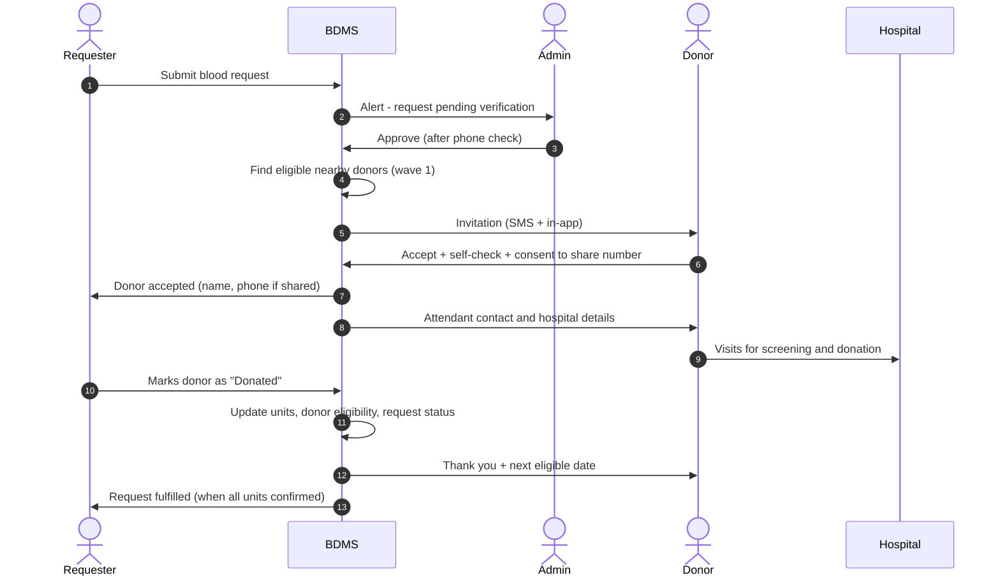
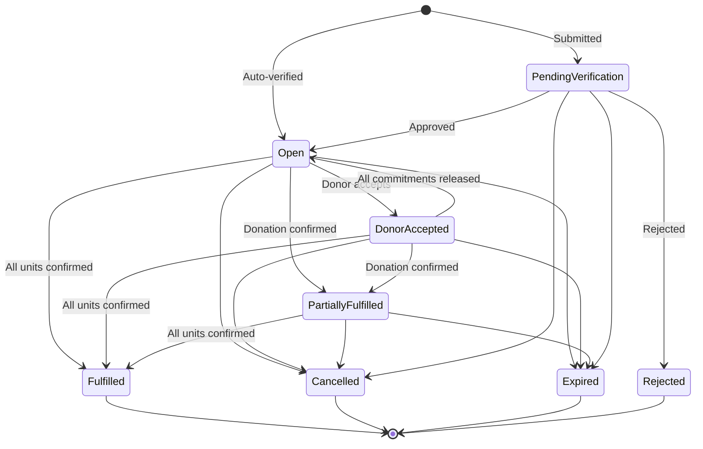

# Product Requirements Document (PRD)

## Blood Donor Management System (BDMS) — MVP

| Item | Detail |
|---|---|
| Document | Product Requirements Document (PRD) |
| Product | Blood Donor Management System (BDMS) — working name |
| Version | 1.1 — Draft for review |
| Date | 14 November 2026 |
| Product Owner | [Name] |
| Status | Draft |
| Related documents | [BRD](01-BRD.md) · [SRS](03-SRS.md) · [TDD](04-TDD-MERN.md) |

### Revision history

| Version | Date | Author | Changes |
|---|---|---|---|
| 0.1 | — | Product team | MVP concept PRD (input) |
| 1.0 | 14 Nov 2026 | [Author] | Complete PRD: personas, 7 modules, user stories with acceptance criteria, lifecycle, notifications, UX, analytics, release plan |
| 1.1 | 14 Nov 2026 | [Author] | Colour palette (red, black, white) and component styles (§10.6); design reference destimax.com (§10.7, pending review); technology set to MERN |

---

## Table of contents

1. [Product overview](#1-product-overview)
2. [Goals, non-goals and success metrics](#2-goals-non-goals-and-success-metrics)
3. [Users and personas](#3-users-and-personas)
4. [Key product concepts](#4-key-product-concepts)
5. [End-to-end user journeys](#5-end-to-end-user-journeys)
6. [Feature requirements by module](#6-feature-requirements-by-module)
7. [Request and invitation lifecycle](#7-request-and-invitation-lifecycle)
8. [Product rules and default limits](#8-product-rules-and-default-limits)
9. [Notification matrix](#9-notification-matrix)
10. [UX and content requirements](#10-ux-and-content-requirements)
11. [Data entities (product view)](#11-data-entities-product-view)
12. [Non-functional requirements (summary)](#12-non-functional-requirements-summary)
13. [Analytics and instrumentation](#13-analytics-and-instrumentation)
14. [Release plan and prioritisation](#14-release-plan-and-prioritisation)
15. [Launch readiness checklist](#15-launch-readiness-checklist)
16. [Future enhancements (Phase 2+)](#16-future-enhancements-phase-2)
17. [Dependencies, risks and open questions](#17-dependencies-risks-and-open-questions)
18. [Appendix A — Suggested Bangla UI terminology](#appendix-a--suggested-bangla-ui-terminology)

---

## 1. Product overview

BDMS is a simple, mobile-friendly, bilingual (Bangla/English) web platform. It connects voluntary blood donors with people who need blood, and helps an operating organization verify requests, coordinate donations and keep accurate donation records.

**Primary goal:** reduce the time needed to find a willing, suitable blood donor.

### 1.1 Product principles

| # | Principle | What it means in practice |
|---|---|---|
| 1 | **Speed with safety** | Fast for requesters, but never at the cost of donor safety or privacy. |
| 2 | **Private by default** | Phone numbers are never public. Contact details are shared only with consent, and only between a requester and the donors who accepted. |
| 3 | **Respect donors' time** | Invite only suitable, nearby, eligible donors, in measured waves. Never spam the whole registry. |
| 4 | **Simple and Bangla-first** | Usable by a first-time, low-literacy user on a low-end Android phone with a poor connection. |
| 5 | **A connector, not a clinic** | The platform connects people. Hospitals make all clinical decisions (screening, compatibility, eligibility on the day). |
| 6 | **Voluntary only** | No payment, ever. Anyone who asks for or offers money can be reported and blocked. |

---

## 2. Goals, non-goals and success metrics

### 2.1 Goals

| ID | Product goal | Linked business objective |
|---|---|---|
| G1 | Get the first willing donor for a verified request as fast as possible | BO-1 |
| G2 | Turn verified requests into confirmed donations | BO-2 |
| G3 | Make donor sign-up and upkeep effortless, so the registry grows and stays fresh | BO-3 |
| G4 | Make fraud hard and privacy breaches impossible by design | BO-4 |
| G5 | Protect donors from over-contact and encourage repeat donation | BO-5 |
| G6 | Give admins efficient tools and complete traceability | BO-6, BO-7 |

### 2.2 Non-goals (MVP)

- Clinical functions: screening, testing, crossmatching, transfusion, diagnosis or medical advice.
- Blood bank inventory or storage.
- Native mobile apps; GPS/map matching; hospital system integration.
- Payments, donor incentives or rewards in cash or kind.
- Multiple organizations (multi-tenant).

### 2.3 Success metrics

**North Star metric:** *Median time from request verification to first donor acceptance* (target ≤ 30 min for emergency requests, ≤ 4 h for normal requests).

| Category | Metric | Target |
|---|---|---|
| Speed | First-wave invitations sent within 2 min of verification | ≥ 95% of requests |
| Speed | Emergency requests verified within 15 min | ≥ 90% |
| Outcome | Verified requests fully fulfilled | ≥ 70% |
| Engagement | Invitation response rate (accepted + declined ÷ sent) | ≥ 50% |
| Engagement | Acceptance → confirmed donation | ≥ 70% |
| Activation | Donor registration completed in ≤ 2 min | ≥ 80% of test users |
| Activation | Logged-in requester submits a request in ≤ 60 s | ≥ 80% of test users |
| Data quality | Accepted invitations with an outcome recorded within 7 days | ≥ 90% |
| **Guardrail** | Automatic invitations sent to ineligible donors | 0 |
| **Guardrail** | Invitations per donor per week | ≤ 5 (hard limit) |
| **Guardrail** | Donor opt-out rate | ≤ 2% per month |
| **Guardrail** | Public exposure of contact data | 0 |

---

## 3. Users and personas

### 3.1 Roles

The same account can be both a donor and a requester. A user becomes a **donor** by completing a donor profile, and anyone logged in can be a **requester**.

| Role | Responsibilities |
|---|---|
| **Guest** (not logged in) | Views public information, eligibility guidance, shared request pages and public availability counts. |
| **Requester** (any registered user) | Requests blood for themselves or someone else, searches for donors (anonymised), tracks requests, records outcomes, updates or cancels requests. |
| **Donor** (registered user with an active donor profile) | Manages profile and availability, responds to invitations, records donations, views history and eligibility. |
| **Admin** | Verifies requests, coordinates donations, manages donors, hospitals and abuse reports, monitors the dashboard, exports reports. |
| **Super Admin** | Everything an Admin can do, plus system settings, eligibility rules, location data, admin accounts, audit logs and exports that include contact data. |

### 3.2 Personas

**Persona 1 — Tanvir, 24, university student, Dhaka (donor, O+)**
- Has donated three times. Wants to help, but stopped posting in Facebook groups because random people call him at all hours, sometimes from far away, and sometimes only a month after he last donated.
- *Needs:* only relevant requests, nearby, when he is eligible; one-tap responses; a record of his donations.

**Persona 2 — Farzana, 27, office worker, Chattogram (donor, B−)**
- Rare blood group, often in demand. After her number was shared in a group she received harassing calls, so she is now reluctant to donate through informal channels.
- *Needs:* her number never public; she decides who gets it; a way to report abusive people.

**Persona 3 — Shahana, 38, mother of a 9-year-old with thalassaemia, Rangpur (requester)**
- Needs 1–2 bags of B+ every 3–4 weeks. Re-does the same search every time and feels she is "begging" in groups.
- *Needs:* to repeat a request quickly, reliable donors, to see who is coming, and to be trusted by the system (fast verification).

**Persona 4 — Kamal, 45, son of a surgery patient, Sylhet (first-time requester)**
- Learns at 8 pm that his father needs 2 bags of A− for surgery tomorrow morning. Has an entry-level Android phone and limited digital literacy. A broker has already offered "donors" for money.
- *Needs:* a very simple Bangla form or a hotline; reassurance about what happens next; protection from brokers.

**Persona 5 — Nusrat, 29, volunteer coordinator (admin)**
- Verifies requests by phone, keeps a spreadsheet of 2,000 donors and calls them one by one.
- *Needs:* one queue with emergencies first, automatic matching, a simple record of outcomes, reports for her organization.

### 3.3 Jobs to be done

| When… | I want to… | So that… |
|---|---|---|
| a patient I care for needs blood | ask for blood in one simple step | suitable donors are contacted quickly |
| I have asked for blood | see in real time who is coming | I can stop searching and coordinate |
| I am willing to donate | be contacted only when I can actually help | I am not overwhelmed and my donation counts |
| I have just donated | have it recorded and be reminded later | I donate safely and regularly |
| I am coordinating requests | verify, monitor and step in only where needed | more requests are fulfilled with less effort |

---

## 4. Key product concepts

| Concept | Definition |
|---|---|
| **Account vs. donor profile** | Every user has an account (mobile number + OTP). A donor profile is an optional extension that makes the user a donor. |
| **Availability vs. eligibility** | *Availability* is the donor's choice: Available, Unavailable or Temporarily Deferred. *Eligibility* is calculated by the system from age and donation-interval rules. Automatic matching requires **both**. |
| **Request** | A need for N units (bags) of a blood group and component at a hospital by a certain time. |
| **Verification** | An admin's check that a request is genuine before any donor is contacted. |
| **Invitation** | A request sent to one specific donor for one specific blood request. A donor can accept or decline it, or let it expire. |
| **Wave** | A batch of invitations. A new wave is sent only if more donors are still needed. |
| **Location tier** | The search area around the hospital: same upazila/thana → same district → same division (nationwide only when an admin chooses it). |
| **Commitment (pledge)** | An accepted invitation. It is **not** a donation. |
| **Donation** | A recorded donation event: *Confirmed* (by the requester or an admin), *Unconfirmed* (self-reported) or *Rejected*. Only confirmed donations count towards fulfilment. |
| **Unit (bag)** | One donation by one donor. |
| **Trusted requester** | A user whose requests are verified automatically (e.g., hospital staff, a known thalassaemia guardian). |

---

## 5. End-to-end user journeys

### 5.1 Main workflow

1. A donor registers and sets their availability.
2. A requester submits a blood request, or calls the hotline and an admin submits it for them.
3. An admin verifies the request. Admin-created requests and requests from trusted requesters are verified automatically.
4. The system identifies matching donors and notifies them in waves, widening the area if needed.
5. A donor reviews the non-identifying details and accepts after a quick self-check.
6. Contact information is exchanged with consent.
7. The donor visits the hospital or blood collection centre for screening and donation.
8. The donation is recorded and confirmed. The donor's eligibility is updated automatically.
9. The request is fulfilled when confirmed units reach the required units. Remaining committed donors are released with thanks.



### 5.2 Donor journey

| Stage | Experience |
|---|---|
| Discover | Hears about BDMS from a partner, a drive or a shared request link. |
| Register | Mobile + OTP → name → donor profile (≈ 2 min). |
| Wait | Gets no messages unless a suitable, nearby request arrives. Can toggle availability at any time. |
| Invited | Receives an SMS with a link → views non-identifying details → accepts or declines in a few taps. |
| Donate | Sees the attendant's contact and hospital details, gets a reminder before the needed-by time, and donates. |
| After | Receives a thank-you; the donation appears in their history; gets a reminder when eligible again. |

### 5.3 Requester journey

| Stage | Experience |
|---|---|
| Need | Learns that blood is needed, possibly urgently. |
| Request | Logs in with OTP → fills a single-screen form (≤ 60 s) → gets a request code and expected verification time. |
| Wait | Is notified when the request is verified. Watches the tracking page: invited, accepted, donated. |
| Coordinate | Gets an SMS when a donor accepts, with the donor's number if shared. |
| Close | Marks each donor's outcome. The request is fulfilled, or extended or cancelled if needed. |

### 5.4 Admin journey

| Stage | Experience |
|---|---|
| Start shift | Marks themselves "On duty"; checks the dashboard and queues. |
| Verify | Works through the verification queue (emergencies first), calls contacts and approves, rejects or asks for more information. |
| Coordinate | Monitors requests where donors are struggling to be found; widens the area, invites manually, records donor responses received by phone. |
| Moderate | Reviews abuse reports; suspends or blocks; marks trusted requesters. |
| Report | Exports CSV files; reviews KPIs. |

---

## 6. Feature requirements by module

Priority: **M** = Must, **S** = Should, **C** = Could (MoSCoW). Detailed system behaviour, validation and limits are in the [SRS](03-SRS.md).

### Module 1 — Authentication and donor profile

| ID | Feature | Priority |
|---|---|---|
| F1.1 | Sign-up and login with mobile number + OTP | M |
| F1.2 | Language preference (Bangla / English) | M |
| F1.3 | Donor profile creation and editing | M |
| F1.4 | Availability management (Available / Unavailable / Temporarily Deferred, with optional end date) | M |
| F1.5 | Eligibility status and next eligible date | M |
| F1.6 | Donation history and self-reported past donations | M |
| F1.7 | Consent, contact-sharing and notification preferences | M |
| F1.8 | Account deletion (M); personal data download (S) | M / S |
| F1.9 | Profile review prompt every 6 months | S |
| F1.10 | Willingness to donate platelets by apheresis | S |

**US-1.1 — Sign up / log in with OTP** (F1.1, F1.2)
*As a new or returning user, I want to log in with my mobile number and a one-time code, so that I don't need to remember a password.*
- Accepts `01XXXXXXXXX`, `+8801XXXXXXXXX` and `8801XXXXXXXXX`. Invalid numbers show an inline error in the chosen language.
- A 6-digit code arrives by SMS and is valid for 5 minutes. "Resend" becomes active after 60 seconds. After 5 wrong attempts the code is invalidated.
- Too many requests show a friendly "try again in N minutes" message.
- First-time users enter their name, confirm their language and accept the Terms of Service and Privacy Policy before continuing. Returning users land on their home screen.
- On supported Android browsers the code fills in automatically from the SMS.

**US-1.2 — Create donor profile** (F1.3, F1.5, F1.7)
*As someone willing to donate, I want to create my donor profile in under two minutes, so that I can be contacted when someone near me needs my blood group.*
- Steps: (1) date of birth and sex; (2) blood group; (3) division → district → upazila/thana, plus an optional area; (4) last donation — "Never", an exact date, or month and year; (5) consents.
- Users below the minimum age (default 18) cannot complete a donor profile. The message explains why and offers "Request blood" instead.
- "I don't know my blood group" explains how to find out. The profile can be saved but is not activated until a blood group is entered.
- Required: consent to receive donation requests, and a self-declaration of basic eligibility (age, weight ≥ the configured minimum, good health), with a link to the eligibility guide.
- After saving, the home screen shows "Available" and the eligibility state, e.g., "Eligible now" or "Eligible from 12 Mar 2027".
- ≥ 80% of usability-test users complete the profile in ≤ 2 minutes.

**US-1.3 — Become unavailable for a while** (F1.4)
*As a donor, I want to mark myself unavailable, optionally until a date, so that I don't receive requests while I'm travelling or busy.*
- Availability can be changed from the home screen in ≤ 2 taps, with an optional end date up to 180 days ahead.
- Unavailable donors receive no automatic invitations and do not appear in non-admin search.
- After the end date, the status returns to Available automatically and the donor sees an in-app notice.
- Pending invitations are declined automatically ("became unavailable"). If the donor has an accepted invitation, the app asks whether they want to withdraw from it.

**US-1.4 — Temporarily deferred** (F1.4)
*As a donor who is unwell or recently had a procedure, I want to set "Temporarily Deferred" with a reason, so that I'm not contacted until I'm fit.*
- Reasons: illness/medication; recent procedure, tattoo or piercing; pregnancy/breastfeeding; deferred by hospital; other.
- Optional end date up to 365 days ahead.
- When the end date passes, the donor is asked (in-app + SMS) to confirm they are ready, and stays excluded until they confirm. If no end date was set, they are asked after 90 days.

**US-1.5 — Donation history and eligibility** (F1.5, F1.6)
*As a donor, I want to see my donation history and when I can donate next.*
- Each history entry shows date, type, place, linked request code (if any) and a label: *Confirmed* or *Unconfirmed* (self-reported or awaiting confirmation).
- Shows the next eligible date for whole blood (and for apheresis if the donor is willing), and the total number of confirmed donations.

**US-1.6 — Add a past donation** (F1.6)
*As a donor, I want to add a donation I made outside the platform, so that I'm not contacted before I'm eligible again.*
- Fields: date (not in the future), type (whole blood / apheresis), place (optional).
- The entry is labelled "Self-reported" and the next eligible date updates immediately.
- A date that conflicts with another recorded donation (within the minimum interval) is blocked, with a message to contact support.

**US-1.7 — Control contact details and notifications** (F1.7)
*As a donor, I want to control how I'm contacted and whether my number is shared.*
- Settings:
  - receive donation requests (on/off);
  - invitation SMS (emergency and normal / emergency only);
  - night-time emergency alerts (default on);
  - eligibility reminders (default on);
  - SMS for other updates (default on);
  - contact sharing when I accept (*Ask each time* — default / *Always share*).
- Turning off "receive donation requests" removes the donor from matching and search immediately. Their history is kept.
- OTPs and critical messages (e.g., "you are no longer needed") cannot be turned off.

**US-1.8 — Delete my account** (F1.8)
*As a user, I want to delete my account and personal data.*
- Requires OTP confirmation and shows the consequences first.
- Active requests are cancelled and accepted invitations withdrawn; everyone affected is notified.
- Personal data is anonymised. Anonymous statistics (e.g., donations by blood group and district) are kept.
- Completed within 24 hours, with a confirmation.
- (S) Before deleting, users can download their data.

**US-1.9 — Profile review** (F1.9)
*As the organization, we want donors to confirm their details every 6 months, so that the data stays fresh.*
- Every 180 days, the donor is prompted to confirm location, availability and last donation, with a single "Still correct" option.

**US-1.10 — Apheresis willingness** (F1.10)
*As a donor, I want to say whether I'm willing to give platelets by apheresis (about 1–2 hours), so that I'm prioritised for platelet requests.*
- An optional toggle with a short explanation. Willing donors are ranked first for apheresis platelet requests.

---

### Module 2 — Find blood donors

| ID | Feature | Priority |
|---|---|---|
| F2.1 | Search donors by blood group and location | M |
| F2.2 | Filters: eligible-by date, last donation older than N months | M |
| F2.3 | Privacy-preserving donor cards (no phone numbers or exact dates) | M |
| F2.4 | Ranking: nearby first, then longest time since last donation | M |
| F2.5 | Invite from search (only with the user's own verified request) | M |
| F2.6 | Public availability counts (no login) | C |
| F2.7 | Admin full search with audited contact reveal | M |

**US-2.1 — Search for donors** (F2.1–F2.4)
*As a requester, I want to search for donors by blood group and area, so that I can see whether donors are available near the hospital.*
- Blood group, division and district are required; upazila is optional.
- Only donors who are Available, have consented and are eligible by the selected date (default today, or the needed-by date of my request) are shown.
- Cards show: display name (first name + initial of last name), blood group, upazila and district, an "Available" badge, how long ago they last donated ("3–6 months ago", "Never / unknown"), number of confirmed donations and a "Blood group verified" badge.
- Cards never show the phone number, exact dates, date of birth or exact age.
- Results are sorted by closeness (same upazila → same district → same division), then by the longest time since the last donation.
- 20 results per page, 100 at most. Each user can run at most 30 searches per hour.

**US-2.2 — Invite from search** (F2.5)
*As a requester with a verified request, I want to invite specific donors I have found.*
- "Invite" is enabled only if I have an active, verified request for the same blood group. Otherwise I see "Create a request to contact donors".
- A donor cannot be invited twice to the same request. Donors who have reached their invitation limits show "Not available for invitations right now".
- At most 10 manual invitations per request per day.
- Invited donors appear on my request's tracking page with their status.

**US-2.3 — Public availability counts** (F2.6, Could)
*As a visitor, I want to see how many donors of a blood group are available in a district without logging in.*
- Counts by blood group × district. Counts below 5 are shown as "fewer than 5". Refreshed every 15 minutes.

**US-2.4 — Admin search** (F2.7)
*As an admin, I want to search all donors, including unavailable ones, and reveal phone numbers when I'm coordinating.*
- All filters are available, including availability, eligibility, consent, verified status and name/phone.
- Phone numbers are masked (`017•••••678`) until "Reveal" is pressed. Each reveal is logged with the admin, the time and the context.

---

### Module 3 — Blood requests and matching

| ID | Feature | Priority |
|---|---|---|
| F3.1 | Create a blood request (M); repeat a previous request (S) | M / S |
| F3.2 | Hospital selection from the master list, or "Hospital not listed" | M |
| F3.3 | Requisition slip / prescription attachment (visible to admins only) | S |
| F3.4 | Active-request limits and duplicate detection | M |
| F3.5 | Verification workflow (requester side; admin side in Module 6) | M |
| F3.6 | Automatic matching and wave-based invitations | M |
| F3.7 | Invitation view and response (accept / decline) with self-check | M |
| F3.8 | Consent-based contact exchange | M |
| F3.9 | Withdraw acceptance (M); late acceptance (S) | M / S |
| F3.10 | Request tracking page | M |
| F3.11 | Update and cancel request | M |
| F3.12 | Expiry, extension and outcome follow-up | M |
| F3.13 | Shareable request link and self-nomination | S |

**US-3.1 — Submit a blood request** (F3.1, F3.2, F3.4)
*As a requester, I want to submit a blood request in under a minute, so that donors can be found quickly.*
- A single-screen form.
  - **Required:** blood group, component (default Whole blood), bags needed (default 1, maximum 10), hospital, urgency, needed by (Emergency offers "As soon as possible"), patient name, contact person (default: me), relationship to patient, declarations.
  - **Optional**, under "More details": ward/bed, reason, notes, requisition slip.
- Hospital search suggests matches as you type, filtered by district. "Hospital not listed" requires a name, address and location.
- The needed-by time cannot be in the past or more than 30 days ahead.
- If I already have 3 active requests, I'm told to close one or call the hotline.
- A possible duplicate (same blood group and hospital within 24 h) shows a warning. I can continue, and admins see a flag.
- After submitting I see the request code (e.g., `RQ-261114-0042`), the status "Pending verification" and the expected verification time (about 15 min for emergencies).
- A logged-in user completes the form in ≤ 60 seconds in usability tests.
- (S) "Repeat a previous request" pre-fills the form from one of my past requests, which is useful for thalassaemia patients.

**US-3.2 — Know the verification result** (F3.5)
*As a requester, I want to know when my request is approved or needs changes.*
- I receive an SMS and an in-app notification on approval, on rejection (with a reason) or when more information is requested.
- When asked for more information, I can edit and resubmit.

**US-3.3 — Automatic matching** (F3.6)
*As a requester, I want suitable donors to be notified automatically, so that I don't have to call people one by one. As a donor, I only want to be contacted for requests I can actually help with.*
- Within 2 minutes of verification, the first wave of invitations goes to donors who:
  - match the blood group exactly;
  - are Available and have consented;
  - are eligible by the needed-by date and within the age limits;
  - have no other active commitment;
  - are under their invitation limits.
- Wave size depends on the bags still needed and the urgency. For example, 2 bags in an emergency → 10 donors (defaults are configurable).
- While donors are still needed, more waves follow every 15 min (emergency) or 2 h (normal). A new wave goes out immediately if every invitation in the current wave was declined or has expired.
- The search area widens automatically: same upazila → same district → same division. If no donors remain, the requester and admins are told, with suggestions (share the link, call the hotline).
- Normal requests send no invitations between 22:00 and 07:00. At night, emergency invitations go only to donors who opted in.
- No donor is ever invited twice for the same request.

**US-3.4 — View an invitation** (F3.7)
*As a donor, I want enough information to decide quickly, without seeing private patient data.*
- Before accepting, I see: urgency, verified badge, blood group, component, bags needed, hospital name and area, how close it is ("same upazila"), needed-by time, reason (if given) and the time left to respond.
- The patient's name, ward/bed, contact person and phone number, and notes stay hidden until I accept.
- I can open the invitation from the SMS link without logging in.

**US-3.5 — Accept an invitation** (F3.7, F3.8)
*As a donor, I want to accept in a couple of taps and then get the details I need.*
- Before confirming, I tick a short self-check:
  - I feel well today.
  - I meet the age and weight requirements.
  - I haven't donated in the last {interval} days.
  - I understand the hospital will screen me.
- I choose whether to share my phone number with the requester. The box is pre-ticked only if my preference is "Always share".
- After accepting, I see the patient name, hospital address, ward/bed, contact person with a tap-to-call number, and notes.
- The requester is notified immediately (SMS + in-app) with my display name, plus my phone number if I shared it.
- If enough donors have already accepted, I see "Thank you — enough donors have already accepted" and no contact details are exchanged.
- I cannot accept if I already have another active commitment or am no longer eligible; the reason is explained.
- Two donors accepting the last needed bag at the same moment never leads to over-commitment.

**US-3.6 — Decline an invitation** (F3.7)
*As a donor, I want to decline easily, optionally giving a reason.*
- Reasons: not available now, not eligible, too far, other.
- "Not eligible" offers to set Temporarily Deferred. "Not available now" offers "Unavailable until…".
- The requester is not notified of each decline; the totals are shown on the tracking page.

**US-3.7 — Withdraw after accepting** (F3.9)
*As a donor who accepted but can no longer go, I want to withdraw, so that someone else can be found.*
- A reason is required. The requester is notified (SMS + in-app). Matching resumes immediately if donors are still needed.

**US-3.8 — Late acceptance** (F3.9, Should)
*As a donor who saw the SMS late, I want to accept if donors are still needed.*
- An expired invitation can still be accepted if the request is active and still needs donors. Otherwise the donor sees "This request no longer needs donors — thank you".

**US-3.9 — Track my request** (F3.10)
*As a requester, I want to see progress at a glance.*
- The page shows:
  - the status and a timeline of key events;
  - bags needed, committed and donated;
  - matching information: invited, pending, declined and expired counts, and the current search area;
  - committed donors: display name and phone (if shared) with a call button, or "The donor will contact you", plus outcome buttons for each donor.
- Available actions: edit, extend, cancel, share link, report a problem.

**US-3.10 — Update or cancel** (F3.11)
*As a requester, I want to update details, or cancel the request when it is no longer needed.*
- **Minor edits** apply immediately: ward/bed, notes, contact name, reason, needed-by time, bags (within limits) and urgency upgrades. Urgency upgrades are flagged to admins.
- **Re-verification** is needed if I change the blood group, the component type (whole blood ↔ apheresis), the hospital or the contact phone. Outstanding invitations are cancelled and affected donors notified.
- Bags cannot be reduced below *donated + committed*. To go lower, I first release a committed donor ("Not needed").
- Cancelling requires a reason. Committed donors receive an SMS saying they are no longer needed.

**US-3.11 — Expiry and outcome follow-up** (F3.12)
*As a requester, I want reminders, so that my request doesn't expire without me noticing and outcomes get recorded.*
- 2 hours before expiry I'm asked to extend the request (at most 2 extensions of up to 7 days each) or record outcomes.
- 6 hours after the needed-by time, I'm asked to record what happened with each committed donor. I'm asked again at 24 hours.
- At expiry the request closes as Expired, and committed donors are told they are no longer needed.

**US-3.12 — Share a request** (F3.13, Should)
*As a requester, I want to share my verified request on Facebook or WhatsApp without exposing private details.*
- The share page shows blood group, component, bags still needed, hospital name and area, needed-by time, urgency and the verified badge. It never shows the patient's name, contact details or notes, and search engines are told not to index it.
- "I can donate" asks the visitor to log in or register. If they match (blood group, availability, eligibility, no other commitment) they go straight to the acceptance flow; if not, they are told why.
- When the request closes, the page says it is no longer active.

---

### Module 4 — Donation management

| ID | Feature | Priority |
|---|---|---|
| F4.1 | Record outcomes for committed donors (donated / did not donate) | M |
| F4.2 | Donor self-report ("I donated") and confirmation by requester or admin | M |
| F4.3 | Disputes and admin review | S |
| F4.4 | Automatic update of last donation date and next eligible date | M |
| F4.5 | Configurable donation-interval rules (Medical Advisor approved) | M |
| F4.6 | Eligibility reminders | M |
| F4.7 | Fulfilment tracking (bags needed / committed / donated) | M |
| F4.8 | Duplicate donation prevention | M |
| F4.9 | Thank-you message with next eligible date | S |

**US-4.1 — Record outcomes** (F4.1, F4.7)
*As a requester, I want to mark each committed donor as donated or not, so that my request's progress is correct.*
- For each committed donor: "Donated" (date, default today) or "Did not donate" (deferred at screening / didn't come / not needed / other).
- "Donated" creates a confirmed donation. Bags donated update, and the status becomes Partially Fulfilled or Fulfilled.
- When the request is fulfilled, remaining committed donors are released by SMS, pending invitations are cancelled and I am notified.
- "Deferred at screening" prompts the donor to update their availability.
- Outcomes can still be recorded up to 7 days after the request closes.

**US-4.2 — Donor self-report** (F4.2)
*As a donor, I want to report that I donated, in case the requester forgets.*
- "I donated" on my committed invitation creates an unconfirmed donation. My eligibility updates immediately.
- The requester is asked to confirm or reject it. If they do neither within 72 h, an admin reviews it.
- If my report is rejected, my eligibility goes back to what it was.

**US-4.3 — Dispute a donation** (F4.3)
*As a donor, I want to dispute a donation recorded in my name that I didn't make.*
- I can dispute within 14 days. An admin reviews it and either keeps or rejects the donation. Both parties are notified and the action is audit-logged.

**US-4.4 — Automatic eligibility** (F4.4, F4.5)
*As the organization, we want each donor's next eligible date calculated automatically from configurable, medically approved rules.*
- Next eligible date = latest donation date + the minimum interval for (previous donation type → next donation type), using a sex-specific rule where one is configured. If sex is not specified, the most conservative rule applies.
- Unconfirmed donations count for eligibility; rejected ones do not.
- A Super Admin edits the rules and must enter the Medical Advisor's approval reference. Every donor's eligibility is recalculated within 15 minutes, and the change is audit-logged.
- Default placeholder rules, until the Medical Advisor approves final values:

  | Previous → next donation | Interval |
  |---|---|
  | Whole blood → whole blood | 120 days |
  | Whole blood → apheresis | 120 days |
  | Apheresis → apheresis | 14 days |
  | Apheresis → whole blood | 28 days |

**US-4.5 — Eligibility reminder** (F4.6)
*As a donor, I want a reminder when I can donate again.*
- Sent once per eligibility cycle, on the eligibility date at 10:00, respecting my preferences and quiet hours.
- Not sent to deferred donors or to donors who have withdrawn consent.

**US-4.6 — No duplicates** (F4.8)
*As an admin, I want each donation to be recorded only once.*
- One donation per donor per request. Double-taps and network retries never create duplicates.
- A donation dated within the minimum interval of another is blocked when a donor enters it, and flagged for admin review when a requester enters it.

**US-4.7 — Thank-you** (F4.9)
*As a donor, I want to be thanked and to know when I can donate next.*
- After confirmation, an in-app thank-you shows my total confirmed donations and my next eligible date.

---

### Module 5 — Notifications

| ID | Feature | Priority |
|---|---|---|
| F5.1 | In-app notification centre | M |
| F5.2 | SMS notifications | M |
| F5.3 | Bilingual templates (Bangla / English) | M |
| F5.4 | Secure one-tap response links in SMS | M |
| F5.5 | Preferences and quiet hours | M |
| F5.6 | Delivery tracking and retries (M); secondary gateway failover (S) | M / S |
| F5.7 | Web push notifications (PWA) | S |
| F5.8 | SMS budget controls | S |

**US-5.1 — Respond from the SMS** (F5.4)
*As a donor, I want to respond from the SMS link without logging in.*
- The link opens the invitation directly. It allows viewing, accepting, declining, withdrawing and "I donated" for **that invitation only**, and expires once it is no longer relevant. Anything else requires login.

**US-5.2 — Quiet hours** (F5.5)
*As a donor, I don't want non-urgent SMS at night.*
- Non-critical SMS and push messages between 22:00 and 07:00 are held until 07:00.
- At night, emergency invitations go only to donors who opted in.
- In-app notifications are always delivered (silently).

**US-5.3 — Requester alerts** (F5.2)
*As a requester, I want an SMS as soon as a donor accepts or withdraws.*
- Sent to the gateway within 1 minute of the event. Actual delivery depends on the mobile operator.

**US-5.4 — My language** (F5.3)
*As a user, I want messages in my language.*
- All notifications use my preferred language.
- Codes, phone numbers, request codes and links always use English digits, so they can be tapped or copied.

**US-5.5 — Reliability** (F5.6)
*As an admin, I want to know when SMS fail.*
- Every SMS has a status: queued, sent, delivered or failed.
- Temporary failures are retried up to 3 times. Persistent failures appear in the admin SMS log.
- (S) Sending switches to a secondary gateway if the primary one fails.

**US-5.6 — SMS budget** (F5.8)
*As a Super Admin, I want to control SMS spending.*
- A daily segment cap, with an alert at 80%.
- At 100%, non-critical SMS are suspended (in-app notifications are still delivered) while critical messages continue.

---

### Module 6 — Admin dashboard and operations

| ID | Feature | Priority |
|---|---|---|
| F6.1 | KPI dashboard | M |
| F6.2 | Verification queue with SLA timers | M |
| F6.3 | Request coordination tools | M |
| F6.4 | Assisted request creation (hotline) | M |
| F6.5 | Donor management | M |
| F6.6 | Bulk donor import with consent confirmation | S |
| F6.7 | Hospital and location master data | M |
| F6.8 | User moderation (suspend / block / trusted) | M |
| F6.9 | CSV exports | M |
| F6.10 | System settings and interval rules (Super Admin) | M |
| F6.11 | Audit log viewer (Super Admin) | M |
| F6.12 | Admin user management (Super Admin) | M |

**US-6.1 — Dashboard** (F6.1)
*As an admin, I want the key numbers at a glance.*
- Donors: total; available and eligible now; by blood group and by district.
- Requests: by status; created and fulfilled in the period.
- Donations: confirmed, for the period and all-time.
- Performance: median verification time; median time to first acceptance; fulfilment rate; invitation response rate.
- Queues: verification, unconfirmed donations, abuse reports.
- SMS sent today against the cap.
- Filters: date range, location, blood group. Data is at most 5 minutes old.

**US-6.2 — Verification queue** (F6.2)
*As an admin, I want a queue with emergencies first and SLA timers.*
- Pending requests are sorted by urgency, then by age. Each has an SLA timer labelled On track, At risk or Overdue, shown with text, icon and style (§10.6).
- Flags: possible duplicate, reported, first-time requester, information requested. The requester's history (requests, fulfilled, cancelled, reports) is shown.
- Opening a request locks it to me for up to 10 minutes; other admins see "Being reviewed by X".
- Actions:
  - **Approve**, with a checklist (contact reached? hospital verified?);
  - **Reject**, with a reason;
  - **Ask for information**, with a message;
  - **Edit** (logged).
- An unverified emergency alerts on-duty admins after 10 minutes and Super Admins after 20 minutes.

**US-6.3 — Coordinate requests** (F6.3)
*As an admin, I want to help requests that are struggling to find donors.*
- Pause or resume matching.
- Widen the search area, including nationwide.
- Invite manually. This can bypass the weekly limits and the area, but **never** availability, consent, eligibility or age limits.
- Record a donor's response given by phone ("on behalf", with a note).
- Record outcomes and donations.
- Adjust the extra-donor buffer.
- Cancel, or reopen within 7 days, with a reason.
- Add internal notes.

**US-6.4 — Hotline requests** (F6.4)
*As an admin, I want to create a request for a caller.*
- The same form plus the caller's phone number. The request is linked to the caller's existing account, or a new account is created for that number.
- The request is verified automatically, and the caller receives an SMS with the request code and a link.

**US-6.5 — Manage donors** (F6.5)
*As an admin, I want to manage donor records.*
- Search and filter donors. View each donor's profile, eligibility, donations, invitations and response statistics.
- Actions:
  - edit fields (logged);
  - mark the blood group as verified (with method and reference);
  - set a deferral (e.g., reported by a hospital);
  - deactivate or reactivate;
  - reveal the phone number (logged);
  - add notes.

**US-6.6 — Import existing donors** (F6.6)
*As an admin, I want to import our existing donor spreadsheet with the donors' consent.*
- A CSV template, and a validation report for each row.
- Existing phone numbers are skipped and never overwritten.
- Imported donors receive a consent SMS and are not matched until they confirm; they can correct their details when confirming.
- The consent link is valid for 14 days, with one reminder.
- At most 5,000 rows per file. Consent SMS are sent at a limited rate and counted against the budget.

**US-6.7 — Master data** (F6.7)
*As an admin, I want to maintain the hospital list.*
- Create, edit and deactivate hospitals (bilingual names, type, address, location, phone).
- Convert "Hospital not listed" entries into master entries.
- Super Admins maintain location data (divisions, districts, upazilas).

**US-6.8 — Moderation** (F6.8)
*As an admin, I want to suspend or block abusive users and mark trusted requesters.*
- Suspend (until a date), block (permanent; the number is added to the block list), unblock, trust or untrust. Each action needs a reason and is audit-logged.
- Blocking cancels the user's active requests and commitments, and affected people receive neutral notifications.

**US-6.9 — Exports** (F6.9)
*As an admin, I want to export donors, requests and donations as CSV.*
- Same filters as the lists. Bangla text displays correctly in Excel.
- Large exports are prepared in the background, with a download link valid for 24 hours.
- Phone numbers are excluded unless a Super Admin includes them and gives a reason. Every export is logged.

**US-6.10 — Settings** (F6.10)
*As a Super Admin, I want to adjust operational rules without a software release.*
- Edit parameters (limits, waves, response windows, quiet hours, SLAs, retention, etc.), with validation.
- Medical parameters require an approval reference.
- A history of changes is kept. Changes take effect within 1 minute.

**US-6.11 — Audit** (F6.11)
*As a Super Admin, I want to see who did what.*
- Filter by person, action, record and date, and see before/after values. Logs cannot be edited or deleted.

**US-6.12 — Admin accounts** (F6.12)
*As a Super Admin, I want to manage admin accounts.*
- Invite an admin by phone number, assign the Admin or Super Admin role, deactivate accounts and reset passwords.
- Admins mark themselves "On duty" to receive escalation alerts.
- Admin login requires OTP + password.

---

### Module 7 — Trust, safety and privacy

| ID | Feature | Priority |
|---|---|---|
| F7.1 | Abuse reporting (request or user) | M |
| F7.2 | Automatic pause on payment reports or repeated reports | S |
| F7.3 | Block list (phone numbers) | M |
| F7.4 | Contact-reveal audit and contact visibility window | M |
| F7.5 | Disclaimers and voluntary-donation declarations | M |
| F7.6 | Data retention and anonymisation | M |
| F7.7 | Trusted requesters (auto-verification) | S |

**US-7.1 — Report abuse** (F7.1)
*As a donor, I want to report a request or a person, for example if someone asks for money.*
- "Report" appears on invitation, request and share pages.
- Reasons: asked for payment, fake request, harassment, wrong information, spam, other.
- My identity is never revealed to the person I report.

**US-7.2 — Automatic pause** (F7.2)
*As the organization, we want suspicious requests to stop reaching donors immediately.*
- Any "asked for payment" report, or reports from 2 different users, pauses matching and blocks new acceptances ("under review").
- On-duty admins are alerted (by SMS for payment reports).

**US-7.3 — Private by default** (F7.4, F7.6)
*As a donor, I want my contact details visible only to people I choose, and only for as long as needed.*
- Contact details are visible only between the parties to an accepted invitation, and only until 7 days after the request closes. Every reveal is logged.
- Patient details are anonymised 12 months after closure; attachments are deleted 30 days after closure.

**US-7.4 — Declarations** (F7.5)
*As the organization, we want every participant to understand that donation is voluntary and that the hospital decides eligibility.*
- Request declarations: the information is accurate; contact details will be shared with donors who accept; no payment will be offered or demanded; the hospital decides compatibility.
- "Donation is free and voluntary — report anyone who asks for money" appears on the invitation and acceptance screens.
- A medical disclaimer appears during registration, request creation and acceptance.

**US-7.5 — Trusted requesters** (F7.7)
*As an admin, I want regular, verified requesters (e.g., hospital staff, thalassaemia guardians) to skip the queue.*
- An admin marks a user as trusted, with a reason. Their requests are verified automatically (configurable) and appear in a list for review afterwards.

---

## 7. Request and invitation lifecycle

### 7.1 Request statuses



| Status | Shown to requester as | Donors being invited? |
|---|---|---|
| Pending Verification | "We're verifying your request" | No |
| Open | "Looking for donors" | Yes |
| Donor Accepted | "Donor found" | Yes, if more are needed |
| Partially Fulfilled | "Partly fulfilled — X of Y bags donated" | Yes, if more are needed |
| Fulfilled | "Completed — thank you" | No |
| Cancelled | "Cancelled" | No |
| Expired | "Expired" | No |
| Rejected | "Could not be verified" | No |

A material edit (blood group, component type, hospital or contact phone) sends a request back to *Pending Verification*. An admin can reopen a closed request within 7 days. Full transition rules are in [SRS §4.5](03-SRS.md#45-state-machines).

### 7.2 Invitation statuses

| Status | Meaning |
|---|---|
| Pending | Sent; waiting for the donor's response |
| Accepted | The donor committed (pledge) |
| Declined | The donor said no |
| Expired | No response within the response window (late acceptance is possible if donors are still needed) |
| Withdrawn | The donor cancelled after accepting |
| Cancelled | Closed by the system (request fulfilled, cancelled, expired or changed) |
| Completed | A donation was recorded |
| Not donated | Accepted, but did not donate (deferred at screening, didn't come, not needed) |

---

## 8. Product rules and default limits

The business rules (RULE-01 to RULE-22) are defined in [BRD §8](01-BRD.md#8-business-rules). All the defaults below are configurable by a Super Admin ([SRS §8](03-SRS.md#8-configuration-parameters)).

| Area | Default |
|---|---|
| Donor age | 18–60 years (placeholder; Medical Advisor to confirm) |
| Minimum weight (self-declared) | 45 kg (placeholder; Medical Advisor to confirm) |
| Donation intervals | WB→WB 120 d · WB→Apheresis 120 d · Apheresis→Apheresis 14 d · Apheresis→WB 28 d (placeholders) |
| OTP | 6 digits · valid 5 min · 5 attempts · resend after 60 s · max 5 per hour per number |
| Active requests per requester | 3 |
| Units per request | 1–10 |
| Needed-by window | Now → +30 days; "ASAP" = within 6 h |
| Expiry grace after needed-by | Emergency 6 h · Normal 24 h |
| Verification SLA | Emergency 15 min · Normal 2 h |
| Wave size | Units still needed × 5 (emergency) or × 3 (normal); minimum 5, maximum 30 |
| Wave interval | Emergency 15 min · Normal 2 h |
| Invitation response window | Emergency 30 min · Normal 12 h |
| Donor invitation limits | Max 2 pending · max 5 per 7 days · 1 active commitment |
| Manual invitations | 10 per request per day |
| Quiet hours | 22:00–07:00 (Asia/Dhaka) |
| Late outcome recording | Up to 7 days after closure |
| Contact visibility | Until 7 days after closure |
| Search | 30 searches per hour · max 100 results |
| Automatic pause | 1 payment report, or 2 reports from different users |
| Retention | Patient details anonymised after 12 months · attachments deleted after 30 days |

---

## 9. Notification matrix

✔ = sent · (opt) = depends on user preference · ★ = critical (cannot be disabled; ignores quiet hours where relevant)

| Event | Recipient | In-app | SMS | Push (S) |
|---|---|---|---|---|
| OTP code ★ | User | – | ✔ | – |
| Request submitted | Requester | ✔ | – | – |
| New emergency request awaiting verification ★ | On-duty admins | ✔ | ✔ | ✔ |
| Verification SLA escalation ★ | On-duty admins → Super Admins | ✔ | ✔ | – |
| Request approved / rejected / info needed | Requester | ✔ | ✔ | ✔ |
| New invitation (emergency) ★ | Donor | ✔ | ✔ (at night only if opted in) | ✔ |
| New invitation (normal) | Donor | ✔ | ✔ (opt) | ✔ |
| Donor accepted ★ | Requester | ✔ | ✔ | ✔ |
| Donor withdrew ★ | Requester | ✔ | ✔ | ✔ |
| You're no longer needed (request fulfilled / cancelled / expired / changed) ★ | Committed donors | ✔ | ✔ | ✔ |
| Invitation cancelled (was pending) | Invited donors | ✔ | – | – |
| Reminder before needed-by time | Committed donors | ✔ | ✔ | ✔ |
| Record the outcome (+6 h, +24 h) | Requester / donor | ✔ | ✔ requester | – |
| Donation recorded (with dispute option) | Donor | ✔ | – | ✔ |
| Please confirm donor's donation | Requester | ✔ | ✔ | – |
| Thank you + next eligible date | Donor | ✔ | (opt) | ✔ |
| Request fulfilled | Requester | ✔ | ✔ | – |
| Request expiring soon / expired | Requester | ✔ | ✔ | – |
| No more donors found nearby | Requester; admins | ✔ | ✔ requester | – |
| Eligible to donate again | Donor | ✔ | ✔ (opt) | ✔ |
| Availability restored / confirm end of deferral | Donor | ✔ | – / ✔ | – |
| Review your profile (every 180 days) | Donor | ✔ | ✔ (opt) | – |
| Consent confirmation (imported / admin-created donor) | Donor (phone) | – | ✔ | – |
| Payment-demand report ★ | On-duty admins | ✔ | ✔ | – |
| SMS budget 80% / 100% ★ | Super Admins | ✔ | ✔ | – |

**SMS content rules:** SMS never include the patient's name, diagnosis or ward, or the requester's phone number. The only exception is the "Donor accepted" SMS to the requester, which includes the donor's number when the donor has consented. Sample templates are in [SRS §9](03-SRS.md#9-notification-catalogue).

---

## 10. UX and content requirements

### 10.1 Screen inventory

| Area | Screen | Users | Purpose |
|---|---|---|---|
| Public | Landing | Guest | "I want to donate" / "I need blood"; how it works; public counts (C) |
| Public | Eligibility guide, FAQ, Privacy, Terms, Contact | All | Approved content in Bangla and English |
| Public | Shared request page | All | Non-identifying request details + "I can donate" |
| Auth | Phone entry, OTP, name and consent | Guest | Sign-up / login |
| User | Home | Donor / Requester | Availability toggle, eligibility, invitations, my requests, quick "Request blood" |
| User | Donor profile wizard; profile and settings | Donor | Create and edit profile; preferences; language; delete account |
| User | Donation history (+ add past donation) | Donor | History, eligibility |
| User | Invitations list and invitation detail | Donor | View, accept, decline, withdraw, "I donated" |
| User | Find donors | Requester | Search, anonymised cards, invite |
| User | Create / edit request | Requester | Single-screen form |
| User | My requests; request tracking | Requester | Status, donors, outcomes, extend, cancel, share |
| User | Notifications centre | All | In-app messages |
| Admin | Dashboard | Admin | KPIs, queues |
| Admin | Verification queue; request detail | Admin | Verify, coordinate |
| Admin | Requests, donors, donations lists | Admin | Manage records |
| Admin | Abuse reports, users, hospitals | Admin | Moderation, master data |
| Admin | Exports, imports | Admin | CSV |
| Admin | Settings, interval rules, locations, admin users, audit log, SMS log | Super Admin | Configuration and oversight |

### 10.2 Key screen sketches (low fidelity)

In these sketches, the main action on each screen (e.g., `[ I can donate ]`, `[ Submit request ]`) is a solid red button. Other buttons are white with a black outline (§10.6).

**Donor home**

```
┌────────────────────────────────────┐
│ BDMS                    [বাংলা|EN] │
├────────────────────────────────────┤
│ Tanvir  ·  O+                      │
│ Status: [ Available           v ]  │
│ Eligible now (last donated 12 Jan) │
├────────────────────────────────────┤
│ INVITATIONS (1 new)                │
│ ! EMERGENCY · O+ · 1 bag           │
│ Dhaka Medical College Hospital     │
│ Needed by 9:00 PM today · 24 min   │
│ [ View & respond ]                 │
├────────────────────────────────────┤
│ [ + Request blood ]                │
│ My requests (0)  ·  History (3)    │
└────────────────────────────────────┘
```

**Invitation (before acceptance)**

```
┌────────────────────────────────────┐
│ EMERGENCY · Verified               │
│ O+ · Whole blood · 1 bag           │
│ Dhaka Medical College Hospital     │
│ Shahbag, Dhaka  (same district)    │
│ Needed by: Today, 9:00 PM          │
│ Reason: Surgery                    │
│ Please respond within 24 min       │
│                                    │
│ Patient & contact details are      │
│ shown after you accept.            │
│                                    │
│ [ I can donate ]   [ Not now ]     │
│ Report this request                │
│ Donation is free and voluntary.    │
└────────────────────────────────────┘
```

**Create request**

```
┌────────────────────────────────────┐
│ Request blood                      │
│ Blood group* [A+][A-][B+][B-]      │
│              [AB+][AB-][O+][O-]    │
│ Component*   [ Whole blood     v ] │
│ Bags needed* [ - ]  1  [ + ]       │
│ Hospital*    [ Search hospital…  ] │
│ Urgency*     (•) Emergency ( ) Normal │
│ Needed by*   [ASAP] [ Date/time ]  │
│ Patient name*[                   ] │
│ Contact*     [ Me: 017•••••678 v ] │
│ Relation*    [ Family          v ] │
│ > More details (optional)          │
│ [x] I confirm the declarations     │
│ [ Submit request ]                 │
└────────────────────────────────────┘
```

### 10.3 Content and tone

- Plain, warm and respectful language. Short sentences; one instruction per line.
- Bangla copy written by a native writer, not machine-translated, and reviewed for clarity with low-literacy users.
- No guilt-tripping of donors ("You missed a chance to save a life" is not acceptable). Thank donors for every response, including declines.
- Explain *why* when something is blocked (e.g., "You can donate again from 12 March").
- Medical content (eligibility guide, self-check, disclaimers) must be approved by the Medical Advisor.

### 10.4 Localisation

- Bangla is the default for Bangla-language browsers. Every page has a language switch in the header.
- Dates appear as `14 Nov 2026` / `১৪ নভেম্বর ২০২৬`, with a 12-hour clock. All times are in Asia/Dhaka.
- OTP codes, phone numbers, request codes and links always use **English (ASCII) digits**, even in Bangla text, so they can be tapped, copied and auto-filled.
- Location names appear in both languages, from official data.

### 10.5 Accessibility and device support

- WCAG 2.1 AA. Touch targets ≥ 44×44 px; base font ≥ 16 px; statuses always shown with text as well as colour.
- Works on Android 8+ phones with 2 GB RAM, on 3G, at screen widths from 320 px.
- Forms keep what the user has typed if the network fails.

### 10.6 Visual design and colour palette

The product uses **three primary colours: red, black and white**. Red is the colour of blood and urgency, and marks what matters most. Black and white give a calm, high-contrast base that stays readable on low-end screens and in bright sunlight.

**Palette (design tokens)**

| Token | Hex | Used for |
|---|---|---|
| `red-600` — primary red | `#C8102E` | Primary buttons, emergency badges, error text and borders, key highlights |
| `red-700` — pressed red | `#A00D24` | Pressed state of red buttons |
| `red-50` — red tint | `#FDECEE` | Emergency banners; error and "at risk" message backgrounds |
| `black` — ink | `#111111` | Body text, headings, icons, secondary buttons, admin sidebar |
| `grey-700` | `#595959` | Secondary text, captions, placeholders |
| `grey-500` | `#8C8C8C` | Form-field borders, disabled text |
| `grey-200` | `#E6E6E6` | Dividers and card borders (decorative only) |
| `grey-50` | `#F5F5F5` | Section backgrounds; success and information messages |
| `white` | `#FFFFFF` | Main background; text on red or black |

The greys are mixtures of black and white, and the red variants are tints and shades of the primary red. **No other hues are used** — no green, amber or blue, even for success or warning states. Pure red (`#FF0000`) is avoided because white text on it fails contrast (4.0:1).

**Usage rules**

1. White is the main background and black is the main text colour. Red should cover no more than about 10% of a screen, so that it keeps its meaning.
2. Red is reserved for: the primary action (one per screen), emergency and urgency signals, and errors.
3. Red text appears only on white or the red tint — never on black or grey (red on black is only 3.2:1).
4. Every status is shown with **text + icon + fill style** (solid, outline or tint), never by colour alone.
5. Keyboard focus is a 2 px black outline with a 2 px white gap, visible on white, grey and red.
6. A dark theme is out of scope for the MVP (it would need a lighter red to keep contrast).

**Components**

| Component | Style |
|---|---|
| Primary button ("Request blood", "I can donate", "Submit request") | Solid red, white text; `red-700` when pressed |
| Secondary button ("Not now", "Back") | White, 2 px black border, black text |
| Destructive action (cancel request, withdraw, delete account) | White, red border and red text; always confirmed in a dialog with explicit wording |
| Text link | Black, underlined |
| Input field | White, `grey-500` border; black border on focus; on error, a red border and a red message with an error icon |
| App bar (web app) | White, red blood-drop logo, black title |
| Admin sidebar | Black with white text; a red bar marks the active item |
| Emergency badge | Solid red, white "EMERGENCY" text, alarm icon |
| Emergency banner | Red-tint background, red alert icon, black text |
| Success message ("Request submitted") | `grey-50` background, black text, black check icon |
| Charts (admin dashboard) | Black and greys; red only to highlight a critical value (e.g., a shortage) |
| App icon and browser theme | White blood drop on red; theme colour red, background white |

**Status styles**

| Status | Style |
|---|---|
| Emergency / normal urgency | Solid red badge with alarm icon / black outline badge |
| Pending verification | Black outline chip, clock icon |
| Open (looking for donors) | Red outline chip, search icon |
| Donor accepted | Solid black chip, white text, person-check icon |
| Partially fulfilled | Red outline chip, "X of Y bags" with progress icon |
| Fulfilled | Solid black chip, white text, check icon |
| Cancelled / expired / rejected | Grey outline chip (`grey-700` text) with matching icon |
| Donor availability | Available: solid black chip with check icon · Unavailable: grey outline · Temporarily deferred: grey outline with pause icon |
| SLA timer (admin) | On track: black outline · At risk: red outline on red tint · Overdue: solid red with "!" icon |

**Contrast check (WCAG 2.1 AA)**

| Colour pair | Contrast | Result |
|---|---|---|
| Black `#111111` on white | 18.9 : 1 | Pass (AAA) |
| Red `#C8102E` on white / white on red | 5.9 : 1 | Pass (AA) |
| White on pressed red `#A00D24` | 8.1 : 1 | Pass (AAA) |
| Red on red tint `#FDECEE` | 5.2 : 1 | Pass (AA) |
| Black on red tint | 16.6 : 1 | Pass (AAA) |
| Grey `#595959` on white | 7.0 : 1 | Pass (AAA) |
| Grey `#8C8C8C` border on white | 3.4 : 1 | Pass (non-text UI components need 3 : 1) |
| Red `#C8102E` on black `#111111` | 3.2 : 1 | Fail for normal text — not allowed |

### 10.7 Design reference

The overall look and feel shall follow the design language of **[destimax.com](https://destimax.com/)**, adapted to the red/black/white palette (§10.6) and to the accessibility and performance rules (§10.5, §12).

> **Status: pending review.** The reference site could not be accessed while this version was drafted. The aspects below will be captured from it (from screenshots or a saved copy of the site) before UI design starts (milestone M0). The palette in §10.6 stays fixed whatever the reference uses.

| Aspect | To capture from the reference | BDMS constraint |
|---|---|---|
| Typography | Typeface family, weights, heading and body sizes | Must pair with a Bangla font of similar style (e.g., Noto Sans Bengali or Hind Siliguri); body text ≥ 16 px |
| Layout and navigation | Grid, section structure, header and navigation pattern, footer | Mobile-first from 320 px; key actions within 3 taps |
| Shapes and depth | Corner radius, border weights, shadows | Touch targets ≥ 44 × 44 px; focus ring always visible |
| Components | Buttons, cards, forms, badges, tables | Component and status styles in §10.6 |
| Imagery and icons | Photography or illustration style, icon set | Lightweight assets (page-weight budget); culturally appropriate imagery |
| Motion | Transitions, hover and scroll effects | Respect `prefers-reduced-motion`; no information conveyed by motion alone |
| Overall tone | Minimal, bold, editorial, etc. | Calm and trustworthy; red reserved for action and urgency |

---

## 11. Data entities (product view)

| Entity | Purpose |
|---|---|
| Users | Accounts, roles, language, status |
| Donor profiles | Blood group, date of birth, location, availability, consents, eligibility |
| Locations | Divisions, districts, upazilas/thanas (Bangla/English) |
| Hospitals | Hospital master list and locations |
| Blood requests | Patient blood requirements and lifecycle |
| Request status history | Every status change, with actor and reason |
| Invitations | Each donor's invitation, response and outcome per request |
| Donations | Donation records (confirmed / unconfirmed / rejected) |
| Interval rules | Configurable donation-interval rules |
| Notifications | In-app, SMS and push messages and their delivery status |
| Consents | Versioned consent records |
| Abuse reports | Reports and their resolution |
| Audit logs | Important administrative actions and contact reveals |
| System settings | Configurable parameters |

The full data dictionary is in [SRS §5](03-SRS.md#5-data-requirements).

---

## 12. Non-functional requirements (summary)

| Area | Requirement (details in SRS §7) |
|---|---|
| Performance | Donor search p95 ≤ 1.5 s; API p95 ≤ 500 ms; first-wave SMS handed to the gateway ≤ 60 s after verification; LCP ≤ 2.5 s on 4G |
| Availability | 99.5% monthly uptime; no notification lost (retries + idempotency) |
| Security | OTP + rate limits; admin 2-factor login; role-based and record-level access control; TLS; encryption at rest; OWASP ASVS L2; penetration test before launch |
| Privacy | Data minimisation; consent records; masked contact details; audited reveals; retention and anonymisation; account deletion |
| Usability | Registration ≤ 2 min; request ≤ 60 s; ≤ 3 taps to key actions |
| Localisation | Full Bangla and English; Asia/Dhaka time zone |
| Accessibility | WCAG 2.1 AA |
| Backup | RPO ≤ 1 h, RTO ≤ 4 h; encrypted backups; quarterly restore test |
| Scalability | 200k donors and 1,000 requests/day without re-architecture; 5× seasonal peaks |
| Technology | MERN stack — MongoDB, Express, React, Node.js — in TypeScript, with Redis and S3-compatible storage ([SRS §2.8](03-SRS.md#28-reference-architecture-mern), [TDD](04-TDD-MERN.md)) |
| Visual identity | Three primary colours — red, black, white — with WCAG AA contrast (§10.6); look and feel based on the design reference (§10.7) |

---

## 13. Analytics and instrumentation

Analytics must be privacy-friendly: self-hosted or server-side, with no third-party advertising trackers and no PII in event payloads.

| Funnel / area | Events |
|---|---|
| Sign-up | `otp_requested`, `otp_verified`, `account_created`, `donor_profile_started`, `donor_profile_completed` (+ duration) |
| Request | `request_form_opened`, `request_submitted` (+ duration), `request_verified` (+ minutes), `request_rejected` (reason) |
| Matching | `wave_dispatched` (size, tier), `tier_expanded`, `pool_exhausted` |
| Invitation | `invitation_sent`, `invitation_opened` (channel), `invitation_accepted` (+ minutes), `invitation_declined` (reason), `invitation_expired`, `invitation_withdrawn` |
| Fulfilment | `outcome_recorded` (type), `donation_confirmed`, `request_fulfilled` (+ hours), `request_expired`, `request_cancelled` (reason) |
| Retention | `eligibility_reminder_sent`, `availability_changed`, `consent_withdrawn` |
| Safety | `abuse_report_submitted` (reason), `auto_pause_triggered`, `user_blocked` |
| Sharing | `share_link_created`, `share_link_opened`, `self_nomination_accepted` |

---

## 14. Release plan and prioritisation

### 14.1 Milestones (indicative, relative to kickoff)

| Milestone | Timing | Scope |
|---|---|---|
| **M0 — Design ready** | Week 3 | Validated flows, Bangla/English prototype, usability test |
| **M1 — Alpha (internal)** | Week 9 | F1.1–F1.7, F2.1–F2.4, F3.1–F3.2, F3.4–F3.5, F3.7–F3.8, F3.10–F3.11, F5.1, F6.2, F6.5, F6.7, F6.12; manual invitations only |
| **M2 — Beta (closed pilot with partner volunteers)** | Week 13 | Automatic matching and waves (F3.6), SMS and links (F5.2–F5.6), donation management (Module 4), expiry and follow-ups (F3.12), dashboard and exports (F6.1, F6.9), settings and audit (F6.10, F6.11), Module 7 Musts |
| **M3 — Public pilot launch** | Week 16 | Should-haves: share link (F3.13), import (F6.6), trusted requesters (F7.7), auto-pause (F7.2), push (F5.7), budget controls (F5.8), late acceptance; hardening; penetration test fixes |
| **M4 — Rollout decision** | Week 24 | Go/no-go against BRD §3.3; national rollout and Phase 2 planning |

The tasks for each sprint, with decision gates and the definition of done, are in the [build plan](05-BUILD-PLAN.md).

### 14.2 MoSCoW summary

| Priority | Features |
|---|---|
| **Must** | F1.1–F1.7, F1.8 (deletion), F2.1–F2.5, F2.7, F3.1–F3.2, F3.4–F3.12 (except late acceptance and repeat request), F4.1–F4.2, F4.4–F4.8, F5.1–F5.6 (except failover), F6.1–F6.5, F6.7–F6.12, F7.1, F7.3–F7.6 |
| **Should** | F1.8 (data download), F1.9, F1.10, F3.1 (repeat request), F3.3, F3.9 (late acceptance), F3.13, F4.3, F4.9, F5.6 (failover), F5.7, F5.8, F6.6, F7.2, F7.7 |
| **Could** | F2.6 public counts; "Add to calendar"; "Open in maps" link |
| **Won't (MVP)** | See BRD §4.2 |

---

## 15. Launch readiness checklist

- [ ] Medical Advisor sign-off: eligibility parameters, interval rules, self-check, eligibility guide, disclaimers
- [ ] Legal sign-off: Terms of Service, Privacy Policy, consent texts (Bangla and English)
- [ ] SMS gateway live; sender ID approved; delivery reports working; templates tested on major operators
- [ ] Location data and pilot-area hospital list loaded and reviewed
- [ ] Independent penetration test passed (no open critical or high findings)
- [ ] Load test passed at 2× expected pilot peak
- [ ] Backup restore test completed; monitoring and alerts configured; on-call rota defined
- [ ] Admins trained; SOPs for verification, escalation, abuse and incidents published
- [ ] Hotline number active; FAQ published
- [ ] Usability targets met (registration ≤ 2 min, request ≤ 60 s)
- [ ] Bangla copy reviewed by a native writer; accessibility audit passed
- [ ] Design reference captured (§10.7); UI reviewed against the palette and contrast rules (§10.6)
- [ ] Analytics dashboards for KPIs ready

---

## 16. Future enhancements (Phase 2+)

- Blood donation campaigns and events.
- Organization-based donor groups (multi-tenant).
- GPS-based matching and map view.
- Hospital and blood bank integration (verified requests, automatic donation confirmation).
- Blood inventory and expiry management.
- Recurring blood requests for thalassaemia patients (schedules).
- Native mobile apps.
- Two-way SMS (reply YES/NO) and IVR for feature-phone users.
- Masked calling (proxy numbers) instead of number exchange.
- Donor recognition: badges, digital certificates.
- Multiple locations per donor (home and work).
- Blood group verification by document upload.

**Out of scope for the MVP:** blood storage, laboratory testing, crossmatching, transfusion management, billing and clinical diagnosis.

---

## 17. Dependencies, risks and open questions

Dependencies (D-01…D-07), risks (R-01…R-12) and business decisions (OD-01…OD-09) are listed in the [BRD](01-BRD.md#12-dependencies).

**Product open questions**

| ID | Question | Proposed default |
|---|---|---|
| PQ-01 | Should anonymised donor cards show a first name, or only "Donor #A7K2"? | First name + last initial |
| PQ-02 | How should display names work for Bangla names? | First word + first letter of the last word |
| PQ-03 | Should requesters see how many donors declined? (It may discourage them.) | Show "no response yet / not available" as combined counts |
| PQ-04 | Should invited donors see the reason (e.g., "Thalassaemia")? It may raise response rates, but it is patient health information. | Show the category only; it is optional for the requester |
| PQ-05 | Should eligibility reminders be sent to donors marked Unavailable? | No (in-app only) |
| PQ-06 | When should the "Install app" (PWA) prompt appear? | After the first accepted invitation or the first submitted request |

---

## Appendix A — Suggested Bangla UI terminology

To be reviewed by a native copywriter.

| English | Bangla (suggested) |
|---|---|
| Donor | রক্তদাতা |
| Requester | অনুরোধকারী |
| Blood request | রক্তের অনুরোধ |
| Available | রক্ত দিতে প্রস্তুত |
| Unavailable | এখন সম্ভব নয় |
| Temporarily deferred | সাময়িক বিরতি |
| Emergency / Normal | জরুরি / সাধারণ |
| Pending verification | যাচাই চলছে |
| Open | রক্তদাতা খোঁজা হচ্ছে |
| Donor accepted | রক্তদাতা পাওয়া গেছে |
| Partially fulfilled | আংশিক পূরণ হয়েছে |
| Fulfilled | সম্পূর্ণ হয়েছে |
| Cancelled / Expired / Rejected | বাতিল / মেয়াদ শেষ / যাচাই করা যায়নি |
| Whole blood | সম্পূর্ণ রক্ত (হোল ব্লাড) |
| Red cells | লোহিত কণিকা (প্যাকড সেল) |
| Platelets / Plasma | প্লাটিলেট / প্লাজমা |
| Apheresis | এফেরেসিস |
| Bag(s) | ব্যাগ |
| Needed by | কখন প্রয়োজন |
| I can donate / Not now | আমি দিতে পারব / এখন না |
| Eligible from… | …থেকে রক্ত দিতে পারবেন |
| Donation is free and voluntary | রক্তদান বিনামূল্যে ও স্বেচ্ছায় |
