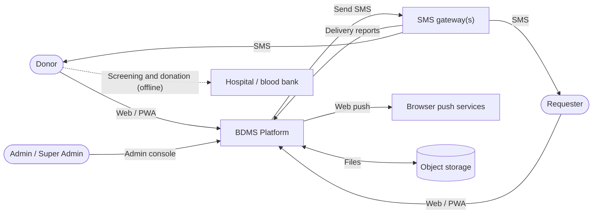
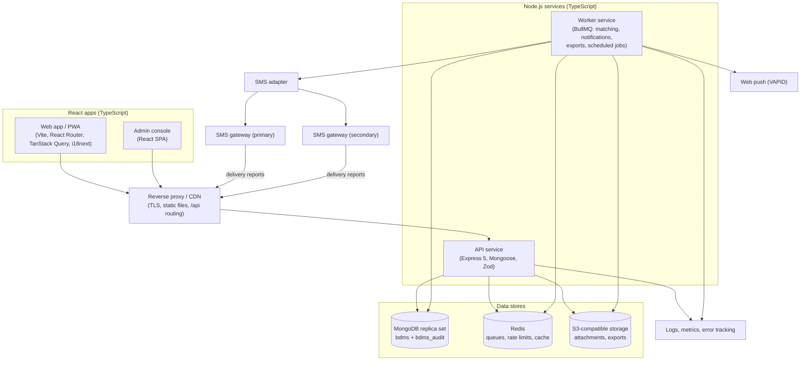
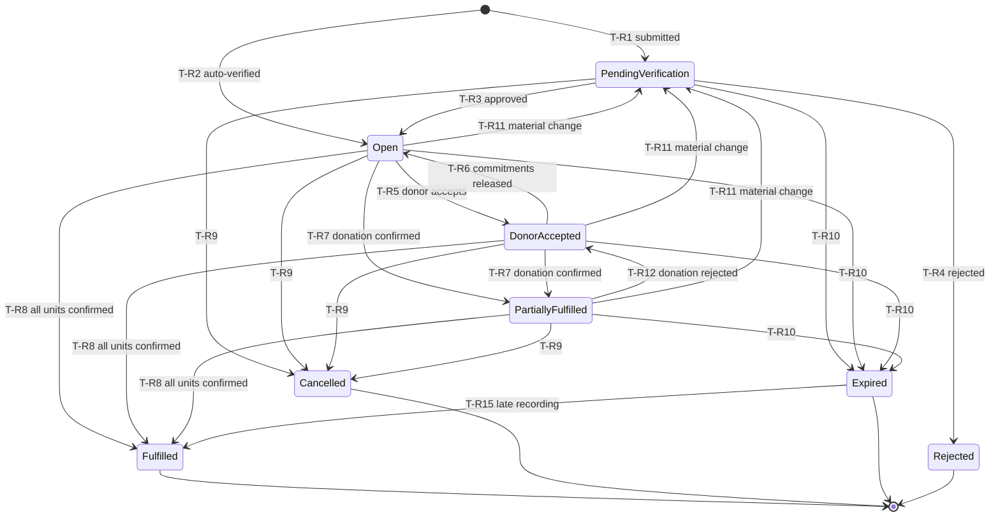
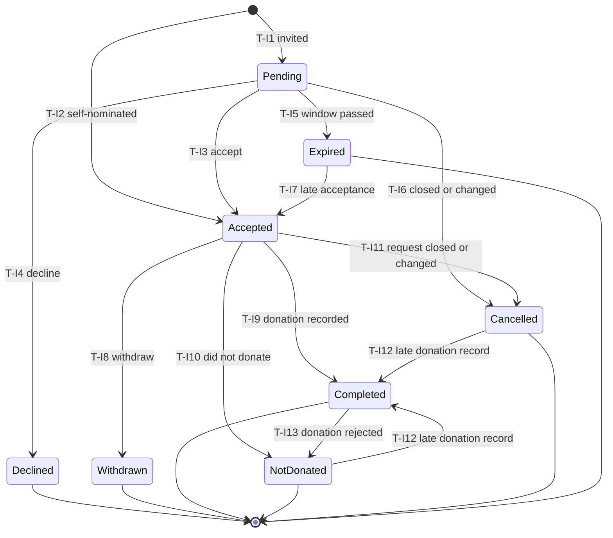
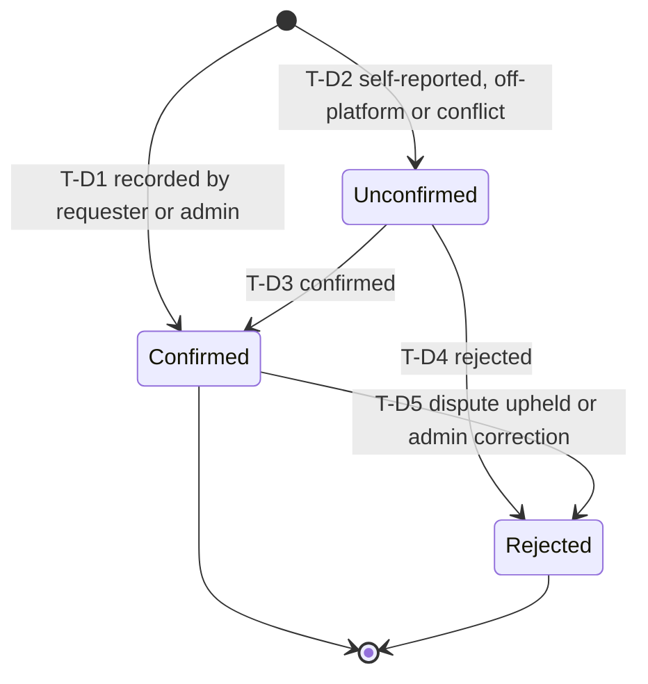
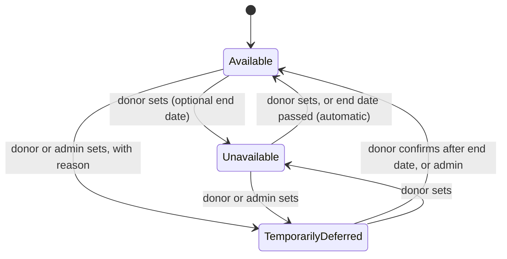
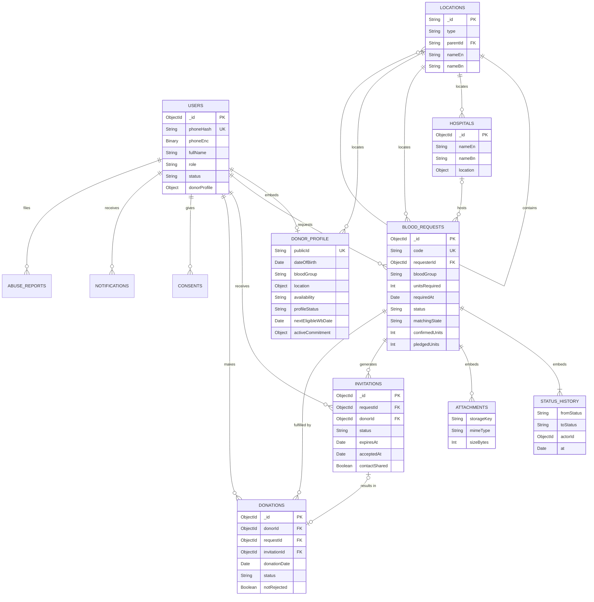

# Software Requirements Specification (SRS)

## Blood Donor Management System (BDMS) — MVP

| Item | Detail |
|---|---|
| Document | Software Requirements Specification (SRS) |
| Structure | Based on ISO/IEC/IEEE 29148:2018 |
| Version | 1.2 — Draft for review |
| Date | 14 November 2026 |
| Owner | [Technical Lead] |
| Status | Draft |
| Related documents | [BRD](01-BRD.md) · [PRD](02-PRD.md) · [TDD](04-TDD-MERN.md) |

### Revision history

| Version | Date | Author | Changes |
|---|---|---|---|
| 1.0 | 14 Nov 2026 | [Author] | First complete SRS for the MVP |
| 1.1 | 14 Nov 2026 | [Author] | Technology stack set to MERN (MongoDB, Express, React, Node.js); data model converted to MongoDB; concurrency, outbox, audit and retention mechanisms adapted; red/black/white colour palette (UI-13) |
| 1.2 | 14 Nov 2026 | [Author] | Aligned with AGENTS.md: critical-path testing only (NFR-MNT-02); phone encryption with MongoDB Client-Side Field Level Encryption instead of custom cipher code (NFR-SEC-04); tool-neutral CI requirement (NFR-MNT-03) |

---

## Table of contents

1. [Introduction](#1-introduction)
2. [Overall description](#2-overall-description)
3. [Functional requirements](#3-functional-requirements)
4. [Business logic specifications](#4-business-logic-specifications)
5. [Data requirements](#5-data-requirements)
6. [External interface requirements](#6-external-interface-requirements)
7. [Non-functional requirements](#7-non-functional-requirements)
8. [Configuration parameters](#8-configuration-parameters)
9. [Notification catalogue](#9-notification-catalogue)
10. [Audit event catalogue](#10-audit-event-catalogue)
11. [API error codes](#11-api-error-codes)
12. [Verification and acceptance](#12-verification-and-acceptance)
13. [Traceability matrix](#13-traceability-matrix)
- [Appendix A — Glossary](#appendix-a--glossary)
- [Appendix B — Formats and identifiers](#appendix-b--formats-and-identifiers)
- [Appendix C — Open issues (TBD)](#appendix-c--open-issues-tbd)

---

## 1. Introduction

### 1.1 Purpose

This SRS specifies the functional and non-functional requirements of the BDMS MVP. It is detailed enough to support design, implementation, testing and acceptance. It is written for developers, QA engineers, DevOps, UX designers and the Product Owner. The Medical Advisor and Legal Advisor should review the sections marked ⚕ and the privacy requirements.

### 1.2 Scope

BDMS is built with the **MERN stack** (MongoDB, Express.js, React, Node.js) and consists of:

- a React web application (installable PWA) for donors and requesters;
- a React admin console;
- a REST API built with Express on Node.js;
- Node.js background workers (matching, notifications, scheduled jobs);
- a MongoDB database, with Redis for queues and caching and S3-compatible storage for files;
- integrations with SMS gateways and browser push services.

The MVP covers OTP authentication; donor profiles and availability; donor search; blood requests and verification; automatic wave-based matching; invitation responses and consent-based contact exchange; donation recording and eligibility; in-app, SMS and push notifications; admin operations and dashboard; CSV reporting; trust and safety; privacy and the data lifecycle; configuration; and audit.

Out of scope: see [BRD §4.2](01-BRD.md#42-out-of-scope-mvp).

### 1.3 Definitions and abbreviations

| Term | Meaning |
|---|---|
| WB / APH | Whole blood donation / apheresis donation (donation types) |
| E.164 | International phone number format, e.g., `+8801712345678` |
| CSPRNG | Cryptographically secure pseudo-random number generator |
| p95 | 95th percentile |
| RPO / RTO | Recovery point objective / recovery time objective |
| PII | Personally identifiable information |
| RBAC | Role-based access control |
| VAPID | Voluntary Application Server Identification (Web Push) |
| MERN | MongoDB, Express.js, React and Node.js — the technology stack (DC-09) |
| ODM | Object-document mapper (Mongoose) |
| Replica set | A group of MongoDB servers holding the same data; required for multi-document transactions |
| TTL index | A MongoDB index that deletes documents automatically after a set time |
| BullMQ | A Redis-based job queue and scheduler for Node.js |
| Transactional outbox | Writing outgoing messages in the same transaction as the business change, then sending them after commit |
| ⚕ | Medical parameter or content that requires Medical Advisor approval before go-live |

The full glossary is in [Appendix A](#appendix-a--glossary).

### 1.4 References

| Ref | Document |
|---|---|
| [BRD] | 01-BRD.md v1.0 — Business Requirements Document |
| [PRD] | 02-PRD.md v1.0 — Product Requirements Document |
| [29148] | ISO/IEC/IEEE 29148:2018 — Requirements engineering |
| [ASVS] | OWASP Application Security Verification Standard (latest stable version at project start) |
| [WCAG] | W3C Web Content Accessibility Guidelines 2.1 |
| [RFC4180] | Common Format and MIME Type for CSV Files |
| [E164] | ITU-T E.164 numbering plan |
| [WebOTP] | W3C WebOTP API |
| [GEO] | Official Bangladesh administrative geocodes (divisions, districts, upazilas/thanas) |
| [TDD] | 04-TDD-MERN.md v1.0 — Technical Design Document (MERN implementation) |
| [MONGO] | MongoDB Manual — transactions, partial indexes, TTL indexes |

### 1.5 Conventions

- **shall** = mandatory; **should** = recommended; **may** = optional.
- Priorities follow the PRD's MoSCoW: **M** (Must), **S** (Should), **C** (Could).
- IDs:
  - `FR-<AREA>-<NN>` — functional requirements;
  - `NFR-<AREA>-<NN>` — non-functional requirements;
  - `RULE-NN` — business rules (BRD);
  - `F<m>.<n>` — PRD features;
  - `C1–C12` — matching filters (§4.3);
  - `MT-n` — matching triggers (FR-MAT-01);
  - `T-R/T-I/T-D` — state transitions (§4.5).
- Configurable values are written as `config.key` (default) and are defined in §8.
- **Time:** all timestamps are stored in UTC. All business times (quiet hours, daily jobs, displayed dates, "today") use **Asia/Dhaka (UTC+06:00, no DST)**.
- **Naming:** field names use camelCase, as stored in MongoDB documents and returned in API JSON (e.g., `requiredAt`). Enum values use UPPER_SNAKE (e.g., `PENDING_VERIFICATION`), configuration keys are dotted snake_case (e.g., `request.max_units`), collection names are snake_case plurals (e.g., `blood_requests`), and CSV export columns are snake_case (FR-RPT-03).

---

## 2. Overall description

### 2.1 Product perspective

BDMS is a new, standalone system. It does not integrate with hospital systems in the MVP.



### 2.2 Product functions (summary)

| Area | Functions |
|---|---|
| Authentication and account (AUTH) | OTP sign-up/login, sessions, admin two-factor login, language, phone change |
| Donor profile (PRF) | Profile, availability, consents, preferences, profile review, age-out |
| Search (SRC) | Anonymised donor search, invite from search, admin search, public counts |
| Requests (REQ) | Create, track, edit, cancel, extend, expire, share, attachments |
| Verification (VER) | Queue, lock, approve, reject, request info, escalation, auto-verification |
| Matching (MAT) | Candidate selection, ranking, waves, tiers, quiet hours, manual invitations |
| Invitations (INV) | View, accept with self-check, decline, withdraw, contact exchange, reminders |
| Donations (DON) | Outcomes, confirmation, disputes, eligibility, interval rules, reminders, fulfilment |
| Notifications (NTF) | In-app, SMS, push, templates, preferences, retries, budget |
| Admin (ADM) | Dashboard, queues, coordination, donors, hospitals, moderation, settings, audit |
| Reports (RPT) | CSV exports |
| Trust and safety (ABU) | Abuse reports, automatic pause, block list, declarations |
| Privacy (PRV) | Consents, deletion, data export, retention, contact visibility |
| Configuration (CFG) / Audit (AUD) | Settings, feature flags, append-only audit trail |

### 2.3 User classes and characteristics

| Class | Description | Usage frequency | Technical skill |
|---|---|---|---|
| Guest | Unauthenticated visitor | Occasional | Any |
| User / Requester | Any authenticated account; creates requests | Episodic, often under stress | Low to medium; often first-time |
| Donor | User with an ACTIVE donor profile | Occasional (when invited) | Low to medium |
| Admin | Operations staff or volunteer | Daily, in shifts | Medium |
| Super Admin | Senior operations or technical staff | Weekly | Medium to high |
| System | Scheduler and workers acting automatically | Continuous | — |

### 2.4 Permissions matrix

✔ = allowed · own = only on the user's own records · ⓐ = audited

| Capability | Guest | User (Requester) | Donor | Admin | Super Admin |
|---|---|---|---|---|---|
| Public pages, shared request page, public counts | ✔ | ✔ | ✔ | ✔ | ✔ |
| Sign-up / login (OTP) | ✔ | – | – | – | – |
| Create / edit donor profile | – | own | own | ✔ ⓐ | ✔ ⓐ |
| Anonymised donor search | – | ✔ | ✔ | ✔ (full) | ✔ (full) |
| Create / track / edit / cancel requests | – | own | own | ✔ ⓐ | ✔ ⓐ |
| Invite donors from search | – | own verified request | own verified request | ✔ ⓐ | ✔ ⓐ |
| Respond to invitations | – | – | own | on behalf ⓐ | on behalf ⓐ |
| Record outcomes / confirm donations | – | own requests | own requests | ✔ ⓐ | ✔ ⓐ |
| Self-report donations, dispute | – | – | own | ✔ ⓐ | ✔ ⓐ |
| Report abuse | – | ✔ | ✔ | – | – |
| View counterpart's contact details | – | accepted donors ⓐ | after acceptance ⓐ | ✔ ⓐ | ✔ ⓐ |
| Verify requests, coordinate, manage donors, hospitals, abuse queue | – | – | – | ✔ ⓐ | ✔ ⓐ |
| Suspend / block / trust users | – | – | – | ✔ ⓐ | ✔ ⓐ |
| CSV exports (without contact details) | – | – | – | ✔ ⓐ | ✔ ⓐ |
| CSV exports including donor phone numbers | – | – | – | – | ✔ ⓐ |
| Settings, interval rules, locations, admin users, audit log | – | – | – | – | ✔ ⓐ |

### 2.5 Operating environment

| Layer | Environment |
|---|---|
| Client | React single-page applications (web app / PWA and admin console) running in Chrome for Android (last 3 major versions), Samsung Internet (last 2), Safari iOS 15+ and desktop Chrome/Edge/Firefox/Safari (last 2). Android 8+ devices with 2 GB RAM. |
| Application | Node.js (current LTS, v24 or later) in Linux containers: an Express 5 API service and a worker service (BullMQ jobs and schedules). |
| Data | MongoDB 7.0 or later (8.0 recommended) as a replica set — 3 nodes in production, on MongoDB Atlas or self-hosted. Redis 7+ for queues, rate limits and caching. S3-compatible object storage. NTP-synchronised clocks. |
| Network | HTTPS only. Each React app and the API are served from the same host (the proxy routes `/api/*` to the API service), so session cookies stay first-party. Must stay usable on 3G and unstable mobile networks. |

### 2.6 Design and implementation constraints

| ID | Constraint |
|---|---|
| DC-01 | Web only (responsive React web app / PWA). No native apps in the MVP. |
| DC-02 | Only Bangladeshi mobile numbers (`+8801[3-9]XXXXXXXX`). |
| DC-03 | Timestamps stored in UTC; business logic in Asia/Dhaka. Date-only values (date of birth, donation date) are stored as UTC midnight of the calendar date. |
| DC-04 | MongoDB shall run as a **replica set** in every environment, including development and CI (a single-node replica set), because multi-document transactions are required for invitation, donation and counter updates. |
| DC-05 | SMS integration through a provider-agnostic adapter (no vendor lock-in). |
| DC-06 | No clinical data (test results, crossmatch) is stored. |
| DC-07 | Open-source libraries preferred. Hosting location depends on decision OD-05 (MongoDB Atlas region or self-hosted). |
| DC-08 | Full Bangla and English parity at launch. |
| DC-09 | **Technology stack — MERN:** MongoDB, Express.js, React and Node.js, written in TypeScript on both frontend and backend so that validation schemas and types are shared. Supporting services: Redis and S3-compatible object storage. Recommended libraries are listed in the [TDD](04-TDD-MERN.md); equivalents may be used if the NFRs are met. |
| DC-10 | **Visual identity:** three primary colours — red, black and white (UI-13). The layout and component style follow the design reference in PRD §10.7. |

### 2.7 Assumptions and dependencies

Business assumptions A-01…A-09 and dependencies D-01…D-07 are listed in [BRD §10–12](01-BRD.md#10-assumptions). Technical assumptions:

- The SMS provider offers an HTTPS API, Unicode SMS and delivery-report callbacks.
- Official geocode data (division → district → upazila/thana, with Bangla and English names) is available in machine-readable form.
- A managed MongoDB replica set (e.g., MongoDB Atlas) and managed Redis are available in the chosen region, or the team can operate them.
- Web push on iOS works only for installed PWAs (iOS 16.4+), so SMS remains the primary channel for critical messages.

### 2.8 Reference architecture (MERN)

The backend is a **modular monolith** in a TypeScript monorepo. One codebase is deployed as two Node.js services — the Express API and the worker — that share a MongoDB replica set and Redis and scale independently. The two React apps are static builds served by the proxy or a CDN. Implementation details (repository layout, libraries, schemas, jobs, CI/CD) are in the [Technical Design Document](04-TDD-MERN.md).



| Component | Responsibility |
|---|---|
| Web app (React PWA) | Donor and requester screens in Bangla and English; offline shell; push notifications |
| Admin console (React) | Admin and Super Admin screens, on a separate host (optional IP allow-list) |
| API service (Express) | REST API, authentication, validation, business services, transactions, server-rendered meta tags for share pages (FR-REQ-17) |
| Worker service (Node.js) | Matching waves, SMS and push dispatch, exports, imports, eligibility recalculation, scheduled jobs (§4.7) |
| MongoDB | System of record (`bdms`) and append-only audit database (`bdms_audit`) |
| Redis | BullMQ queues and job schedulers, rate-limit counters, settings cache, distributed locks |
| Object storage | Attachments, exports, imports, personal data exports |

---

## 3. Functional requirements

### 3.1 Authentication and account (AUTH)

| ID | Requirement | Pri |
|---|---|---|
| FR-AUTH-01 | The system shall provide one sign-up/login flow for new and existing users: the user enters a Bangladeshi mobile number, receives a one-time password (OTP) by SMS and verifies it. | M |
| FR-AUTH-02 | The system shall accept mobile numbers as `01XXXXXXXXX`, `+8801XXXXXXXXX` or `8801XXXXXXXXX`, ignoring spaces and hyphens. It shall validate the national part against `^01[3-9][0-9]{8}$` and store the number in E.164 form (`+8801XXXXXXXXX`). Invalid input shall return `AUTH_INVALID_PHONE`. | M |
| FR-AUTH-03 | An OTP shall be a 6-digit numeric code generated with a CSPRNG and stored only as a keyed hash (HMAC-SHA-256). It shall be valid for `otp.ttl_seconds` (300) and usable once. Issuing a new OTP shall invalidate any unused OTP for the same number and purpose. | M |
| FR-AUTH-04 | An OTP shall be invalidated after `otp.max_attempts` (5) failed verification attempts (`AUTH_OTP_ATTEMPTS_EXCEEDED`), after which a new code must be requested. | M |
| FR-AUTH-05 | OTP issuance shall be throttled: resend cooldown `otp.resend_cooldown_seconds` (60); at most `otp.max_per_phone_hour` (5) per number per hour and `otp.max_per_phone_day` (10) per day; at most `otp.max_per_ip_hour` (20) per IP per hour. Exceeding a limit returns HTTP 429 `AUTH_RATE_LIMITED` with `Retry-After`. Responses shall not reveal whether a number is registered. | M |
| FR-AUTH-06 | OTP requests for numbers on the block list (FR-ABU-05) shall be refused with `AUTH_BLOCKED`, and no SMS shall be sent. | M |
| FR-AUTH-07 | After the first successful verification for a number, the system shall create a user account (status ACTIVE, role USER). Before any other function becomes available, the user shall enter a full name (2–100 characters) and accept the current versions of the Terms of Service and Privacy Policy, recorded as consents (FR-PRV-01). | M |
| FR-AUTH-08 | USER sessions shall use a short-lived access token (15 min) and a rotating refresh token (30-day sliding expiry, `session.user_refresh_days`), both in `HttpOnly; Secure; SameSite=Lax` cookies. Refresh tokens shall be stored hashed and rotated on every use. If a rotated token is reused, the whole session family shall be revoked. | M |
| FR-AUTH-09 | ADMIN and SUPER_ADMIN logins shall require two factors: OTP **and** password. Passwords shall be at least 10 characters, checked against a list of common or breached passwords, and hashed with Argon2id (or bcrypt with cost ≥ 12). Five consecutive failed password attempts shall lock password login for 15 minutes (`AUTH_LOCKED`). Admin sessions shall have an idle timeout of `session.admin_idle_minutes` (30) and an absolute timeout of `session.admin_absolute_hours` (12). | M |
| FR-AUTH-10 | Users shall be able to log out of the current session and log out of all devices. Logout shall revoke tokens on the server. | M |
| FR-AUTH-11 | When a user becomes SUSPENDED, BLOCKED or DELETED, all of their sessions shall be revoked within 60 seconds, and further logins refused with `AUTH_SUSPENDED` or `AUTH_BLOCKED`. Suspended users shall see the suspension end date and how to contact support. | M |
| FR-AUTH-12 | Users shall be able to change their mobile number by verifying an OTP sent to the new number. The new number must not belong to another account or appear on the block list. The change shall be audit-logged (PHONE_CHANGED) and all other sessions revoked. | S |
| FR-AUTH-13 | Roles shall be USER, ADMIN and SUPER_ADMIN. Donor capability shall be derived from having an ACTIVE donor profile. Only a SUPER_ADMIN shall assign the ADMIN and SUPER_ADMIN roles. | M |
| FR-AUTH-14 | The user's language (`bn` or `en`) shall be stored and applied to the UI and all notifications. The initial value shall come from the browser's `Accept-Language` header (`bn*` → `bn`, otherwise `en`). Users can change it at any time. | M |
| FR-AUTH-15 | The OTP SMS should end with the WebOTP origin-bound line `@{domain} #{code}`, and the OTP input shall use `autocomplete="one-time-code"` to enable autofill. | S |
| FR-AUTH-16 | `lastActiveAt` shall be updated on authenticated activity, at most once per hour per user. | M |

### 3.2 Donor profile and availability (PRF)

| ID | Requirement | Pri |
|---|---|---|
| FR-PRF-01 | Any ACTIVE user shall be able to create exactly one donor profile. | M |
| FR-PRF-02 | The donor profile shall capture the fields in Table 3.2-A, validated as stated. | M |
| FR-PRF-03 | A donor profile shall become **ACTIVE** only when all of these hold: the blood group is known; the donor's age is within [`donor.min_age` ⚕ (18), `donor.max_age` ⚕ (60)]; consent to receive requests is given; and the eligibility self-declaration is confirmed. Otherwise it shall be saved as **DRAFT** (not matchable, not searchable), and the API shall return the reason (e.g., `PRF_UNDERAGE`). | M |
| FR-PRF-04 | The "last donation" answer given at registration shall be stored as a donation record (source OFF_PLATFORM, status UNCONFIRMED). If only a month and year are given, the date shall be the last day of that month, or today if it is the current month. "Never" creates no record. | M |
| FR-PRF-05 | The donor's home and profile shall show: age in years; availability; eligibility per donation type ("Eligible now" or "Eligible from {date}", §4.2); last donation date and type; number of confirmed donations; and the blood-group-verified badge. | M |
| FR-PRF-06 | Availability shall be AVAILABLE, UNAVAILABLE or TEMPORARILY_DEFERRED. UNAVAILABLE may have an optional `availabilityUntil` date ≤ today + `availability.unavailable_max_days` (180). TEMPORARILY_DEFERRED requires a `deferralReason` and may have an `availabilityUntil` date ≤ today + `availability.deferral_max_days` (365). Changes shall take effect immediately for matching and search. | M |
| FR-PRF-07 | Every day at 00:05, donors who are UNAVAILABLE with `availabilityUntil` < today shall be set to AVAILABLE and sent AVAILABILITY_RESTORED. | M |
| FR-PRF-08 | Every day at 09:00, DEFERRAL_ENDED_CONFIRM shall be sent to TEMPORARILY_DEFERRED donors whose `availabilityUntil` < today. Donors deferred without an end date shall receive it after `availability.deferral_check_days` (90) days, and every 90 days after that. These donors shall stay TEMPORARILY_DEFERRED until they, or an admin, set them to AVAILABLE. | M |
| FR-PRF-09 | When a donor sets UNAVAILABLE or TEMPORARILY_DEFERRED, all their PENDING invitations shall become DECLINED (reason BECAME_UNAVAILABLE). If they hold an ACCEPTED invitation on an active request, the UI shall warn them and offer to withdraw it (FR-INV-09). The availability change alone shall not withdraw the commitment. | M |
| FR-PRF-10 | If `bloodGroupVerified` is true, the donor shall not be able to change their blood group (`PRF_BLOOD_GROUP_LOCKED`) and must contact an admin. Otherwise, a blood group change shall be blocked while the donor holds an ACCEPTED invitation. When allowed, it shall cancel all PENDING invitations (reason PROFILE_CHANGED), set `bloodGroupReviewFlag` for admin review and be audit-logged (BLOOD_GROUP_CHANGED_BY_USER). | M |
| FR-PRF-11 | Donors shall be able to withdraw consent to receive requests. This sets the profile to INACTIVE, removes the donor from matching and search immediately, and cancels PENDING invitations (reason PROFILE_CHANGED). ACCEPTED invitations are handled as in FR-PRF-09. Giving consent again shall reactivate the profile if the FR-PRF-03 conditions hold. | M |
| FR-PRF-12 | Donors shall be able to set: `contactSharePref` (ASK_EACH_TIME default / ALWAYS_SHARE), `invitationSms` (ALL default / EMERGENCY_ONLY), `nightEmergencyAlerts` (default true), `eligibilityReminders` (default true) and `apheresisWilling` (default false). All users can set `smsNonCritical` (default true). | M |
| FR-PRF-13 | When `profile.review_days` (180) have passed since `profileConfirmedAt`, the system shall send PROFILE_REVIEW. Confirming "Still correct", or saving the profile, updates `profileConfirmedAt`. | S |
| FR-PRF-14 | Every day, the system shall find ACTIVE donors older than `donor.max_age` ⚕. They are excluded from matching (computed by C5) and receive AGE_OUT_THANKS once (`ageOutNotifiedAt`). | M |

**Table 3.2-A — Donor profile fields**

| Field | Required | Validation / default |
|---|---|---|
| Full name | Yes | From the account; 2–100 characters; Bangla or Latin letters, spaces, `.`, `-`, `'` |
| Date of birth | Yes | Valid date. For activation, age today must be within [`donor.min_age`, `donor.max_age`] |
| Sex | Yes | MALE, FEMALE, OTHER, PREFER_NOT_TO_SAY (used only for interval rules) |
| Blood group | Yes | A_POS, A_NEG, B_POS, B_NEG, AB_POS, AB_NEG, O_POS, O_NEG; UNKNOWN allowed only for DRAFT profiles |
| Division / district / upazila | Yes | Must form a valid, active hierarchy in `locations` |
| Area | No | ≤ 100 characters of free text (visible to admins only) |
| Last donation | Yes | NEVER, an exact date, or a month and year; ≤ today; ≥ date of birth + 16 years |
| Last donation type | If a date is given | WHOLE_BLOOD (default) / APHERESIS |
| Apheresis willing | No | Boolean; default false |
| Consent: receive donation requests | Yes, for activation | Must be true to activate |
| Eligibility self-declaration ⚕ | Yes, for activation | "I am {minAge}–{maxAge} years old, weigh at least {minWeight} kg and am in good health" |
| Preferences | Yes | Defaults per FR-PRF-12 |

### 3.3 Donor search (SRC)

| ID | Requirement | Pri |
|---|---|---|
| FR-SRC-01 | Donor search shall be available only to authenticated ACTIVE users and admins. | M |
| FR-SRC-02 | Inputs: `bloodGroup` (required); `divisionId` (required); `districtId` (required for non-admins); `upazilaId` (optional); `eligibleOn` (date, default today, ≤ today + 30 days); `lastDonationOlderThanDays` (optional: 90, 120, 180 or 365); `donationType` (default WHOLE_BLOOD); `page`. | M |
| FR-SRC-03 | For non-admin users, results shall include only donors who meet filters **C1–C6** (§4.3), evaluated on `eligibleOn`, and shall exclude the searching user. | M |
| FR-SRC-04 | For non-admin users, each result shall contain only: opaque `publicId`; display name (first given name + initial of the last name); blood group; upazila and district names; availability badge; last-donation bucket (`<3 months`, `3–6 months`, `6–12 months`, `>12 months`, `never/unknown`); number of confirmed donations; blood-group-verified badge; apheresis-willing badge. No API shall ever return phone numbers, date of birth, exact age, sex, exact dates or area text to non-admin users. | M |
| FR-SRC-05 | Results shall be ordered by the ranking in §4.3, using the search location as the reference. | M |
| FR-SRC-06 | Non-admin results shall be paginated at `search.page_size` (20) and capped at `search.max_results` (100) per query. | M |
| FR-SRC-07 | Non-admin users shall be limited to `search.rate_limit_per_hour` (30) searches per hour. Further searches return `SRC_RATE_LIMITED`. | M |
| FR-SRC-08 | Every search shall be logged (user, filters, result count, time) to detect abuse. Logs are retained for `retention.search_logs_days` (90). | M |
| FR-SRC-09 | A non-admin user may invite donors from the results only to a request they own that is OPEN, DONOR_ACCEPTED or PARTIALLY_FULFILLED, not paused, and for the same blood group. Invitations are created per FR-MAT-10 with `source = REQUESTER`, up to `invitation.manual_per_request_day` (10) per request per Asia/Dhaka calendar day (`INV_MANUAL_CAP_REACHED`). | M |
| FR-SRC-10 | A public, unauthenticated endpoint shall return, for a given district, the number of donors per blood group who meet C1–C6 today. Values below 5 shall be returned as `"<5"`. Responses are cached for 15 minutes. | C |
| FR-SRC-11 | Admin search shall cover all donors in any availability, eligibility or profile status. It adds filters for name, exact phone, verified flag, consent, profile status, registration date and last activity. Phone numbers shall be shown masked (`017•••••678`). The full number is returned only through a "Reveal" action, which is audit-logged first (CONTACT_REVEALED). | M |

### 3.4 Blood requests (REQ)

| ID | Requirement | Pri |
|---|---|---|
| FR-REQ-01 | Any ACTIVE user shall be able to create a blood request with the fields in Table 3.4-A. | M |
| FR-REQ-02 | Each request shall receive a unique human-readable code `RQ-YYMMDD-NNNN` (Asia/Dhaka date plus a daily sequence from an atomic counter in the `counters` collection, zero-padded to at least 4 digits) and a random `publicSlug` (≥ 10 base62 characters) for share links. | M |
| FR-REQ-03 | Initial status: OPEN with `verificationMethod = ADMIN_CREATED` if the creator is an admin; OPEN with `AUTO_TRUSTED` if the requester is trusted and `verification.trusted_auto_approve` (true) is on; otherwise PENDING_VERIFICATION. | M |
| FR-REQ-04 | `expiresAt` = `requiredAt` + `request.expiry_grace_hours.<urgency>` (emergency 6, normal 24). It shall be recalculated whenever `requiredAt` or the urgency changes. | M |
| FR-REQ-05 | A user shall not have more than `request.max_active_per_user` (3) requests in non-terminal statuses (`REQ_LIMIT_REACHED`). Admin-created requests are exempt. | M |
| FR-REQ-06 | **Duplicate check.** A new request is a possible duplicate if another non-terminal request: (a) is for the same blood group; (b) is at the same hospital (or the same normalised unlisted-hospital name and upazila); (c) has the same requester **or** the same contact phone; and (d) was created within `request.duplicate_window_hours` (24). The API shall then return `REQ_DUPLICATE_SUSPECTED`. If the user explicitly confirms, the request is created with `duplicateSuspect = true` and `duplicateOf` set. | M |
| FR-REQ-07 | Create endpoints shall honour the `Idempotency-Key` header. A repeated key from the same user within 24 h returns the original response and creates nothing new. | M |
| FR-REQ-08 | The request location (division, district, upazila) shall be taken from the selected hospital, or from the location entered for an unlisted hospital. It is the reference location for matching. | M |
| FR-REQ-09 | Requesters shall be able to list their own requests (newest first) and view each one. A request is visible only to its requester and to admins. Invited donors see limited fields (FR-INV-01), as does the public share page (FR-REQ-17). | M |
| FR-REQ-10 | The requester's tracking view shall show: code; status and timeline (status history); `unitsRequired`, `pledgedUnits` and `confirmedUnits`; matching state, current tier and number of waves; invitation counts by status; accepted donors (display name, phone if allowed by FR-INV-11, acceptance time, outcome controls); and the available actions. | M |
| FR-REQ-11 | Requester edits in non-terminal statuses shall follow Table 3.4-B. | M |
| FR-REQ-12 | The requester or an admin may cancel a request. A reason is required: ARRANGED_ELSEWHERE, NO_LONGER_NEEDED, CREATED_BY_MISTAKE, PATIENT_CONDITION_CHANGED or OTHER (with text). Effects are as in T-R9 (§4.5). | M |
| FR-REQ-13 | At `expiresAt` − `request.expiry_warning_hours` (2), the system shall send REQUEST_EXPIRING to the requester. | M |
| FR-REQ-14 | The requester may extend `requiredAt` to at most now + `request.extension_max_days` (7), up to `request.max_extensions` (2) times (`REQ_EXTENSION_LIMIT`). Admins have no limit. `expiresAt` is recalculated. | M |
| FR-REQ-15 | A job running every 5 minutes shall move non-terminal requests with `expiresAt` ≤ now to EXPIRED (T-R10). | M |
| FR-REQ-16 | Every status transition shall be appended to the request's embedded `statusHistory` array (from, to, actor or SYSTEM, reason, timestamp) in the same write as the status change. | M |
| FR-REQ-17 | **Share page** `/r/{slug}`. For OPEN, DONOR_ACCEPTED and PARTIALLY_FULFILLED requests it shows: blood group, component, units still needed (`unitsRequired − confirmedUnits`), hospital name, upazila and district, `requiredAt`, urgency and verification badge. It includes Open Graph tags and a `noindex` meta tag and header, rendered by the Express server in the initial HTML response (social-media crawlers do not run the React app). For any other status it shows "no longer active". It never shows the patient's name, contact details, notes, ward or attachments. | S |
| FR-REQ-18 | **Self-nomination.** From the share page, an authenticated user with an ACTIVE donor profile may volunteer. The system shall check filters C1–C8 and C11 (§4.3) and that units are still needed. If all pass, it creates an invitation (`source = SELF_NOMINATED`) and goes straight to acceptance (FR-INV-04). Otherwise it shows a generic reason: "blood group doesn't match", "eligible from {date}", "you already have a commitment" or "no longer needed". | S |
| FR-REQ-19 | **Attachments.** Up to 2 files per request; JPEG, PNG or PDF; ≤ 5 MB each. File type is checked by magic bytes; images are re-encoded to strip metadata; files should be malware-scanned. Files are stored in a private bucket and shown only to admins through signed URLs valid for 5 minutes. Every view is audit-logged (ATTACHMENT_VIEWED). | S |
| FR-REQ-20 | **Repeat request.** A requester can start a new request pre-filled from one of their earlier requests. Every field is copied except `requiredAt`, attachments and declarations. | S |

**Table 3.4-A — Request fields**

| Field | Required | Validation / default |
|---|---|---|
| Patient name | Yes | 2–100 characters |
| Blood group | Yes | One of the 8 groups |
| Component | Yes | WHOLE_BLOOD (default), RED_CELLS, PLATELETS_RANDOM, PLATELETS_APHERESIS, PLASMA, NOT_SURE |
| Units required | Yes | Integer from 1 to `request.max_units` (10); default 1 |
| Hospital | Yes | ID of an active hospital, **or** an unlisted hospital: name (3–150 characters), address (≤ 250) and division/district/upazila |
| Ward / bed / cabin | No | ≤ 50 characters |
| Urgency | Yes | EMERGENCY / NORMAL |
| Required at | Yes | Between now − 5 min and now + `request.max_days_ahead` (30 days) (`REQ_INVALID_REQUIRED_AT`). "ASAP" (EMERGENCY only) sets now + `request.asap_window_hours` (6) and `isAsap = true` |
| Reason | No | SURGERY, ACCIDENT_TRAUMA, CHILDBIRTH, THALASSEMIA, CANCER, DENGUE, ANAEMIA, OTHER |
| Contact person name | Yes | 2–100 characters; defaults to the requester's name |
| Contact phone | Yes | Valid Bangladeshi mobile number, not on the block list; defaults to the requester's phone |
| Relationship to patient | Yes | SELF, FAMILY, FRIEND, HOSPITAL_STAFF, VOLUNTEER, OTHER |
| Notes | No | ≤ 500 characters; visible only to admins and accepted donors |
| Attachments | No | See FR-REQ-19 |
| Declarations | Yes | All four must be ticked: the information is accurate; my contact details will be shared with donors who accept; no payment will be offered or demanded; the hospital decides compatibility and eligibility |

**Table 3.4-B — Edit rules**

| Change | Allowed when | Effect |
|---|---|---|
| Ward/bed, notes, contact name, reason | Non-terminal | Applied immediately |
| `requiredAt` | Non-terminal; within the allowed window | Applied immediately; `expiresAt` recalculated; new invitations use the new window |
| Increase units | New value ≤ `request.max_units` | Applied immediately; matching triggered (MT-3) |
| Decrease units | New value ≥ `confirmedUnits + pledgedUnits` | Applied immediately; otherwise `REQ_UNITS_BELOW_COMMITTED` |
| Urgency NORMAL → EMERGENCY | Non-terminal | Applied immediately; affects future waves only; `urgencyChangedFlag = true`, listed for admin review; audited |
| Urgency EMERGENCY → NORMAL | Non-terminal | Applied immediately |
| Component, keeping the same donation type (§4.1) | Non-terminal | Applied immediately |
| Component, changing the donation type | Non-terminal | **Material** |
| Blood group | No CONFIRMED donations exist (otherwise `REQ_BLOOD_GROUP_CHANGE_BLOCKED`) | **Material** |
| Hospital | Non-terminal | **Material** |
| Contact phone | Non-terminal | **Material** |
| *Effect of any material change* | — | T-R11: status → PENDING_VERIFICATION (or re-auto-verified for admin-created or trusted requests); all PENDING and ACCEPTED invitations → CANCELLED (reason REQUEST_CHANGED), notified per §9; `currentTier` reset to TIER_1; recorded in status history and audit (REQUEST_MATERIAL_CHANGE) |

### 3.5 Verification (VER)

| ID | Requirement | Pri |
|---|---|---|
| FR-VER-01 | The verification queue shall list all PENDING_VERIFICATION requests, EMERGENCY first, then by `createdAt` ascending. Each row shall show: code, urgency, blood group, units, hospital, district, elapsed time and an SLA indicator shown as text, icon and palette style (UI-13): *On track* (< 50% of SLA; black outline), *At risk* (50–100%; red outline on red tint) or *Overdue* (> 100%; solid red with an alert icon). It shall also show flags (duplicate suspect, reported, first request by this user, info requested, unlisted hospital) and the requester's history (total, fulfilled, cancelled and rejected requests; reports). | M |
| FR-VER-02 | Opening a request for review shall lock it to that admin for `verification.review_lock_minutes` (10), or until they act on it. Other admins see the lock and can take over only after confirming (REVIEW_LOCK_TAKEN_OVER). | M |
| FR-VER-03 | **Approve.** The admin completes a checklist (contact person reached: yes/no; hospital verified: yes/no/not possible) and may add notes. Effects: T-R3; `verifiedBy` and `verifiedAt` set; matching triggered (MT-1); REQUEST_APPROVED sent. | M |
| FR-VER-04 | **Reject.** A reason is required (UNREACHABLE, INCOMPLETE_INFO, DUPLICATE, SUSPECTED_FRAUD, COMMERCIAL_OR_PAYMENT, OUT_OF_SERVICE_AREA, OTHER), plus an optional message. Effects: T-R4; REQUEST_REJECTED sent. For SUSPECTED_FRAUD and COMMERCIAL_OR_PAYMENT, the requester sees only the generic message "could not be verified". | M |
| FR-VER-05 | **Request information.** The admin enters a message. The request stays PENDING_VERIFICATION with `infoRequested = true`, and REQUEST_INFO_NEEDED is sent. When the requester edits and resubmits, the flag is cleared and the request is marked "updated" in the queue. Time spent waiting for the requester (`infoRequestedSecondsTotal`) shall be excluded from SLA metrics. | M |
| FR-VER-06 | During verification, admins shall be able to edit any field (e.g., fix typos, or map an unlisted hospital to a master hospital). Edits are audit-logged with before and after values (REQUEST_EDITED). | M |
| FR-VER-07 | Auto-verification (FR-REQ-03) shall record `verificationMethod`. Auto-verified requests shall appear in a "Post-verification review" list until an admin marks them reviewed (REQUEST_POST_REVIEWED). | M |
| FR-VER-08 | **Escalation.** An EMERGENCY request still pending after `verification.escalation_minutes` (10) shall trigger ADMIN_VERIFICATION_ESCALATION to on-duty admins (or to all admins if nobody is on duty). After twice that time, it goes to all Super Admins. A NORMAL request pending longer than `verification.sla_minutes.normal` (120) shall trigger an in-app alert to on-duty admins. Each threshold alerts at most once per request. | M |
| FR-VER-09 | If `verification.auto_publish_unverified_emergency` (false) is enabled, an EMERGENCY request still pending after `verification.auto_publish_after_minutes` (30) shall move to OPEN with `verificationMethod = AUTO_UNVERIFIED`. Invitations and the share page shall then show "Not yet verified", and the request stays in the post-verification review list. | C |
| FR-VER-10 | A new PENDING_VERIFICATION EMERGENCY request shall immediately trigger ADMIN_NEW_EMERGENCY to on-duty admins (or all admins if nobody is on duty). | M |

### 3.6 Matching and invitations (MAT)

| ID | Requirement | Pri |
|---|---|---|
| FR-MAT-01 | The matching engine shall run asynchronously for a request on these triggers: **MT-1** the request enters OPEN (approval, auto-verification, reopen); **MT-2** `nextWaveAt` is reached; **MT-3** units are increased; **MT-4** an invitation leaves PENDING or ACCEPTED, need > 0, and the request has no PENDING invitations left; **MT-5** an admin resumes matching or changes the tier; **MT-6** an EXHAUSTED request is re-checked every `matching.exhausted_recheck_hours` (6); **MT-7** quiet hours end. | M |
| FR-MAT-02 | Candidate selection shall apply filters C1–C12 and the location tier (§4.3). | M |
| FR-MAT-03 | Candidates shall be ranked as defined in §4.3. | M |
| FR-MAT-04 | Wave size and dispatch shall follow §4.4. | M |
| FR-MAT-05 | First-wave invitations shall be created within 30 s (p95) of MT-1, and the first SMS handed to the gateway within 60 s (p95). | M |
| FR-MAT-06 | Location tiers: TIER_1 = same upazila; TIER_2 = same district; TIER_3 = same division; TIER_4 = nationwide. The engine moves from tier n to n+1 automatically when tier n has no candidates left, up to `matching.max_auto_tier` (TIER_3). Only an admin can enable TIER_4 (`maxTierOverride`). | M |
| FR-MAT-07 | When need > 0, no PENDING invitations remain, and no candidates exist at the highest allowed tier, `matchingState` shall become EXHAUSTED. POOL_EXHAUSTED is sent to the requester (in-app and SMS, at most once per request per 24 h) and to admins (in-app), and the request is re-checked per MT-6. | M |
| FR-MAT-08 | Each request shall have a `matchingState`: IDLE (not verified), ACTIVE, PAUSED, SATISFIED (need ≤ 0), EXHAUSTED or STOPPED (terminal). | M |
| FR-MAT-09 | **Quiet hours** (`notification.quiet_hours_start`–`end`, 22:00–07:00). NORMAL requests shall not dispatch waves during quiet hours; their next wave is scheduled for when quiet hours end. EMERGENCY requests shall invite only donors with `nightEmergencyAlerts = true` (C12); any remaining need is re-evaluated when quiet hours end (MT-7). | M |
| FR-MAT-10 | **Manual invitations** create invitations with `source` REQUESTER (from search) or ADMIN. Requester invitations must pass C1–C12, but not the location tier. Admin invitations must pass C1–C8 and C11–C12; an admin may override C9, C10 and the location tier, with a recorded reason (MANUAL_INVITATIONS_SENT). Availability, consent, eligibility and age limits can never be overridden (RULE-22). | M |
| FR-MAT-11 | An invitation's `expiresAt` = max(now + `invitation.min_response_minutes` (15), min(now + `invitation.response_window_minutes.<urgency>` (emergency 30, normal 720), `requiredAt`)). | M |
| FR-MAT-12 | Each new invitation shall trigger INVITATION_NEW (in-app; SMS per §9 and preferences; push if subscribed), which includes a secure response link (FR-INV-02). | M |
| FR-MAT-13 | Matching for any one request shall be serialised so that concurrent triggers cannot dispatch duplicate waves: matching jobs are de-duplicated per request (BullMQ job ID `match-{requestId}`), and the worker holds a short lease on the request (`leaseUntil`, taken with a conditional update) while dispatching. A unique compound index on `invitations` (requestId, donorId) shall enforce uniqueness. | M |
| FR-MAT-14 | Admins shall be able to pause and resume matching, with a reason (MATCHING_PAUSED / MATCHING_RESUMED). While a request is PAUSED, no invitations are created and acceptances return `INV_REQUEST_UNDER_REVIEW`. Existing PENDING invitations stay as they are. | M |
| FR-MAT-15 | For APHERESIS requests, donors with `apheresisWilling = true` shall be ranked ahead of other donors in the same tier. | S |
| FR-MAT-16 | Admins may set a per-request `pledgeBuffer` (0–3; default `matching.pledge_buffer_units` = 0) to recruit extra donors beyond the units required (PLEDGE_BUFFER_CHANGED). | S |

### 3.7 Invitation response and contact exchange (INV)

| ID | Requirement | Pri |
|---|---|---|
| FR-INV-01 | Before acceptance, the invitation shall expose only: urgency; verification badge ("Verified" / "Not yet verified"); blood group; component; units still needed; hospital name, upazila and district; a tier label ("same upazila / district / division"); `requiredAt` (or "ASAP"); reason category, if given; and the response deadline. It shall **not** expose the patient's name, ward/bed, contact name or phone, notes, attachments, or the requester's identity. | M |
| FR-INV-02 | **Response token.** Each invitation shall have a token with ≥ 128 bits of randomness, URL-safe, stored only as a hash and scoped to that one invitation. It is valid while the invitation is PENDING or ACCEPTED and for `invitation.token_grace_hours` (24) after it moves to any other state, but never beyond 24 h after the request closes. With the token, the holder may view the invitation, accept, decline, withdraw, report "I donated" and report abuse (`INV_TOKEN_INVALID` otherwise). Every other action requires login. | M |
| FR-INV-03 | **Accept preconditions** (all must hold): (a) the invitation is PENDING, or EXPIRED with late acceptance enabled (FR-INV-10); (b) the request is OPEN, DONOR_ACCEPTED or PARTIALLY_FULFILLED and matching is not PAUSED; (c) `confirmedUnits + pledgedUnits < unitsRequired + pledgeBuffer`; (d) the donor meets C1–C8 at the moment of acceptance. On failure the API returns the matching code: `INV_EXPIRED`, `INV_REQUEST_UNDER_REVIEW`, `INV_NOT_NEEDED`, `INV_DONOR_INELIGIBLE` (with reason and eligible-from date) or `INV_ACTIVE_COMMITMENT`. | M |
| FR-INV-04 | Before accepting, the donor shall confirm every self-check item. The list is configurable and approved by the Medical Advisor ⚕; defaults: feel well today; meet the age and minimum-weight requirements; have not donated in the last {interval} days; understand that the hospital's screening decides eligibility. The donor is also shown the contact-sharing checkbox, pre-ticked only if `contactSharePref = ALWAYS_SHARE`. | M |
| FR-INV-05 | **On acceptance** the following shall happen atomically: (1) the invitation becomes ACCEPTED, with `acceptedAt`, `respondedAt`, `contactShared` and `selfCheckConfirmedAt` set; (2) a CONTACT_SHARE consent is recorded if the donor shared their number; (3) request counters and status are recalculated (§4.6), and `firstAcceptedAt` is set if empty; (4) DONOR_ACCEPTED is sent to the requester, with the donor's display name and, if shared, phone number. The donor is then shown the full details: patient name, hospital name, address and phone, ward/bed, contact person's name and tap-to-call phone, notes and required time. Showing the requester's contact details shall be audit-logged (CONTACT_REVEALED). | M |
| FR-INV-06 | If precondition (c) fails at the moment of acceptance, the invitation shall become CANCELLED (reason NOT_NEEDED) and the donor is shown a thank-you message. No contact details are exchanged. | M |
| FR-INV-07 | Acceptance shall run in a MongoDB transaction that uses conditional atomic updates (§4.6). The update on the request (`confirmedUnits + pledgedUnits < unitsRequired + pledgeBuffer`) ensures concurrent acceptances can never exceed the limit. The update on the donor (`activeCommitment` must be empty) ensures a donor can never hold two commitments (RULE-09). | M |
| FR-INV-08 | **Decline**, with an optional reason: NOT_AVAILABLE_NOW, NOT_ELIGIBLE, TOO_FAR or OTHER. NOT_ELIGIBLE prompts the donor to set TEMPORARILY_DEFERRED; NOT_AVAILABLE_NOW offers UNAVAILABLE with an end date. The requester is not notified of individual declines. | M |
| FR-INV-09 | **Withdraw** (ACCEPTED → WITHDRAWN). A reason is required: CANNOT_MAKE_IT, BECAME_UNWELL, PERSONAL_EMERGENCY or OTHER. DONOR_WITHDREW is sent to the requester, counters and status are recalculated and matching is triggered (MT-4). BECAME_UNWELL prompts the donor to set a deferral. | M |
| FR-INV-10 | **Late acceptance.** An EXPIRED invitation may be accepted if preconditions (b)–(d) of FR-INV-03 hold (`feature.late_acceptance`). | S |
| FR-INV-11 | The donor's phone number shall be returned to the requester only when all of these hold: the invitation has `acceptedAt` set and is ACCEPTED, COMPLETED, or within the late-recording window; `contactShared = true`; and the request is still within the contact visibility window (FR-PRV-05). Each time the requester retrieves the number, CONTACT_REVEALED is logged. Otherwise the requester sees "The donor will contact you". | M |
| FR-INV-12 | ACCEPTED_DONOR_REMINDER shall be sent at `requiredAt` − `notification.accepted_reminder_minutes` (120), but only if the invitation was accepted more than 3 h before `requiredAt` and is still ACCEPTED. | M |
| FR-INV-13 | OUTCOME_FOLLOWUP shall be sent to the requester (in-app and SMS) and to the donor (in-app) at `requiredAt` + `notification.outcome_followup_hours` (6), and again at +24 h, for each invitation that is still ACCEPTED. Invitations still ACCEPTED 48 h after `requiredAt` shall appear in the admin "Outcome pending" queue. | M |
| FR-INV-14 | Admins may record a donor's response (accept, decline or withdraw) on the donor's behalf. A note is mandatory (e.g., "confirmed by phone"), and `respondedBy` stores the admin. For acceptance, the self-check is replaced by the admin's confirmation that it was read to the donor. Audit-logged (RESPONSE_RECORDED_ON_BEHALF). | M |

### 3.8 Donations and eligibility (DON)

| ID | Requirement | Pri |
|---|---|---|
| FR-DON-01 | The requester (for their own requests) or an admin may record an outcome for any invitation with `acceptedAt` set that is either ACCEPTED, or CANCELLED/NOT_DONATED with the request closed no more than `donation.late_recording_days` (7) ago. Outcomes: **DONATED** (donation date: default today; ≤ today; ≥ the request's creation date − 1 day) or **NOT_DONATED** (reason DEFERRED_AT_SCREENING, DID_NOT_ARRIVE, NOT_NEEDED or OTHER). | M |
| FR-DON-02 | A DONATED outcome recorded by the requester or an admin shall create a donation linked to the request and invitation: source REQUEST, units 1, status CONFIRMED (unless there is an interval conflict, FR-DON-08). The invitation becomes COMPLETED, and DONATION_RECORDED is sent to the donor with a dispute link. | M |
| FR-DON-03 | A NOT_DONATED outcome shall set the invitation to NOT_DONATED with the given reason. DEFERRED_AT_SCREENING also prompts the donor (in-app) to set TEMPORARILY_DEFERRED. NOT_NEEDED sends INVITATION_NOT_NEEDED to the donor. | M |
| FR-DON-04 | A donor may report "I donated" on their own ACCEPTED invitation, or on one still within the late-recording window. This creates a donation (source REQUEST, status UNCONFIRMED), moves the invitation to COMPLETED and sends DONATION_CONFIRMATION_REQUEST to the requester. | M |
| FR-DON-05 | The requester (for their own requests) or an admin may confirm an UNCONFIRMED request-linked donation (→ CONFIRMED) or reject it (→ REJECTED; reason required). Rejection sets the invitation to NOT_DONATED (reason REPORTED_NOT_DONATED) and sends DONATION_REJECTED to the donor. | M |
| FR-DON-06 | UNCONFIRMED request-linked donations older than `donation.confirmation_escalation_hours` (72) shall appear in the admin review queue. | M |
| FR-DON-07 | A donor may dispute a CONFIRMED donation recorded by someone else within `donation.dispute_days` (14). This sets `disputed = true` and puts the donation in the admin review queue. The admin either keeps it (CONFIRMED) or rejects it (REJECTED), with a note. Both parties are notified; the decision is audit-logged (DONATION_DISPUTE_RESOLVED). | S |
| FR-DON-08 | **Duplicate and sanity controls.** (a) At most one non-REJECTED donation per invitation, and per (donor, request), enforced by partial unique indexes (§5.4). (b) An idempotency key on creation. (c) **Interval conflict:** a donation dated within the applicable minimum interval (§4.2) of another non-REJECTED donation by the same donor, in either direction and including the same date. It is refused with `DON_INTERVAL_CONFLICT` when the donor adds it as an off-platform donation. It is saved as UNCONFIRMED with `intervalConflict = true` and queued for admin review when a requester enters it, or when a donor reports it against a request. Admins may save it only with an override reason (INTERVAL_OVERRIDE). | M |
| FR-DON-09 | Donors may add off-platform donations: date (≤ today and ≥ date of birth + 16 years), donation type, and place (≤ 150 characters, optional). These are stored with source OFF_PLATFORM and status UNCONFIRMED. Donors may edit or delete their own OFF_PLATFORM UNCONFIRMED records within `donation.offplatform_edit_days` (30) of creation (audited). | M |
| FR-DON-10 | Admins may create CONFIRMED donations for any donor. A donation can be linked to a request, in which case a COMPLETED invitation with source ADMIN is created if none exists, or it can be OFF_PLATFORM. Admins may also edit or reject any donation, with a reason (DONATION_CREATED_BY_ADMIN / DONATION_EDITED / DONATION_REJECTED). | M |
| FR-DON-11 | Whenever a donation is created, updated or changes status, the system shall recalculate in the same transaction: the donor's `lastDonationDate`, `lastDonationType`, `nextEligibleWbDate`, `nextEligibleAphDate` (from non-REJECTED donations, §4.2) and `confirmedDonationCount`; and, for any linked request, `confirmedUnits`, `pledgedUnits` and the status (§4.6). | M |
| FR-DON-12 | Donors shall be able to see their donation history: date, type, place or hospital, linked request code, source and status label (Confirmed / Unconfirmed). REJECTED records appear in a collapsed "Not counted" section. | M |
| FR-DON-13 | **Interval rules** (Super Admin). Rules can be created, updated or deactivated: previous type, next type, sex (ANY / MALE / FEMALE) and `minDays` (1–730). Every change requires a Medical Advisor approval reference (approver name, approval date, document reference) and is versioned and audited (INTERVAL_RULE_CHANGED). After a change, every donor's derived eligibility dates shall be recalculated in the background, within 15 minutes for 200,000 donors. Checks made at the moment of acceptance (FR-INV-03 d) shall use the new rules immediately. | M |
| FR-DON-14 | **Eligibility reminder.** Every day at `notification.eligibility_reminder_time` (10:00), ELIGIBILITY_REMINDER is sent to donors who meet all of these: profile ACTIVE with consent; `eligibilityReminders = true`; availability is not TEMPORARILY_DEFERRED; age within limits; at least one recorded donation; `nextEligibleWbDate` ≤ today; and `lastEligibilityReminderFor` ≠ `nextEligibleWbDate`. After sending, `lastEligibilityReminderFor` is set to `nextEligibleWbDate`. UNAVAILABLE donors receive the reminder in-app only, with no SMS or push (PQ-05). | M |
| FR-DON-15 | When a donation becomes CONFIRMED, DONATION_THANK_YOU is sent (in-app, plus SMS if `notification.thank_you_sms` is true). It includes the donor's confirmed-donation count and next eligible date. | S |
| FR-DON-16 | **Fulfilment.** When `confirmedUnits ≥ unitsRequired`, the request moves to FULFILLED (T-R8). Remaining PENDING invitations → CANCELLED (NOT_NEEDED) with INVITATION_CANCELLED; ACCEPTED invitations → CANCELLED (NOT_NEEDED) with INVITATION_NOT_NEEDED; REQUEST_FULFILLED is sent to the requester. | M |
| FR-DON-17 | **Reopen.** An admin may reopen a FULFILLED, EXPIRED, CANCELLED or REJECTED request within `request.reopen_days` (7) of closure, with a reason (T-R14, REQUEST_REOPENED). The status is recalculated (REJECTED → PENDING_VERIFICATION). If `requiredAt` is in the past, a new `requiredAt` is mandatory. | M |

### 3.9 Notifications (NTF)

| ID | Requirement | Pri |
|---|---|---|
| FR-NTF-01 | Every notification shall be stored with: recipient; event key; channel; language; rendered content; payload; priority (CRITICAL or NORMAL); status (QUEUED, SCHEDULED, SENT, DELIVERED, FAILED, SUPPRESSED, or READ for in-app); timestamps; provider; provider message ID; SMS segment count; and error code. | M |
| FR-NTF-02 | Channels: IN_APP (always created for registered users), SMS (per §9 and the user's preferences) and PUSH (S, if the user has subscribed). | M |
| FR-NTF-03 | The in-app notification centre shall list notifications newest first, 20 per page, with an unread-count badge, "mark one / mark all as read" and deep links. Notifications are retained for `retention.notifications_months` (12). | M |
| FR-NTF-04 | Templates shall exist for every event × channel × language (`bn`, `en`), with named variables. A missing translation falls back to English and raises an alert. When an SMS template is saved, the system shall warn if a rendered sample exceeds 2 segments. OTP codes, phone numbers, request codes and URLs shall always use ASCII digits. Other numbers in `bn` messages may use Bangla digits (`l10n.bangla_digits`, default true). Blood groups in SMS shall use the ASCII hyphen (e.g., `O-`) so that English messages stay in GSM-7 encoding. | M |
| FR-NTF-05 | SMS shall be sent asynchronously through the provider adapter (§6.3). Temporary failures (timeouts, 5xx responses, throttling) shall be retried up to 3 times, after 30 s, 2 min and 10 min. If `sms.secondary_provider` is configured (S), a message that still fails on the primary provider shall be sent through the secondary one. Permanent failures are marked FAILED. | M |
| FR-NTF-06 | Delivery reports shall be received through authenticated webhooks and update the notification's status. Processing shall be idempotent by provider message ID. | M |
| FR-NTF-07 | CRITICAL notifications cannot be turned off. A NORMAL SMS shall be SUPPRESSED if the user turned off `smsNonCritical`; a normal-urgency INVITATION_NEW SMS shall be SUPPRESSED if `invitationSms = EMERGENCY_ONLY`. The in-app notification is always created. | M |
| FR-NTF-08 | NORMAL-priority SMS and push messages generated during quiet hours shall be SCHEDULED for the end of quiet hours. CRITICAL messages are sent immediately (emergency invitations at night go only to opted-in donors, FR-MAT-09). | M |
| FR-NTF-09 | The same notification (event key, entity, recipient, channel, occurrence) shall never be sent twice. Notifications shall be written to the `notifications` collection in the same transaction as the change that triggers them (transactional outbox), and queued after commit with the notification ID as the job ID. A sweeper re-queues QUEUED notifications older than 1 minute. Workers process messages at least once, with idempotent handlers. | M |
| FR-NTF-10 | Response links shall use the short form `https://{domain}/i/{token}`. Tokens shall never appear in logs in plaintext; logs store only a hash prefix. | M |
| FR-NTF-11 | **SMS budget.** The system shall count SMS segments per Asia/Dhaka day. At 80% of `sms.daily_segment_cap` it sends SMS_BUDGET_ALERT. At 100%, NORMAL SMS are SUPPRESSED (in-app notifications are still delivered) while CRITICAL SMS continue, and a second alert is sent. | S |
| FR-NTF-12 | Web push (VAPID) shall be available to users who opt in on supported browsers, for the events marked in §9. Payloads shall contain no patient identifiers. | S |
| FR-NTF-13 | SMS shall never include the patient's name, the reason or diagnosis, ward/bed, notes, or the requester's phone number. The only phone number allowed in any SMS is the donor's number in DONOR_ACCEPTED, and only if the donor agreed to share it. | M |

### 3.10 Admin console (ADM)

| ID | Requirement | Pri |
|---|---|---|
| FR-ADM-01 | The dashboard shall show the metrics in Table 3.10-A. Filters: date range (today / 7 days / 30 days / custom), division or district, blood group. Data shall be at most 5 minutes old. | M |
| FR-ADM-02 | **Requests list.** Filters: status, urgency, blood group, location, date range, matching state, and flags (duplicate, reported, paused, exhausted, auto-verified, urgency changed, outcome pending). Search by code, contact phone (exact) or patient name. Sortable and paginated. | M |
| FR-ADM-03 | **Request detail (admin).** Shows all fields; attachments (FR-REQ-19); a timeline (status history plus key audit events); an invitations table (donor, wave, tier, source, status, sent and response times, reasons); donations; and internal notes. Actions: approve, reject, request info, edit (VER); pause or resume; set tier (including TIER_4); manual invite through an embedded admin search; record a response on a donor's behalf (FR-INV-14); record outcomes and donations; set the pledge buffer; extend; cancel; reopen; mark post-verification review as done. | M |
| FR-ADM-04 | **Assisted request creation (hotline).** The admin enters the request (Table 3.4-A) and the caller's phone number. The system links the request to the user with that number, or creates one (ACTIVE; name = contact name; language chosen by the admin; consents captured at first login). The request is created with `createdBy = admin`, `requesterId = caller` and `verificationMethod = ADMIN_CREATED`. REQUEST_CREATED_BY_ADMIN is sent to the caller with the code and a login link. | M |
| FR-ADM-05 | **Donors.** List with filters (blood group, location, availability, eligibility, profile status, consent, verified, registration range, last active). The detail view shows profile, eligibility, donations, invitations with response statistics (invited, accepted, declined, expired, withdrawn, did not arrive), reports and notes. Actions: edit profile fields; verify the blood group (method DONOR_CARD, HOSPITAL_RECORD, LAB_REPORT or OTHER, plus a reference note); set availability or deferral; deactivate or reactivate the profile; reveal the phone number (audited); add notes. Every edit is audit-logged. | M |
| FR-ADM-06 | **Admin-created donor.** The admin enters donor details and a phone number, creating the user (if new) and a donor profile in PENDING_CONSENT. CONSENT_CONFIRMATION is sent by SMS with a link. The donor verifies by OTP, reviews and corrects the details, accepts the Terms and Privacy Policy, and gives consent; the profile then becomes ACTIVE if FR-PRF-03 holds. The link is valid for `import.consent_link_days` (14), with one reminder on day 7. Profiles not confirmed in time are deleted. | S |
| FR-ADM-07 | **Bulk import.** CSV upload using a template (full_name, phone, blood_group, date_of_birth or birth_year, sex, division, district, upazila, last_donation_date (optional)); at most `import.max_rows` (5,000) rows. A per-row validation report can be downloaded. Rows whose phone number already exists are skipped and never overwritten. Valid rows create PENDING_CONSENT profiles as in FR-ADM-06. A birth_year becomes a date of birth of 1 July of that year with `dobIsApproximate = true`, which the donor must confirm. Consent SMS are limited to `import.sms_per_hour` (1,000) and count against the SMS budget. The import summary (created, skipped, errors) is audited (IMPORT_EXECUTED). | S |
| FR-ADM-08 | **Hospitals.** Create, edit and deactivate (no deletion if referenced). Fields: nameEn, nameBn, shortNameEn, shortNameBn (≤ 30 characters, used in SMS), type (GOVERNMENT, PRIVATE, MILITARY, NGO, BLOOD_BANK, OTHER), address, division/district/upazila, phone, optional latitude/longitude. Warn about similar existing names. List the unlisted-hospital entries from requests, with actions "map to existing" or "create new" (UNLISTED_HOSPITAL_MAPPED). | M |
| FR-ADM-09 | **Locations** (Super Admin). Import official geocodes (division, district, upazila/thana, with Bangla and English names and codes). Names can be edited and locations activated or deactivated. Referenced locations cannot be deleted. | M |
| FR-ADM-10 | **User moderation.** Suspend (until a date, with reason), block (with reason; adds the phone hash to the block list), unblock, and grant or revoke trusted-requester status (with reason). All sessions are revoked (FR-AUTH-11). **Suspend:** matching is PAUSED on the user's active requests and PENDING invitations to the user are CANCELLED. **Block:** the user's non-terminal requests are CANCELLED (reason ADMIN_ACTION); their ACCEPTED invitations are WITHDRAWN (reason ADMIN_ACTION), with neutral notifications; their donor profile becomes INACTIVE. ACCOUNT_STATUS_CHANGED is sent to the user. Every action is audit-logged. | M |
| FR-ADM-11 | The abuse report queue shall work as specified in FR-ABU-04. | M |
| FR-ADM-12 | **Admin users** (Super Admin). Add an admin by phone number (creating or linking the user, with role ADMIN or SUPER_ADMIN and a password to be set at first login); change roles; deactivate (role and sessions revoked); reset passwords. The last remaining Super Admin cannot remove their own role. Admins can switch their own "On duty" flag. | M |
| FR-ADM-13 | **Settings** (Super Admin). View and edit the §8 parameters, with type and range validation. Medical parameters (⚕) require an approval reference. Each change is versioned, audited and effective within 60 s. | M |
| FR-ADM-14 | **Audit log viewer** (Super Admin). Filter by actor, action, entity type/ID and date range; view before/after differences; export to CSV (audited). | M |
| FR-ADM-15 | **Internal notes** on requests, donors and users are visible only to admins. The author can edit a note for 15 minutes; after that it cannot be changed. | M |
| FR-ADM-16 | **SMS log.** Phone numbers masked; status, segments, provider and event; daily usage against the cap; estimated cost (`sms.cost_per_segment`). | S |
| FR-ADM-17 | **Work queues:** Verification; Post-verification review; Outcome pending (FR-INV-13); Unconfirmed donations > 72 h (FR-DON-06); Interval conflicts (FR-DON-08); Disputes (FR-DON-07); Blood group changes (FR-PRF-10); Urgency upgrades (Table 3.4-B); Abuse reports (FR-ABU-04); Exhausted requests (FR-MAT-07). The dashboard shows each queue's size and the age of its oldest item. | M |

**Table 3.10-A — Dashboard metrics**

| Group | Metric | Definition |
|---|---|---|
| Donors | Registered donors | Donor profiles in ACTIVE or INACTIVE status |
| Donors | Active donors | Profile ACTIVE with consent |
| Donors | Available and eligible now | Donors meeting C1–C6 today |
| Donors | By blood group / by location | Active donors per blood group; per division and district |
| Donors | New registrations | Profiles created in the period |
| Requests | Current by status | Count per status (now) |
| Requests | Created / fulfilled in period | By urgency |
| Donations | Confirmed (period / all time) | Donations with status CONFIRMED |
| Donations | Self-reported (period) | OFF_PLATFORM donations that are UNCONFIRMED |
| Performance | Verification time | Median and p90 in minutes, by urgency, excluding time spent waiting for the requester |
| Performance | Time to first acceptance | Median and p90 from `verifiedAt` to `firstAcceptedAt` |
| Performance | Fulfilment rate | FULFILLED ÷ verified requests closed in the period |
| Performance | Invitation response rate | Invitations accepted or declined ÷ invitations sent |
| Performance | Withdrawal / did-not-arrive rate | WITHDRAWN ÷ accepted; NOT_DONATED (DID_NOT_ARRIVE) ÷ accepted |
| Operations | Queues | Size and oldest item age for each FR-ADM-17 queue |
| Operations | SMS today | Segments sent, failed and suppressed, against the cap |

### 3.11 Reporting and exports (RPT)

| ID | Requirement | Pri |
|---|---|---|
| FR-RPT-01 | Export types: DONORS, REQUESTS, INVITATIONS and DONATIONS (Admin, Super Admin); ABUSE_REPORTS (S); AUDIT_LOGS (Super Admin). Filters match the corresponding list screens. | M |
| FR-RPT-02 | Default columns are given in Table 3.11-A. Patient names, contact phones, notes and attachments shall never be exported. Donor phone numbers may be exported only as allowed by FR-RPT-05. | M |
| FR-RPT-03 | Format: RFC 4180 CSV in UTF-8 with a byte-order mark (so Bangla displays correctly in Excel), comma-separated, with a header row of snake_case English column names. Enum values are written as codes, dates as `YYYY-MM-DD`, and timestamps in ISO 8601 with `+06:00`. | M |
| FR-RPT-04 | Formula-injection protection: any cell beginning with `=`, `+`, `-`, `@`, a tab or a carriage return shall be prefixed with a single quote. | M |
| FR-RPT-05 | Including donor phone numbers requires the SUPER_ADMIN role and a reason, and is audited. | M |
| FR-RPT-06 | Exports with more than 5,000 rows are generated in the background. The file is stored privately, downloadable through a link valid for 24 h, and deleted after `retention.export_files_days` (7). An export can contain at most 100,000 rows (`EXP_ROW_LIMIT`). | M |
| FR-RPT-07 | Every export shall be audited (EXPORT_GENERATED: actor, type, filters, row count, whether contact details were included, reason). | M |

**Table 3.11-A — Export columns**

| Export | Columns |
|---|---|
| DONORS | donor_public_id, display_name, blood_group, blood_group_verified, sex, age, division, district, upazila, availability, profile_status, eligible_now, next_eligible_wb_date, last_donation_date, confirmed_donations, apheresis_willing, registered_at, last_active_at, [phone — Super Admin only] |
| REQUESTS | request_code, created_at, created_by_role, urgency, blood_group, component, units_required, confirmed_units, hospital, division, district, upazila, status, verification_method, verified_at, verification_minutes, first_accepted_at, minutes_to_first_acceptance, waves, invitations_sent, closed_at, closure_reason |
| INVITATIONS | request_code, donor_public_id, wave_no, tier, source, status, sent_at, responded_at, decline_reason, withdraw_reason, outcome_reason |
| DONATIONS | donation_id, donor_public_id, blood_group, donation_date, donation_type, source, status, request_code, hospital_or_place, reported_by_role, confirmed_at |

### 3.12 Trust and safety (ABU)

| ID | Requirement | Pri |
|---|---|---|
| FR-ABU-01 | Authenticated users, and holders of an invitation token, can report a request (from the invitation, request or share page) or a user (requester ↔ accepted donor). Reasons: ASKED_FOR_PAYMENT, FAKE_REQUEST, HARASSMENT, WRONG_INFORMATION, SPAM, OTHER. Details ≤ 1,000 characters. | M |
| FR-ABU-02 | A reporter can have only one open report per target; submitting again updates it. The reporter's identity shall never be shown to the person reported. | M |
| FR-ABU-03 | **Automatic pause.** If a request receives any ASKED_FOR_PAYMENT report, or open reports from at least `abuse.auto_pause_threshold` (2) different reporters, its matching shall be PAUSED (pause reason ABUSE_REVIEW), acceptances blocked (`INV_REQUEST_UNDER_REVIEW`) and on-duty admins alerted. Payment reports trigger ABUSE_PAYMENT_ALERT by SMS and in-app; other reports alert in-app only. | S |
| FR-ABU-04 | **Admin review.** Reports move OPEN → UNDER_REVIEW (assigned) → ACTIONED or DISMISSED, with a resolution note (ABUSE_REPORT_RESOLVED). Actions: dismiss, warn the user (notification), suspend, block, cancel the request, resume matching. ASKED_FOR_PAYMENT reports are highlighted with a 2-hour review target; other reports have a 24-hour target. | M |
| FR-ABU-05 | **Block list.** HMAC hashes of normalised phone numbers. Blocked numbers cannot request OTPs (FR-AUTH-06) or be used as the contact phone on new requests (`REQ_CONTACT_BLOCKED`). Blocked donors are excluded from matching (C2). | M |
| FR-ABU-06 | The invitation view, the acceptance confirmation and the share page shall show: "Donation is free and voluntary. Report anyone who asks for or offers money." The request form shall require the declarations in Table 3.4-A. | M |
| FR-ABU-07 | A medical disclaimer approved by the Medical Advisor ⚕ shall be shown during donor profile creation, request creation and invitation acceptance, and on the eligibility guide. | M |

### 3.13 Privacy and data lifecycle (PRV)

| ID | Requirement | Pri |
|---|---|---|
| FR-PRV-01 | Consent records shall be stored for TERMS, PRIVACY, RECEIVE_REQUESTS, ELIGIBILITY_DECLARATION and CONTACT_SHARE (per invitation). Each record holds the user, consent type, document version, granted or withdrawn, timestamp, context (e.g., invitation ID), IP hash and user agent. When the Terms or Privacy Policy version changes, users shall accept the new version at their next login. | M |
| FR-PRV-02 | **Account deletion** (confirmed by OTP) shall: cancel the user's non-terminal requests (reason ACCOUNT_DELETED); withdraw their ACCEPTED invitations and decline their PENDING ones; anonymise the account (name → "Deleted user"; phone removed, with its hash kept only if the number is on the block list); remove the date of birth, upazila, area and notes (keeping blood group, district and age band for statistics); keep donation records linked to the anonymised profile; revoke all sessions; set the status to DELETED. It completes within 24 h and is audited without PII (ACCOUNT_DELETED). | M |
| FR-PRV-03 | **Personal data download.** Users can request a ZIP export (JSON and CSV) of their profile, consents, own requests, invitations, donations and the last 12 months of notifications. It is generated within 24 h and available in-app only, through a link valid for 48 h (DATA_EXPORT_READY). | S |
| FR-PRV-04 | Retention shall be applied as specified in §5.5, through TTL indexes and a daily retention job at 03:00. | M |
| FR-PRV-05 | **Contact visibility window.** Contact information shared between a requester and a donor (phone numbers, contact names, ward/bed and, for donors, the patient's name) shall be available to them only while the invitation is ACCEPTED, COMPLETED or within the late-recording window, and never later than `privacy.contact_visibility_days` (7) after the request closes. | M |
| FR-PRV-06 | Logs, error reports and analytics shall never contain plaintext phone numbers (use the masked form `+88017•••••678`), OTPs, tokens, patient names or notes. | M |

### 3.14 Configuration (CFG)

| ID | Requirement | Pri |
|---|---|---|
| FR-CFG-01 | All §8 parameters shall be kept in a settings store with key, type, default, min/max, description and a medical flag. They are read through a cache refreshed at least every 60 s; changes are broadcast to all instances through Redis pub/sub. | M |
| FR-CFG-02 | Changes to medical parameters (⚕) and interval rules shall require the approval reference fields (approver, date, document reference). | M |
| FR-CFG-03 | Every settings change shall be versioned (old and new value, actor, time, reason) and audited (SETTING_CHANGED). | M |
| FR-CFG-04 | Feature flags (§8.10) shall allow features to be switched on or off without a deployment. | M |

### 3.15 Audit (AUD)

| ID | Requirement | Pri |
|---|---|---|
| FR-AUD-01 | The system shall record the audit events in §10. Each record holds: ID; timestamp (UTC); actor user ID (or SYSTEM); actor role; action; entity type and ID; before and after values (changed fields only, with phone numbers masked); reason; IP address; user agent; correlation ID. | M |
| FR-AUD-02 | Audit records shall be append-only. They are stored in a separate database (`bdms_audit`) where the application's MongoDB user holds a custom role with only the `find` and `insert` actions, and no UI or API can change or delete them. Retention is enforced by a TTL index managed by a database administrator (§5.5). | M |
| FR-AUD-03 | Every time a full phone number is shown to someone other than its owner (admin reveal, requester viewing a donor's phone, donor viewing the contact phone), a CONTACT_REVEALED event shall be recorded (viewer, subject, context, channel). Repeated views by the same viewer of the same subject in the same context within 1 hour may be combined into one event. | M |
| FR-AUD-04 | Audit records shall be kept for at least `retention.audit_logs_months` (24). | M |

---

## 4. Business logic specifications

### 4.1 Component → donation type mapping

| Requested component | Donation type used for eligibility | Notes |
|---|---|---|
| WHOLE_BLOOD | WHOLE_BLOOD | |
| RED_CELLS | WHOLE_BLOOD | The blood bank separates it from a whole-blood donation |
| PLATELETS_RANDOM | WHOLE_BLOOD | Random-donor platelets come from whole-blood donations |
| PLASMA | WHOLE_BLOOD | Fresh frozen plasma from whole blood (apheresis plasma is not in the MVP) |
| NOT_SURE | WHOLE_BLOOD | The hospital decides |
| PLATELETS_APHERESIS | APHERESIS | Single-donor platelets; procedure takes about 1–2 hours |

### 4.2 Eligibility calculation

Interval rules define the minimum number of days between a donation of type *previous* and the next donation of type *next*, optionally per sex. **Default seed values ⚕ are conservative placeholders** that must be replaced with values approved by the Medical Advisor before go-live:

| previousType | nextType | sex | minDays |
|---|---|---|---|
| WHOLE_BLOOD | WHOLE_BLOOD | ANY | 120 |
| WHOLE_BLOOD | APHERESIS | ANY | 120 |
| APHERESIS | APHERESIS | ANY | 14 |
| APHERESIS | WHOLE_BLOOD | ANY | 28 |

```text
function intervalDays(prevType, nextType, sex):
    rules = activeRules where rule.previousType = prevType and rule.nextType = nextType
    if rules is empty:
        raise ConfigAlert("missing interval rule", prevType, nextType)
        return max(minDays of all active rules)               -- fail safe
    if sex in (MALE, FEMALE):
        if rules has a rule for this sex: return that rule's minDays
        if rules has an ANY rule:         return the ANY rule's minDays
        return max(minDays of rules)
    -- OTHER / PREFER_NOT_TO_SAY / unknown → most conservative
    return max(minDays of rules)

function nextEligibleDate(donor, targetType):
    result = null                       -- null = no donation recorded (stored as 1970-01-01)
    for d in donor.donations where d.status in (CONFIRMED, UNCONFIRMED):
        candidate = d.donationDate + intervalDays(d.donationType, targetType, donor.sex) days
        if result is null or candidate > result: result = candidate
    return result

function isEligible(donor, targetType, onDate):
    age = completedYears(donor.dateOfBirth, onDate)
    if age < config.donor.min_age or age > config.donor.max_age: return false
    ned = nextEligibleDate(donor, targetType)
    return ned is null or ned <= onDate
```

- `nextEligibleWbDate` and `nextEligibleAphDate` are stored on `users.donorProfile` (recalculated per FR-DON-11 and FR-DON-13), so that matching and search queries can use indexes. When no donation is recorded they hold the sentinel date 1970-01-01, so a single range condition (`≤ D`) also covers "eligible now".
- UNCONFIRMED donations count; REJECTED donations do not (RULE-12).
- **Worked example:** a FEMALE donor donated WHOLE_BLOOD on 2026-08-01. With the default rules, `nextEligibleWbDate` = 2026-08-01 + 120 days = **2026-11-29**. She is not eligible for a whole-blood request needed on 2026-11-20, but is eligible for one needed on 2026-12-01. `nextEligibleAphDate` is also 2026-11-29 (WB→APH = 120 days).

### 4.3 Matching: candidate selection and ranking

Inputs for request R: blood group G; donation type T (§4.1); reference location L = (division, district, upazila); required date D = the Asia/Dhaka date of `requiredAt` (or today, if `requiredAt` is in the past).

A donor P is a **candidate** only if all of the following hold:

| # | Filter | Rule |
|---|---|---|
| C1 | `P.bloodGroup = G` (exact match) | RULE-02 |
| C2 | P's user status is ACTIVE and `P.profileStatus = ACTIVE` | |
| C3 | `P.receiveRequestsConsent = true` | RULE-03 |
| C4 | `P.availability = AVAILABLE` | RULE-03 |
| C5 | `minAge ≤ age(P, D) ≤ maxAge` | RULE-17 |
| C6 | `isEligible(P, T, D)`, using the stored next-eligible date for T | RULE-03 |
| C7 | P is not R's requester, and P's phone ≠ `R.contactPhone` | |
| C8 | P has no ACCEPTED invitation on another non-terminal request | RULE-09 |
| C9 | P has fewer than `invitation.max_pending_per_donor` (2) PENDING invitations | RULE-16 |
| C10 | P received fewer than `invitation.max_per_donor_7d` (5) invitations in the last 7 days | RULE-16 |
| C11 | No invitation exists yet for (R, P) | RULE-08 |
| C12 | If it is currently quiet hours: `R.urgency = EMERGENCY` and `P.nightEmergencyAlerts = true` | RULE-16 |
| Tier | P's location falls within the current tier relative to L | FR-MAT-06 |

**Tier membership:** TIER_1 if `P.upazila = L.upazila`; TIER_2 if `P.district = L.district`; TIER_3 if `P.division = L.division`; TIER_4 otherwise. Each tier includes the closer tiers, so a TIER_2 search also covers TIER_1 donors not yet invited.

**Ranking** (applied in order):

1. Tier, ascending (closest first).
2. For APHERESIS requests: `apheresisWilling = true` first (FR-MAT-15).
3. Days since the donor's last non-REJECTED donation, descending. Donors with no recorded donation count as having the longest gap.
4. `lastActiveAt`, descending (recently active first, nulls last).
5. A random tie-breaker, seeded per request so that results are reproducible.

**Implementation (MongoDB).** Candidates are selected in two stages for each tier.

*Stage 1 — indexed query* on `users` for C1–C6, C8, C12 and the tier. It is sorted by the ranking, limited to three times the remaining wave size, and uses the partial matching indexes (§5.4):

```js
db.users.find({
  status: "ACTIVE",
  "donorProfile.profileStatus": "ACTIVE",
  "donorProfile.receiveRequestsConsent": true,
  "donorProfile.availability": "AVAILABLE",
  "donorProfile.bloodGroup": G,
  "donorProfile.location.upazilaId": L.upazilaId,     // TIER_1 (districtId / divisionId for TIER_2 / TIER_3)
  "donorProfile.dateOfBirth": { $gt: maxDob, $lte: minDob }, // C5: D − (maxAge + 1) years < DOB ≤ D − minAge years
  "donorProfile.nextEligibleWbDate": { $lte: D },     // C6 (nextEligibleAphDate for APHERESIS)
  "donorProfile.activeCommitment": null,              // C8
  _id: { $ne: R.requesterId }                         // C7, part 1
  // during quiet hours (C12): "donorProfile.nightEmergencyAlerts": true
})
.sort({ "donorProfile.lastDonationDate": 1, lastActiveAt: -1, "donorProfile.rankSalt": 1 })
.limit(3 * remaining)
```

*Stage 2 — exclusions* for the batch. One aggregation on `invitations` covers C9, C10 and C11, and each donor's `phoneHash` is compared with the request's `contactPhoneHash` (C7, part 2):

```js
db.invitations.aggregate([
  { $match: { donorId: { $in: batchIds },
              $or: [ { status: "PENDING" }, { createdAt: { $gte: sevenDaysAgo } }, { requestId: R._id } ] } },
  { $group: { _id: "$donorId",
              pending:     { $sum: { $cond: [ { $eq: ["$status", "PENDING"] }, 1, 0 ] } },
              last7Days:   { $sum: { $cond: [ { $gte: ["$createdAt", sevenDaysAgo] }, 1, 0 ] } },
              thisRequest: { $sum: { $cond: [ { $eq: ["$requestId", R._id] }, 1, 0 ] } } } }
])
```

Donors are dropped if `pending ≥ invitation.max_pending_per_donor`, `last7Days ≥ invitation.max_per_donor_7d` or `thisRequest > 0`. Further batches are fetched until the wave is full or the tier has no candidates left. Donors who have never donated have no `lastDonationDate`, so they sort first in ascending order, as the ranking requires. For APHERESIS requests, `"donorProfile.apheresisWilling": -1` is added as the first sort key.

**Invariant:** an ACCEPTED invitation always belongs to a non-terminal request, because every transition to a terminal status cancels ACCEPTED invitations (T-I11). C8 can therefore be checked from `activeCommitment` alone, without reading the request.

### 4.4 Wave dispatch

```text
need       = unitsRequired + pledgeBuffer − confirmedUnits − pledgedUnits
multiplier = matching.wave_multiplier.emergency (5)  |  matching.wave_multiplier.normal (3)
waveSize   = clamp(need × multiplier, matching.min_wave_size (5), matching.max_wave_size (30))
interval   = matching.wave_interval_minutes.emergency (15)  |  .normal (120)
```

*Example:* an emergency request for 2 units with nothing pledged → need = 2 → 2 × 5 = 10 → wave size 10.

```text
procedure dispatchWave(R):                 -- worker holds the request lease (leaseUntil, FR-MAT-13)
    if R.status not in (OPEN, DONOR_ACCEPTED, PARTIALLY_FULFILLED):
        R.matchingState = STOPPED; return
    if R.matchingState = PAUSED: return
    need = computeNeed(R)
    if need <= 0: R.matchingState = SATISFIED; return
    if inQuietHours(now) and R.urgency = NORMAL:
        R.nextWaveAt = quietHoursEnd(now); return
    size = waveSize(need, R.urgency); selected = []; tier = R.currentTier
    loop:
        batch = findCandidates(R, tier, limit = size − len(selected))   -- §4.3 stages 1 and 2
        selected += batch
        if len(selected) >= size: break
        if tier < maxTier(R):           -- TIER_4 if maxTierOverride is set, else matching.max_auto_tier
            tier = tier + 1; log TIER_EXPANDED
        else: break
    R.currentTier = tier
    if selected is empty:
        if R has PENDING invitations: R.nextWaveAt = now + interval; return
        R.matchingState = EXHAUSTED; send POOL_EXHAUSTED (FR-MAT-07)
        R.nextWaveAt = now + matching.exhausted_recheck_hours; return
    in one transaction:
        insert invitations for selected (source AUTO, waveNo = R.waveCount + 1, tier per donor)
        insert INVITATION_NEW notifications (outbox, FR-NTF-09)
        R.waveCount += 1; R.matchingState = ACTIVE; R.nextWaveAt = now + interval
    after commit: queue the new notifications
```

**Early next wave (MT-4):** when an invitation is resolved, if the request has no PENDING invitations left and need > 0, `dispatchWave` runs immediately instead of waiting for `nextWaveAt`. Every trigger first sets `nextWaveAt` to now and then queues the job, so the per-minute wave dispatcher (§4.7) catches any trigger that arrives while a job for the same request is already running.

### 4.5 State machines

#### 4.5.1 Blood request



| ID | From | To | Trigger / actor | Guard | Side effects |
|---|---|---|---|---|---|
| T-R1 | — | PENDING_VERIFICATION | Submit / requester | Validation passes; not auto-verified | REQUEST_SUBMITTED; ADMIN_NEW_EMERGENCY if emergency; escalation timers start |
| T-R2 | — | OPEN | Submit / admin or trusted requester | FR-REQ-03 | `verificationMethod` set; MT-1 |
| T-R3 | PENDING_VERIFICATION | OPEN or derived¹ | Approve / admin (or system for auto re-verification) | Not locked by another admin | `verifiedBy`/`verifiedAt`; REQUEST_APPROVED; MT-1 |
| T-R4 | PENDING_VERIFICATION | REJECTED | Reject / admin | Reason given | REQUEST_REJECTED; `closedAt` |
| T-R5 | OPEN | DONOR_ACCEPTED | Acceptance / donor or admin on behalf | `pledgedUnits ≥ 1` | DONOR_ACCEPTED notification |
| T-R6 | DONOR_ACCEPTED | OPEN | Withdraw / not donated / release / system | `pledgedUnits = 0` and `confirmedUnits = 0` | MT-4 |
| T-R7 | OPEN, DONOR_ACCEPTED | PARTIALLY_FULFILLED | Donation confirmed / requester or admin | `0 < confirmedUnits < unitsRequired` | REQUEST_PARTIALLY_FULFILLED (first time) |
| T-R8 | OPEN, DONOR_ACCEPTED, PARTIALLY_FULFILLED | FULFILLED | Donation confirmed / requester or admin | `confirmedUnits ≥ unitsRequired` | FR-DON-16; `closedAt` |
| T-R9 | Any non-terminal | CANCELLED | Cancel / requester, admin or system (block, deletion) | Reason given | PENDING and ACCEPTED invitations → CANCELLED; notifications (§9); `closedAt` |
| T-R10 | Any non-terminal | EXPIRED | `expiresAt ≤ now` / system | — | Invitations → CANCELLED (REQUEST_CLOSED); REQUEST_EXPIRED; INVITATION_NOT_NEEDED to accepted donors; `closedAt` |
| T-R11 | OPEN, DONOR_ACCEPTED, PARTIALLY_FULFILLED | PENDING_VERIFICATION | Material edit / requester | Table 3.4-B | Invitations → CANCELLED (REQUEST_CHANGED); tier reset |
| T-R12 | PARTIALLY_FULFILLED | DONOR_ACCEPTED or OPEN | Donation rejected / requester or admin | `confirmedUnits = 0` | Recalculate (§4.6); MT-4 if need > 0 |
| T-R13 | FULFILLED | Derived | Confirmed donation rejected (dispute) / admin | Within `request.reopen_days` | Handled as a reopen (T-R14) |
| T-R14 | FULFILLED, EXPIRED, CANCELLED, REJECTED | Derived (REJECTED → PENDING_VERIFICATION) | Reopen / admin | ≤ 7 days since closure; reason; new `requiredAt` if the old one has passed | MT-1; REQUEST_REOPENED |
| T-R15 | EXPIRED | FULFILLED | Late donation recording / requester or admin | Within `donation.late_recording_days`; `confirmedUnits ≥ unitsRequired` | REQUEST_FULFILLED |

¹ After a material change (T-R11), approval returns the request to the status derived from its counters (§4.6).

#### 4.5.2 Invitation



| ID | From | To | Trigger / actor | Notes |
|---|---|---|---|---|
| T-I1 | — | PENDING | Wave or manual invitation / system, requester or admin | INVITATION_NEW |
| T-I2 | — | ACCEPTED | Self-nomination / donor | Created and accepted atomically (FR-REQ-18) |
| T-I3 | PENDING | ACCEPTED | Accept / donor or admin on behalf | FR-INV-03 to FR-INV-07 |
| T-I4 | PENDING | DECLINED | Decline / donor or admin on behalf; system (BECAME_UNAVAILABLE) | FR-INV-08, FR-PRF-09 |
| T-I5 | PENDING | EXPIRED | `expiresAt` reached / system | MT-4 |
| T-I6 | PENDING | CANCELLED | Request satisfied, closed or changed; donor profile changed, blocked or deleted / system or admin | INVITATION_CANCELLED |
| T-I7 | EXPIRED | ACCEPTED | Late acceptance / donor | FR-INV-10 |
| T-I8 | ACCEPTED | WITHDRAWN | Withdraw / donor, admin on behalf, or system (block, deletion) | DONOR_WITHDREW; MT-4 |
| T-I9 | ACCEPTED | COMPLETED | Donation recorded / requester, admin or donor | FR-DON-02, FR-DON-04 |
| T-I10 | ACCEPTED | NOT_DONATED | Outcome "did not donate" / requester or admin | FR-DON-03; MT-4 |
| T-I11 | ACCEPTED | CANCELLED | Request fulfilled, cancelled, expired or materially changed / system | INVITATION_NOT_NEEDED |
| T-I12 | CANCELLED (with `acceptedAt`), NOT_DONATED | COMPLETED | Late donation record / requester, admin or donor | ≤ `donation.late_recording_days` after closure |
| T-I13 | COMPLETED | NOT_DONATED | Donation rejected / requester or admin | FR-DON-05 |

#### 4.5.3 Donation



A donor may delete their own OFF_PLATFORM UNCONFIRMED record within 30 days (FR-DON-09). The record is removed and the deletion is audit-logged.

#### 4.5.4 Donor availability



### 4.6 Request counters and status derivation

```text
confirmedUnits = sum(units) of donations where requestId = R and status = CONFIRMED
pledgedUnits   = count(invitations of R with status = ACCEPTED)
               + count(invitations of R with status = COMPLETED whose donation is UNCONFIRMED)

-- derived status for verified, non-terminal requests
if   confirmedUnits >= unitsRequired  → FULFILLED  (terminal; T-R8)
elif confirmedUnits > 0               → PARTIALLY_FULFILLED
elif pledgedUnits > 0                 → DONOR_ACCEPTED
else                                  → OPEN
```

The counters are recalculated in the same transaction as any change to an invitation or donation (FR-DON-11). For closed requests, late recordings (FR-DON-01) update the counters. An EXPIRED request becomes FULFILLED if its confirmed units reach the units required (T-R15); CANCELLED requests stay CANCELLED.

**Concurrency (MongoDB).** MongoDB transactions use snapshot isolation and have no row locks, so these rules apply:

- Every operation that changes a request's invitations or donations runs in a multi-document transaction (write concern `majority`) that **also writes the request document**. Concurrent changes to the same request then cause a write conflict, and the transaction is retried with a fresh snapshot (`TransientTransactionError`), so the counters stay correct.
- Counters are updated with guarded `$inc` operations (acceptance) or recalculated from source data (donation changes), always inside such a transaction.
- `activeCommitment` is set on T-I2, T-I3 and T-I7 and cleared on T-I8 to T-I11, in the same transaction as the invitation change.
- No external calls (SMS, object storage) are made inside a transaction. Notifications go to the outbox and are sent after commit (FR-NTF-09).
- A nightly job recalculates the counters of non-terminal requests from source data and alerts on any difference (§4.7).

Acceptance is guarded by conditional updates on the request and on the donor (FR-INV-07):

```js
// inside withTransaction(async (session) => { ... })
const request = await BloodRequest.findOneAndUpdate(
  { _id: requestId,
    status: { $in: ["OPEN", "DONOR_ACCEPTED", "PARTIALLY_FULFILLED"] },
    matchingState: { $ne: "PAUSED" },
    $expr: { $lt: [ { $add: ["$confirmedUnits", "$pledgedUnits"] },
                    { $add: ["$unitsRequired", "$pledgeBuffer"] } ] } },
  { $inc: { pledgedUnits: 1 } },
  { session, new: true });
if (!request) throw await rejectionFor(requestId);     // INV_NOT_NEEDED, INV_REQUEST_UNDER_REVIEW, ...

const donor = await User.findOneAndUpdate(
  { _id: donorId, "donorProfile.activeCommitment": null },
  { $set: { "donorProfile.activeCommitment": { requestId, invitationId, since: new Date() } } },
  { session });
if (!donor) throw new DomainError("INV_ACTIVE_COMMITMENT");   // RULE-09

// then, in the same transaction: invitation PENDING/EXPIRED → ACCEPTED (conditional on its
// current status), consent record, statusHistory, firstAcceptedAt, outbox notifications, audit
```

### 4.7 Scheduled jobs

Jobs run in the worker service as BullMQ job schedulers with `tz: "Asia/Dhaka"`. Every job shall be idempotent and run exactly once per schedule across instances (NFR-AVL-04).

| Job | Schedule | Function | Ref |
|---|---|---|---|
| wave-dispatcher | Every 1 min | Run `dispatchWave` for requests whose `nextWaveAt` ≤ now (ACTIVE, or EXHAUSTED re-check) | FR-MAT-01, -07 |
| invitation-expiry | Every 1 min | PENDING invitations with `expiresAt` ≤ now → EXPIRED; MT-4 | FR-MAT-11 |
| request-expiry | Every 5 min | Non-terminal requests with `expiresAt` ≤ now → EXPIRED | FR-REQ-15 |
| request-expiry-warning | Every 15 min | REQUEST_EXPIRING at `expiresAt` − 2 h | FR-REQ-13 |
| verification-escalation | Every 1 min | Check SLA thresholds; send alerts | FR-VER-08 |
| unverified-auto-publish | Every 1 min (if enabled) | FR-VER-09 | FR-VER-09 |
| review-lock-cleanup | Every 1 min | Release stale review locks | FR-VER-02 |
| outbox-sweeper | Every 1 min | Re-queue QUEUED notifications older than 1 minute | FR-NTF-09 |
| accepted-donor-reminder | Every 5 min | ACCEPTED_DONOR_REMINDER | FR-INV-12 |
| outcome-followup | Every 15 min | OUTCOME_FOLLOWUP; Outcome-pending queue | FR-INV-13 |
| donation-confirmation-escalation | Hourly | Unconfirmed donations > 72 h → admin queue | FR-DON-06 |
| availability-restore | Daily 00:05 | UNAVAILABLE → AVAILABLE when the end date has passed | FR-PRF-07 |
| sms-budget-reset | Daily 00:00 | Reset daily segment counters | FR-NTF-11 |
| age-out | Daily 01:00 | Detect donors over the maximum age; AGE_OUT_THANKS | FR-PRF-14 |
| eligibility-recompute | When interval rules change; nightly safety pass at 02:00 | Recalculate stored eligibility dates | FR-DON-13 |
| counter-reconciliation | Daily 02:15 | Recalculate counters of non-terminal requests from source data; alert on drift | §4.6 |
| rank-salt-refresh | Daily 02:30 | Regenerate `donorProfile.rankSalt` (ranking tie-breaker) | §4.3 |
| retention | Daily 03:00 | Apply the job-based rules in §5.5 (TTL indexes handle the rest) | FR-PRV-04 |
| consent-link-expiry | Daily 04:00 | Expire or remind PENDING_CONSENT profiles | FR-ADM-06 |
| quiet-hours-release | Daily at quiet-hours end (07:00) | Release SCHEDULED notifications; MT-7 | FR-NTF-08, FR-MAT-09 |
| deferral-check | Daily 09:00 | DEFERRAL_ENDED_CONFIRM | FR-PRF-08 |
| eligibility-reminder | Daily 10:00 | ELIGIBILITY_REMINDER | FR-DON-14 |
| profile-review | Daily 11:00 | PROFILE_REVIEW | FR-PRF-13 |

---

## 5. Data requirements

Data is stored in MongoDB, running as a replica set (DC-04). Operational data lives in the `bdms` database; audit records live in a separate `bdms_audit` database (FR-AUD-02). The schemas below are implemented as Mongoose models (TDD §6).

### 5.1 Collections and relationships



**Modelling decisions**

| Data | Decision | Rationale |
|---|---|---|
| Donor profile | Embedded in `users` as `donorProfile` | One-to-zero-or-one. Matching needs user status and profile fields in one indexed query, without `$lookup`. |
| Request status history, attachments | Embedded arrays in `blood_requests` | Bounded (typically fewer than 20 history entries; at most 2 attachments) and always read with the request |
| Verification, matching state, counters | Fields of `blood_requests` | Updated atomically with the request (§4.6) |
| Invitations, donations | Separate collections | Unbounded (about 1 million invitations a year); queried by donor and by request |
| Notifications, consents, sessions, OTPs, search logs | Separate collections | Unbounded; retention through TTL indexes (§5.5) |
| Audit logs | Separate database `bdms_audit` | Append-only privileges (FR-AUD-02) |
| Locations | `_id` = official geocode (string) | Stable, readable references |
| Derived fields: `nextEligibleWbDate`, `nextEligibleAphDate`, `lastDonationDate`, `confirmedDonationCount`, `activeCommitment`, `confirmedUnits`, `pledgedUnits` | Stored, and updated in the same transaction as their source data | Index-friendly matching and atomic concurrency control |

### 5.2 Data dictionary

Conventions:

- `_id` is an ObjectId unless stated otherwise. Every document has `createdAt` and `updatedAt` (Date, UTC), maintained by Mongoose.
- **Date-only** values are stored as a Date at 00:00:00.000Z of the Asia/Dhaka calendar date (DC-03).
- Optional fields are omitted rather than stored as `null` — except `activeCommitment`, which is `null` when empty. The partial indexes in §5.4 rely on this.
- "Enc" = encrypted with MongoDB Client-Side Field Level Encryption (NFR-SEC-04).

**users**

| Field | Type | Req | Description / constraints |
|---|---|---|---|
| `_id` | ObjectId | Y | |
| `phoneEnc` | Binary | Y¹ | E.164 number; Enc (CSFLE, random algorithm) |
| `phoneHash` | String | Y¹ | HMAC-SHA-256 (hex) of the normalised number; unique |
| `fullName` | String | Y | 2–100 characters |
| `preferredLanguage` | String | Y | `bn` (default) or `en` |
| `role` | String | Y | USER, ADMIN, SUPER_ADMIN |
| `status` | String | Y | ACTIVE, SUSPENDED, BLOCKED, DELETED |
| `suspendedUntil` | Date | N | |
| `isTrustedRequester` | Boolean | Y | Default false |
| `smsNonCritical` | Boolean | Y | Default true |
| `admin` | Object | N | Admins only: `passwordHash` (Argon2id), `isOnDuty`, `failedPasswordAttempts`, `lockedUntil`, `mustChangePassword` |
| `termsVersion`, `privacyVersion` | String | N | Last versions accepted |
| `lastLoginAt`, `lastActiveAt` | Date | N | |
| `deletedAt` | Date | N | |
| `donorProfile` | Object | N | Embedded donor profile (next table) |

¹ Removed when the account is deleted (FR-PRV-02).

**users.donorProfile** (embedded; in this SRS its fields are referred to without the `donorProfile.` prefix, e.g., `availabilityUntil`)

| Field | Type | Req | Description |
|---|---|---|---|
| `publicId` | String | Y | Unique opaque ID (8 characters, Crockford base32) |
| `dateOfBirth` | Date (date-only) | Y² | |
| `dobIsApproximate` | Boolean | Y | True for imports that only give a birth year |
| `sex` | String | Y | §5.3 |
| `bloodGroup` | String | Y | §5.3; UNKNOWN only when DRAFT |
| `bloodGroupVerified` | Boolean | Y | Default false |
| `bloodGroupVerification` | Object | N | `by`, `at`, `method`, `note` |
| `bloodGroupReviewFlag` | Boolean | Y | Set when the donor changes their own blood group |
| `location` | Object | Y | `divisionId`, `districtId`, `upazilaId` → `locations._id` (`upazilaId` removed on deletion) |
| `area` | String | N | ≤ 100 characters |
| `availability` | String | Y | §5.3 |
| `availabilityUntil` | Date (date-only) | N | |
| `deferralReason` | String | N | Required when TEMPORARILY_DEFERRED |
| `deferralCheckedAt` | Date | N | FR-PRF-08 |
| `profileStatus` | String | Y | DRAFT, PENDING_CONSENT, ACTIVE, INACTIVE |
| `receiveRequestsConsent` | Boolean | Y | |
| `contactSharePref` | String | Y | ASK_EACH_TIME (default), ALWAYS_SHARE |
| `invitationSms` | String | Y | ALL (default), EMERGENCY_ONLY |
| `nightEmergencyAlerts`, `eligibilityReminders` | Boolean | Y | Default true |
| `apheresisWilling` | Boolean | Y | Default false |
| `lastDonationDate`, `lastDonationType` | Date (date-only), String | N | Derived (FR-DON-11); absent if no donation is recorded |
| `nextEligibleWbDate`, `nextEligibleAphDate` | Date (date-only) | Y | Derived; **1970-01-01 when no donation is recorded** (§4.2) |
| `confirmedDonationCount` | Int32 | Y | Derived |
| `activeCommitment` | Object or null | Y | `requestId`, `invitationId`, `since` while the donor holds an ACCEPTED invitation; `null` otherwise (RULE-09) |
| `lastEligibilityReminderFor` | Date (date-only) | N | FR-DON-14 |
| `ageOutNotifiedAt` | Date | N | FR-PRF-14 |
| `profileConfirmedAt` | Date | Y | FR-PRF-13 |
| `consentLinkExpiresAt` | Date | N | PENDING_CONSENT only |
| `rankSalt` | Double | Y | Random 0–1, regenerated nightly (ranking tie-breaker, §4.3) |
| `ageBand` | String | N | Set only on account deletion, e.g., "25-34" |

² Removed on account deletion and replaced by `ageBand`.

**blood_requests**

| Field | Type | Req | Description |
|---|---|---|---|
| `_id` | ObjectId | Y | |
| `code` | String | Y | Unique `RQ-YYMMDD-NNNN` (daily sequence from `counters`) |
| `publicSlug` | String | Y | Unique, ≥ 10 base62 characters |
| `requesterId`, `createdBy` | ObjectId | Y | → `users` |
| `patientName` | String | Y³ | 2–100 characters |
| `bloodGroup`, `component` | String | Y | §5.3 |
| `unitsRequired` | Int32 | Y | 1 to `request.max_units` |
| `hospitalId` | ObjectId | N | → `hospitals`; absent for an unlisted hospital |
| `hospitalOtherName`, `hospitalOtherAddress` | String | N | Unlisted hospital (address removed on anonymisation) |
| `location` | Object | Y | `divisionId`, `districtId`, `upazilaId` (FR-REQ-08) |
| `wardBed` | String | N³ | ≤ 50 characters |
| `urgency` | String | Y | EMERGENCY, NORMAL |
| `isAsap` | Boolean | Y | |
| `requiredAt`, `expiresAt` | Date | Y | |
| `extensionCount` | Int32 | Y | Default 0 |
| `reason`, `relationship` | String | N / Y | §5.3 |
| `contactName` | String | Y³ | |
| `contactPhoneEnc`, `contactPhoneHash` | Binary, String | Y³ | Number encrypted with CSFLE, and its HMAC hash (together called "contactPhone" in this SRS) |
| `notes` | String | N³ | ≤ 500 characters |
| `status` | String | Y | §5.3 |
| `statusHistory` | Array | Y | `{ fromStatus, toStatus, actorId, reason, at }` (FR-REQ-16) |
| `attachments` | Array | N | At most 2: `{ storageKey, mimeType, sizeBytes, uploadedBy, uploadedAt, deletedAt }` |
| `confirmedUnits`, `pledgedUnits` | Int32 | Y | Counters (§4.6) |
| `matchingState` | String | Y | §5.3 |
| `pauseReason` | String | N | ADMIN, ABUSE_REVIEW, USER_SUSPENDED |
| `currentTier` | Int32 | Y | 1–4; default 1 |
| `maxTierOverride` | Int32 | N | 4 when an admin enables nationwide matching |
| `waveCount` | Int32 | Y | |
| `nextWaveAt` | Date | N | |
| `pledgeBuffer` | Int32 | Y | 0–3; default 0 |
| `leaseUntil`, `leaseOwner` | Date, String | N | Matching lease (FR-MAT-13) |
| `exhaustedNotifiedAt` | Date | N | FR-MAT-07 |
| `verificationMethod` | String | N | §5.3 |
| `verifiedBy`, `verifiedAt` | ObjectId, Date | N | |
| `verificationChecklist` | Object | N | FR-VER-03 |
| `infoRequested` | Boolean | Y | |
| `infoRequestedAt`, `infoRequestedSecondsTotal` | Date, Int32 | N / Y | SLA exclusion (FR-VER-05) |
| `reviewLock` | Object | N | `by`, `at` (FR-VER-02) |
| `postReviewDone` | Boolean | Y | |
| `escalationLevelSent` | Int32 | Y | FR-VER-08 |
| `rejection`, `cancellation` | Object | N | `{ reason, message }` / `{ reason, note, by }` |
| `closedAt` | Date | N | |
| `duplicateSuspect` | Boolean | Y | |
| `duplicateOf` | ObjectId | N | |
| `urgencyChangedFlag` | Boolean | Y | |
| `firstAcceptedAt` | Date | N | KPI |
| `anonymisedAt` | Date | N | |

³ Removed on anonymisation (§5.5).

**invitations**

| Field | Type | Req | Description |
|---|---|---|---|
| `_id` | ObjectId | Y | `createdAt` is the time sent |
| `requestId` | ObjectId | Y | → `blood_requests` |
| `donorId` | ObjectId | Y | → `users` |
| `source` | String | Y | AUTO, REQUESTER, ADMIN, SELF_NOMINATED |
| `waveNo` | Int32 | N | Absent for manual invitations |
| `tier` | Int32 | Y | Tier at the time of invitation |
| `status` | String | Y | §5.3 |
| `expiresAt` | Date | Y | FR-MAT-11 |
| `viewedAt`, `respondedAt`, `acceptedAt` | Date | N | |
| `respondedBy` | ObjectId | N | The donor, or an admin acting on their behalf |
| `onBehalfNote`, `overrideReason` | String | N | ≤ 250 characters |
| `selfCheckConfirmedAt` | Date | N | |
| `contactShared` | Boolean | Y | Default false |
| `declineReason`, `withdrawReason`, `outcomeReason` | String | N | §5.3 |
| `tokenHash` | String | Y | SHA-256 of the response token; unique |
| `tokenExpiresAt` | Date | Y | |

**donations**

| Field | Type | Req | Description |
|---|---|---|---|
| `_id` | ObjectId | Y | |
| `donorId` | ObjectId | Y | → `users` |
| `requestId`, `invitationId` | ObjectId | N | Absent for OFF_PLATFORM donations |
| `donationDate` | Date (date-only) | Y | |
| `donationType` | String | Y | WHOLE_BLOOD, APHERESIS |
| `units` | Int32 | Y | Default 1 |
| `source` | String | Y | REQUEST, OFF_PLATFORM |
| `status` | String | Y | UNCONFIRMED, CONFIRMED, REJECTED |
| `notRejected` | Boolean | Y | `true` unless status is REJECTED; updated together with `status`; used by the partial unique indexes (§5.4) |
| `hospitalId`, `placeText` | ObjectId, String | N | Place of donation (≤ 150 characters) |
| `reportedBy`, `reportedByRole` | ObjectId, String | Y | DONOR, REQUESTER, ADMIN |
| `confirmedBy`, `confirmedAt` | ObjectId, Date | N | |
| `rejectedBy`, `rejectedAt`, `rejectionReason` | ObjectId, Date, String | N | |
| `intervalConflict`, `disputed` | Boolean | Y | |
| `disputeNote`, `notes` | String | N | ≤ 500 characters |

**Other core collections**

| Collection | Fields |
|---|---|
| `interval_rules` | `previousType`, `nextType`, `sex` (ANY, MALE, FEMALE), `minDays` (Int32, 1–730), `version`, `isActive`, `approval { approvedByName, reference, approvedOn }`, `createdBy` |
| `notifications` | `userId` (absent for pre-account messages), `phoneHash`, `eventKey`, `channel`, `priority`, `language`, `title`, `body` (SMS body masked after 90 days), `payload`, `status`, `scheduledFor`, `sentAt`, `deliveredAt`, `readAt`, `provider`, `providerMessageId`, `segments`, `attempts`, `errorCode`, `idempotencyKey` (unique) |
| `audit_logs` (database `bdms_audit`) | `occurredAt`, `actorId` (absent = SYSTEM), `actorRole`, `action`, `entity { type, id }`, `before`, `after` (changed fields only, phone numbers masked), `reason`, `ip`, `userAgent`, `correlationId` |
| `hospitals` | `nameEn`, `nameBn`, `shortNameEn`, `shortNameBn` (≤ 30 characters, for SMS), `searchTerms` (normalised tokens for type-ahead), `type`, `address`, `location`, `phone`, `geo` (optional GeoJSON point; a 2dsphere index enables Phase 2 GPS matching), `isActive`, `createdBy` |
| `locations` | `_id` (String, official geocode), `type` (DIVISION, DISTRICT, UPAZILA), `parentId`, `nameEn`, `nameBn`, `isActive` |

**Supporting collections**

| Collection | Fields |
|---|---|
| `consents` | `userId`, `type`, `documentVersion`, `granted`, `context { type, id }`, `ipHash`, `userAgent`, `createdAt` |
| `otp_challenges` | `phoneHash`, `codeHash`, `purpose` (LOGIN, CHANGE_PHONE, DELETE_ACCOUNT, CONSENT_CONFIRM), `expiresAt`, `attempts`, `consumedAt`, `ipHash`, `createdAt` |
| `sessions` | `userId`, `refreshTokenHash`, `familyId`, `audience` (app, admin), `expiresAt`, `lastUsedAt`, `revokedAt`, `ipHash`, `userAgent` |
| `push_subscriptions` | `userId`, `endpoint` (unique), `keys { p256dh, auth }`, `userAgent`, `revokedAt` |
| `abuse_reports` | `reporterId`, `targetType` (REQUEST, USER), `targetId`, `reason`, `details`, `status`, `isOpen`, `assignedTo`, `resolution { action, note, by, at }` |
| `blocked_phones` | `_id` = phone hash, `reason`, `blockedBy`, `createdAt` |
| `admin_notes` | `entityType`, `entityId`, `authorId`, `body`, `editableUntil` |
| `settings`, `settings_history` | `_id` = key, `value`, `valueType`, `min`, `max`, `isMedical`, `description` / `key`, `oldValue`, `newValue`, `actorId`, `reason`, `approvalReference` |
| `search_logs` | `userId`, `filters`, `resultCount`, `createdAt` |
| `export_jobs` | `requestedBy`, `exportType`, `filters`, `includeContact`, `reason`, `status`, `rowCount`, `fileKey`, `expiresAt`, `completedAt` |
| `import_jobs` | `uploadedBy`, `fileKey`, `totalRows`, `createdCount`, `skippedCount`, `errorCount`, `errorReportKey`, `status` |
| `idempotency_keys` | `_id` = "{userId}:{key}", `endpoint`, `requestHash`, `response`, `createdAt` |
| `counters` | `_id` = "RQ-YYMMDD", `seq`, `createdAt` (daily request-code sequence) |

Collection names are set explicitly in each Mongoose model.

### 5.3 Enumerations

Enum values are stored as UPPER_SNAKE strings.

| Enum (TypeScript type) | Values |
|---|---|
| BloodGroup | A_POS, A_NEG, B_POS, B_NEG, AB_POS, AB_NEG, O_POS, O_NEG (UNKNOWN — DRAFT profiles only) |
| Sex | MALE, FEMALE, OTHER, PREFER_NOT_TO_SAY |
| Availability | AVAILABLE, UNAVAILABLE, TEMPORARILY_DEFERRED |
| DeferralReason | ILLNESS_MEDICATION, RECENT_PROCEDURE, PREGNANCY_BREASTFEEDING, DEFERRED_BY_HOSPITAL, OTHER |
| ProfileStatus | DRAFT, PENDING_CONSENT, ACTIVE, INACTIVE |
| Component | WHOLE_BLOOD, RED_CELLS, PLATELETS_RANDOM, PLATELETS_APHERESIS, PLASMA, NOT_SURE |
| DonationType | WHOLE_BLOOD, APHERESIS |
| Urgency | EMERGENCY, NORMAL |
| RequestStatus | PENDING_VERIFICATION, OPEN, DONOR_ACCEPTED, PARTIALLY_FULFILLED, FULFILLED, CANCELLED, EXPIRED, REJECTED |
| MatchingState | IDLE, ACTIVE, PAUSED, SATISFIED, EXHAUSTED, STOPPED |
| VerificationMethod | MANUAL, ADMIN_CREATED, AUTO_TRUSTED, AUTO_UNVERIFIED |
| RequestReason | SURGERY, ACCIDENT_TRAUMA, CHILDBIRTH, THALASSEMIA, CANCER, DENGUE, ANAEMIA, OTHER |
| Relationship | SELF, FAMILY, FRIEND, HOSPITAL_STAFF, VOLUNTEER, OTHER |
| RejectionReason | UNREACHABLE, INCOMPLETE_INFO, DUPLICATE, SUSPECTED_FRAUD, COMMERCIAL_OR_PAYMENT, OUT_OF_SERVICE_AREA, OTHER |
| CancelReason | ARRANGED_ELSEWHERE, NO_LONGER_NEEDED, CREATED_BY_MISTAKE, PATIENT_CONDITION_CHANGED, ADMIN_ACTION, ACCOUNT_DELETED, OTHER |
| InvitationSource | AUTO, REQUESTER, ADMIN, SELF_NOMINATED |
| InvitationStatus | PENDING, ACCEPTED, DECLINED, EXPIRED, WITHDRAWN, CANCELLED, COMPLETED, NOT_DONATED |
| DeclineReason | NOT_AVAILABLE_NOW, NOT_ELIGIBLE, TOO_FAR, BECAME_UNAVAILABLE, OTHER |
| WithdrawReason | CANNOT_MAKE_IT, BECAME_UNWELL, PERSONAL_EMERGENCY, ADMIN_ACTION, ACCOUNT_DELETED, OTHER |
| OutcomeReason | DEFERRED_AT_SCREENING, DID_NOT_ARRIVE, NOT_NEEDED, REPORTED_NOT_DONATED, REQUEST_CHANGED, REQUEST_CLOSED, PROFILE_CHANGED, ADMIN_ACTION, OTHER |
| DonationSource | REQUEST, OFF_PLATFORM |
| DonationStatus | UNCONFIRMED, CONFIRMED, REJECTED |
| BgVerificationMethod | DONOR_CARD, HOSPITAL_RECORD, LAB_REPORT, OTHER |
| HospitalType | GOVERNMENT, PRIVATE, MILITARY, NGO, BLOOD_BANK, OTHER |
| NotificationStatus | QUEUED, SCHEDULED, SENT, DELIVERED, FAILED, SUPPRESSED, READ |
| ConsentType | TERMS, PRIVACY, RECEIVE_REQUESTS, ELIGIBILITY_DECLARATION, CONTACT_SHARE |
| AbuseReason | ASKED_FOR_PAYMENT, FAKE_REQUEST, HARASSMENT, WRONG_INFORMATION, SPAM, OTHER |
| AbuseStatus | OPEN, UNDER_REVIEW, ACTIONED, DISMISSED |
| Tier | 1 = TIER_1 (upazila), 2 = TIER_2 (district), 3 = TIER_3 (division), 4 = TIER_4 (national) |

### 5.4 Indexes and constraints

| Collection | Keys | Options | Purpose |
|---|---|---|---|
| users | `{ phoneHash: 1 }` | unique; partial `{ phoneHash: { $type: "string" } }` | One account per phone number |
| users | `{ "donorProfile.publicId": 1 }` | unique; partial `{ "donorProfile.publicId": { $type: "string" } }` | Opaque donor ID |
| users | `{ "donorProfile.bloodGroup": 1, "donorProfile.location.upazilaId": 1, "donorProfile.lastDonationDate": 1 }` | partial *activeDonor*¹ | TIER_1 matching and search |
| users | The same with `location.districtId`, and with `location.divisionId` | partial *activeDonor*¹ | TIER_2 / TIER_3 matching and search |
| users | `{ "donorProfile.bloodGroup": 1, "donorProfile.location.districtId": 1, "donorProfile.profileStatus": 1 }` | partial `{ "donorProfile.profileStatus": { $exists: true } }` | Admin donor lists, dashboard |
| users | `{ "donorProfile.availability": 1, "donorProfile.availabilityUntil": 1 }` | partial `{ "donorProfile.availabilityUntil": { $type: "date" } }` | Availability jobs |
| users | `{ "donorProfile.nextEligibleWbDate": 1 }` | partial `{ "donorProfile.profileStatus": "ACTIVE" }` | Eligibility reminders |
| users | `{ role: 1 }` | — | Admin look-ups |
| blood_requests | `{ code: 1 }`, `{ publicSlug: 1 }` | unique | Codes, share links |
| blood_requests | `{ status: 1, urgency: 1, createdAt: 1 }` | — | Verification queue, lists |
| blood_requests | `{ status: 1, expiresAt: 1 }` | — | Expiry job |
| blood_requests | `{ requesterId: 1, status: 1, createdAt: -1 }` | — | My requests; active-request limit |
| blood_requests | `{ matchingState: 1, nextWaveAt: 1 }` | — | Wave dispatcher |
| blood_requests | `{ contactPhoneHash: 1, bloodGroup: 1, createdAt: -1 }` | — | Duplicate check (FR-REQ-06) |
| invitations | `{ requestId: 1, donorId: 1 }` | unique | RULE-08 |
| invitations | `{ donorId: 1, status: 1 }`, `{ donorId: 1, createdAt: -1 }` | — | C9, C10 |
| invitations | `{ requestId: 1, status: 1 }` | — | Tracking view, counters |
| invitations | `{ expiresAt: 1 }` | partial `{ status: "PENDING" }` | Expiry job |
| invitations | `{ tokenHash: 1 }` | unique | Token look-up |
| donations | `{ invitationId: 1 }` | unique; partial `{ notRejected: true, invitationId: { $type: "objectId" } }` | RULE-13 |
| donations | `{ donorId: 1, requestId: 1 }` | unique; partial `{ notRejected: true, requestId: { $type: "objectId" } }` | RULE-13 |
| donations | `{ donorId: 1, donationDate: -1 }` | — | Eligibility, history |
| donations | `{ requestId: 1, status: 1 }` | — | Fulfilment |
| interval_rules | `{ previousType: 1, nextType: 1, sex: 1 }` | unique; partial `{ isActive: true }` | One active rule per combination |
| notifications | `{ idempotencyKey: 1 }` | unique | FR-NTF-09 |
| notifications | `{ userId: 1, channel: 1, createdAt: -1 }` | — | Inbox |
| notifications | `{ status: 1, scheduledFor: 1 }` | — | Scheduling, outbox sweeper |
| notifications | `{ provider: 1, providerMessageId: 1 }` | — | Delivery reports |
| abuse_reports | `{ reporterId: 1, targetType: 1, targetId: 1 }` | unique; partial `{ isOpen: true }` | One open report per target (FR-ABU-02) |
| sessions | `{ refreshTokenHash: 1 }` | unique | Token rotation |
| audit_logs | `{ "entity.type": 1, "entity.id": 1, occurredAt: -1 }`, `{ actorId: 1, occurredAt: -1 }`, `{ action: 1, occurredAt: -1 }` | — | Audit queries |
| (retention) | TTL indexes | see §5.5 | Automatic deletion |

¹ *activeDonor* = `{ status: "ACTIVE", "donorProfile.profileStatus": "ACTIVE", "donorProfile.availability": "AVAILABLE", "donorProfile.receiveRequestsConsent": true }`. Queries must include these conditions to use the index.

Notes:

- Partial-index filters use only equality, `$exists: true` and `$type`, which work on every supported MongoDB version. `$ne` is not allowed in partial filters, which is why the `notRejected` and `isOpen` flags exist.
- Mongoose schemas (types, enums, ranges, required fields) are the main validation layer behind the Zod request validation. The `users`, `blood_requests`, `invitations` and `donations` collections should also have MongoDB `$jsonSchema` validators.
- Outside development, indexes are created by migrations (`migrate-mongo`), not by Mongoose `autoIndex`.

### 5.5 Data retention and anonymisation

| Data | Retention | Mechanism |
|---|---|---|
| `otp_challenges` | `retention.otp_days` (30) | TTL index on `createdAt` (2,592,000 s) |
| `sessions` | 30 days after expiry | TTL index on `expiresAt` (2,592,000 s) |
| `search_logs` | `retention.search_logs_days` (90) | TTL index on `createdAt` (7,776,000 s) |
| `notifications` | `retention.notifications_months` (12); SMS body masked after 90 days | TTL index on `createdAt` (31,536,000 s); masking in the daily retention job |
| `idempotency_keys` | 24 hours | TTL index on `createdAt` (86,400 s) |
| `counters` | 7 days | TTL index on `createdAt` (604,800 s) |
| Patient-identifying request fields (`patientName`, `wardBed`, `contactName`, `contactPhoneEnc`, `contactPhoneHash`, `notes`, `hospitalOtherAddress`) | `retention.patient_data_months` (12) after closure | Daily retention job: `$unset` the fields and set `anonymisedAt` |
| Request attachments | `retention.attachments_days` (30) after closure | Daily retention job deletes the objects and sets `deletedAt`; a bucket lifecycle rule acts as a backstop |
| Export files / personal data exports | 7 days / 48 hours | Bucket lifecycle rules |
| Import files and error reports | 30 days | Bucket lifecycle rules |
| `abuse_reports` | 24 months after resolution | Daily retention job anonymises the reporter |
| `audit_logs` | At least `retention.audit_logs_months` (24) | TTL index on `occurredAt` (63,072,000 s), created by a database administrator |
| Unconfirmed PENDING_CONSENT profiles | When the consent link expires (14 days) | Daily job (FR-ADM-06) |
| Deleted accounts | Within 24 hours | FR-PRV-02 |
| Application logs | 30 days | Log platform retention |
| Backups | 30 daily + 12 monthly | Backup policy (NFR-BAK-02) |

MongoDB's TTL monitor runs about once a minute, so a document may outlive its expiry by a few minutes. When a TTL-backed retention setting is changed (§8.9), the index is updated with `collMod`.

### 5.6 Reference data and seeds

| Data | Source | Owner |
|---|---|---|
| Divisions, districts, upazilas/thanas (Bangla and English) | Official geocodes [GEO] | Super Admin |
| Hospitals for the pilot area (with short names for SMS) | Health facility registry and partner lists | Admin |
| Interval rules ⚕ | §4.2 placeholders → values approved by the Medical Advisor | Super Admin + Medical Advisor |
| System settings | §8 defaults | Super Admin |
| Notification templates (Bangla and English) | §9 | Product Owner + copywriter |
| Terms of Service, Privacy Policy, disclaimers, self-check text v1 ⚕ | Legal / Medical Advisor | Legal / Medical Advisor |

Seed data is loaded by migration scripts (TDD §6.7).

---

## 6. External interface requirements

### 6.1 User interface

| ID | Requirement |
|---|---|
| UI-01 | Responsive from 320 px to 1920 px wide, designed mobile-first. The admin console is optimised for ≥ 1280 px but remains usable on tablets. |
| UI-02 | A language switch on every page; the `lang` attribute is set to the active language. A self-hosted, subsetted Bangla web font (e.g., Noto Sans Bengali or Hind Siliguri) with system fallbacks. |
| UI-03 | Phone fields use `type="tel"` and `inputmode="numeric"`. The OTP field uses `inputmode="numeric"` and `autocomplete="one-time-code"`. |
| UI-04 | Inline validation with messages in the active language. Entered data is kept when errors or network failures occur; the request form keeps a local draft. |
| UI-05 | Statuses are shown with text, an icon and a palette style (UI-13). Colour is never the only indicator. |
| UI-06 | Destructive actions (cancel request, withdraw, delete account, block user) need a confirmation dialog. |
| UI-07 | Visible phone numbers are rendered as `tel:` links. |
| UI-08 | Times are shown in Asia/Dhaka, using the 12-hour clock, with relative hints ("in 2 hours", "24 min left"). |
| UI-09 | Every list has loading, empty and error states. |
| UI-10 | PWA: web app manifest; a service worker (Workbox, e.g., via `vite-plugin-pwa`) that caches static assets but never API responses; an offline page; an install prompt shown per PQ-06. |
| UI-11 | (C) An "Open in Maps" link built from the hospital name and address; (C) an "Add to calendar" (.ics) file for accepted invitations. |
| UI-12 | Admin tables use server-side pagination, sorting and filters, and keep filters in the URL. |
| UI-13 | **Colour palette.** The interface shall use three primary colours — red `#C8102E`, black `#111111` and white `#FFFFFF` — plus neutral greys mixed from black and white, and tints or shades of the red. No other hues are used (no green, amber or blue), even for success and warning states. Red is reserved for primary actions, emergency and urgency signals, and errors. All text meets WCAG 2.1 AA contrast (black on white 18.9:1; red on white and white on red 5.9:1). Red text on black is not used (3.2:1). Statuses are distinguished by text, icon and fill style (solid, outline, tint), never by colour alone. Tokens and component and status styles are defined in [PRD §10.6](02-PRD.md#106-visual-design-and-colour-palette) and enforced in code (TDD §7.2). |
| UI-14 | **Design reference.** Layout, typography, component shapes, spacing, imagery and motion shall follow the design language of the reference site named in [PRD §10.7](02-PRD.md#107-design-reference), adapted to UI-13 and NFR-ACC. |

Screen inventory and sketches: see [PRD §10](02-PRD.md#10-ux-and-content-requirements).

### 6.2 REST API

**Conventions**

| ID | Convention |
|---|---|
| API-01 | REST over HTTPS, JSON (UTF-8), base path `/api/v1`, implemented with Express 5 on Node.js. An OpenAPI 3.x specification, generated from the shared Zod schemas, is the contract. |
| API-02 | Authentication uses session cookies (FR-AUTH-08). State-changing requests are protected against CSRF by SameSite cookies plus a double-submit token (e.g., `csrf-csrf`); the deprecated `csurf` package shall not be used. Invitation-token access uses the `X-Invitation-Token` header and no cookies, so it is not exposed to CSRF. |
| API-03 | Error format: `{"error": {"code": "...", "message": "<localised>", "details": {...}, "correlationId": "..."}}`. HTTP status codes per §11. |
| API-04 | Pagination with `page` and `pageSize` (≤ 100) for lists; cursor-based for notifications. |
| API-05 | The `Idempotency-Key` header is required on POSTs that create requests, invitations, donations or exports. Keys are kept for 24 h. |
| API-06 | Field names in camelCase; IDs as 24-character hexadecimal strings (MongoDB ObjectId); timestamps in ISO 8601 UTC (`Z`); dates as `YYYY-MM-DD`; enums as UPPER_SNAKE codes. |
| API-07 | Rate-limit responses include `Retry-After`. |
| API-08 | Every resource endpoint enforces object-level authorisation (the requester owns the request; the donor owns the invitation or donation; a token covers one invitation). |
| API-09 | Response fields are filtered by role on the server (serialisers per role). Hiding fields in the UI is never relied on. |
| API-10 | The version is in the URI; breaking changes require `/v2`. |

**Endpoint catalogue** (paths relative to `/api/v1`)

| Method | Path | Access | Purpose | FR |
|---|---|---|---|---|
| POST | /auth/otp/request | Public | Request an OTP | AUTH-01..06 |
| POST | /auth/otp/verify | Public | Verify the OTP; create the session or account | AUTH-01, 03, 04, 07 |
| POST | /auth/admin/password | Admin (after OTP) | Second factor | AUTH-09 |
| POST | /auth/refresh · /auth/logout | Session | Rotate tokens; log out (`?all=true`) | AUTH-08, 10 |
| GET / PATCH | /me | User | Account, language, preferences | AUTH-14, PRF-12 |
| POST | /me/consents | User | Accept Terms / Privacy versions | PRV-01 |
| POST | /me/phone-change | User | Change phone number | AUTH-12 |
| POST | /me/deletion · /me/data-export | User | Delete account; request a data export | PRV-02, 03 |
| GET / PUT | /me/donor-profile | User | Read, create or update the donor profile | PRF-01..05, 10 |
| PATCH | /me/donor-profile/availability | Donor | Change availability | PRF-06, 09 |
| POST | /me/donor-profile/consent · /confirm | Donor | Withdraw or give consent; "still correct" | PRF-11, 13 |
| GET / POST | /me/donations | Donor | History; add an off-platform donation | DON-09, 12 |
| PATCH / DELETE | /me/donations/{id} | Donor | Edit or delete own off-platform record | DON-09 |
| POST | /me/donations/{id}/dispute | Donor | Dispute a donation | DON-07 |
| GET | /me/invitations | Donor | List invitations | INV-01 |
| GET | /me/notifications · POST /me/notifications/read | User | Inbox; mark as read | NTF-03 |
| POST / DELETE | /me/push-subscriptions[/{id}] | User | Web push subscription | NTF-12 |
| GET | /locations?type=&parentId= | Public | Location hierarchy | ADM-09 |
| GET | /hospitals?q=&districtId= | User | Hospital type-ahead | REQ-01 |
| GET | /donors/search | User | Anonymised donor search | SRC-01..08 |
| GET | /public/availability-counts?districtId= | Public | Aggregated counts | SRC-10 |
| POST / GET | /requests | User | Create a request; list own requests | REQ-01..09 |
| GET / PATCH | /requests/{id} | Owner / Admin | Tracking view; edit | REQ-10, 11 |
| POST | /requests/{id}/cancel · /extend | Owner / Admin | Cancel; extend | REQ-12, 14 |
| POST | /requests/{id}/attachments | Owner | Upload an attachment | REQ-19 |
| POST | /requests/{id}/invitations | Owner / Admin | Manual invitations | SRC-09, MAT-10 |
| POST | /requests/{id}/invitations/{invId}/outcome | Owner / Admin | Record an outcome | DON-01..03 |
| POST | /requests/{id}/donations/{donId}/confirm · /reject | Owner / Admin | Confirm or reject a reported donation | DON-05 |
| GET | /public/requests/{slug} | Public | Share page data | REQ-17 |
| POST | /public/requests/{slug}/volunteer | Donor | Self-nominate | REQ-18 |
| GET | /invitations/{id} | Donor / token | View an invitation | INV-01, 02 |
| POST | /invitations/{id}/accept · /decline · /withdraw · /donated | Donor / token | Respond; report "I donated" | INV-03..10, DON-04 |
| POST | /reports | User / token | Report abuse | ABU-01, 02 |
| GET | /admin/dashboard · /admin/queues/{queue} | Admin | Dashboard; work queues | ADM-01, 17 |
| GET / POST | /admin/requests | Admin | List requests; assisted creation | ADM-02, 04 |
| GET / PATCH | /admin/requests/{id} | Admin | Detail; edit | ADM-03, VER-06 |
| POST | /admin/requests/{id}/lock · /approve · /reject · /request-info | Admin | Verification | VER-02..05 |
| POST | /admin/requests/{id}/pause · /resume · /tier · /buffer · /reopen · /reviewed | Admin | Coordination | MAT-06, 14, 16, DON-17, VER-07 |
| POST | /admin/invitations/{id}/respond-on-behalf | Admin | Record a response on a donor's behalf | INV-14 |
| GET / POST / PATCH | /admin/donors[/{id}] | Admin | Donor management; admin-created donor | ADM-05, 06 |
| POST | /admin/donors/{id}/verify-blood-group · /reveal-phone | Admin | Verify blood group; reveal phone (audited) | ADM-05, SRC-11 |
| POST / GET | /admin/imports[/{id}] | Admin | Bulk import | ADM-07 |
| GET / POST / PATCH | /admin/donations[/{id}] · POST /admin/donations/{id}/resolve-dispute | Admin | Donation management; resolve disputes | DON-07, 10 |
| POST | /admin/users/{id}/suspend · /block · /unblock · /trust · /untrust | Admin | Moderation | ADM-10 |
| GET / PATCH | /admin/reports[/{id}] | Admin | Abuse queue | ABU-04 |
| GET / POST / PATCH | /admin/hospitals[/{id}] | Admin | Hospital master data | ADM-08 |
| POST / GET | /admin/exports[/{id}] | Admin | CSV exports | RPT-01..07 |
| POST | /admin/notes · PATCH /admin/me/on-duty | Admin | Internal notes; on-duty flag | ADM-15, 12 |
| GET | /admin/sms-log | Admin | SMS log and usage | ADM-16 |
| GET / PUT | /admin/settings | Super Admin | Settings | ADM-13, CFG-01..04 |
| GET / POST / PATCH | /admin/interval-rules | Super Admin | Interval rules ⚕ | DON-13 |
| GET / POST / PATCH | /admin/locations · /admin/admin-users | Super Admin | Locations; admin accounts | ADM-09, 12 |
| GET | /admin/audit-logs | Super Admin | Audit viewer | ADM-14 |
| POST | /webhooks/sms/{provider} | Provider (secret + IP allow-list) | Delivery reports | NTF-06 |

Web routes (not API): `/i/{token}` → invitation landing page; `/r/{slug}` → share page.

### 6.3 SMS gateway interface

```text
interface SmsProvider {
  send(to: E164, text: string, opts: { unicode: bool, senderId: string, clientRef: string })
      -> { providerMessageId, segments, accepted: bool, errorCode?, transient?: bool }
  parseDeliveryReport(httpRequest)
      -> { providerMessageId, status: DELIVERED | FAILED | EXPIRED | UNKNOWN, errorCode?, deliveredAt? }
  getBalance?() -> { amount, currency }          -- optional, for monitoring
}
```

| ID | Requirement |
|---|---|
| SMS-01 | Encoding: GSM-7 if every character is in the GSM-7 alphabet, otherwise UCS-2 (Unicode). Segment sizes: GSM-7 160 (single) / 153 (multi-part); UCS-2 70 / 67. |
| SMS-02 | HTTP timeouts: 5 s to connect, 10 s in total. Retry policy per FR-NTF-05. |
| SMS-03 | The sender ID / mask is configured per provider (`sms.sender_id`) and must be approved under BTRC rules. |
| SMS-04 | The delivery-report webhook is authenticated by a shared secret (header or path token) and a provider IP allow-list, and processed idempotently by `providerMessageId`. |
| SMS-05 | Primary and secondary providers are selected by configuration. Switching providers needs no code change. |
| SMS-06 | Provider credentials are kept in the secret manager and never logged. |

### 6.4 Web push

- VAPID keys per environment; one subscription per device; encrypted payloads ≤ 4 KB.
- Payloads contain only a title, a short body and a deep link — no patient identifiers.
- Subscriptions that return HTTP 404 or 410 are removed.
- On iOS, push works only for installed PWAs (iOS/iPadOS 16.4+); SMS remains the primary channel for critical events.

### 6.5 Object storage

- S3-compatible API (AWS SDK for JavaScript v3); private buckets for attachments, exports, imports and user data exports; server-side encryption.
- Signed URLs: attachments 5 min; exports 24 h; data exports 48 h.
- Lifecycle rules enforce §5.5.

---

## 7. Non-functional requirements

### 7.1 Performance

| ID | Requirement |
|---|---|
| NFR-PERF-01 | API latency at nominal load (≤ 200 concurrent users): p95 ≤ 500 ms for reads and ≤ 800 ms for writes, excluding external calls. |
| NFR-PERF-02 | Donor search p95 ≤ 1.5 s with 200,000 donor profiles. |
| NFR-PERF-03 | First-wave invitations created ≤ 30 s, and the first SMS handed to the gateway ≤ 60 s, after verification (p95). In-app notifications visible ≤ 30 s after the triggering event (p95). |
| NFR-PERF-04 | On a mid-range Android device: LCP ≤ 2.5 s on 4G and ≤ 5 s on "Fast 3G" throttling. Initial JavaScript ≤ 200 KB gzipped for user-facing routes; first-load page weight ≤ 500 KB for key screens. |
| NFR-PERF-05 | Admin dashboard p95 ≤ 3 s. Synchronous exports (≤ 5,000 rows) ≤ 10 s. |

### 7.2 Capacity and scalability

| ID | Requirement |
|---|---|
| NFR-CAP-01 | Without architectural change, support: 200,000 donor profiles; 1,000 requests/day; 1,000,000 invitations/year; 500 concurrent users; 20 outbound SMS per second (subject to the provider). |
| NFR-CAP-02 | Handle 5× normal load during seasonal peaks (e.g., dengue season) by scaling the stateless API and worker processes horizontally. |
| NFR-CAP-03 | The data model shall support growth to 1,000,000 donors with only index changes or MongoDB sharding (e.g., of `invitations` and `notifications`). |

### 7.3 Availability and reliability

| ID | Requirement |
|---|---|
| NFR-AVL-01 | 99.5% monthly availability for user-facing functions. Planned maintenance happens between 02:00 and 05:00 with ≥ 24 h notice and is excluded. |
| NFR-AVL-02 | No accepted job or notification is ever lost. This relies on: durable queues (BullMQ on Redis with AOF persistence and `maxmemory-policy noeviction`); the transactional outbox (FR-NTF-09); at-least-once processing with idempotent handlers; and retained failed jobs with alerting. |
| NFR-AVL-03 | Graceful degradation: an SMS gateway outage shall not block request creation, verification or in-app notifications, and admins are alerted within 5 minutes. |
| NFR-AVL-04 | Scheduled jobs run exactly once per schedule across instances (BullMQ job schedulers) and are idempotent. |

### 7.4 Backup and disaster recovery

| ID | Requirement |
|---|---|
| NFR-BAK-01 | Continuous MongoDB backups with point-in-time recovery: MongoDB Atlas continuous cloud backup, or, if self-hosted, daily snapshots plus oplog-based PITR (e.g., Percona Backup for MongoDB). RPO ≤ 1 h; RTO ≤ 4 h. Redis is not a system of record: after a loss, queues are rebuilt from MongoDB (outbox, `nextWaveAt`, job records). |
| NFR-BAK-02 | Backups are encrypted (AES-256) and stored in a separate account or region from production. Retention: 30 daily + 12 monthly. |
| NFR-BAK-03 | A restore is tested before launch and every quarter after, following a documented DR runbook. |

### 7.5 Security

| ID | Requirement |
|---|---|
| NFR-SEC-01 | TLS 1.2+ for all external traffic (1.3 preferred); HSTS (≥ 6 months, includeSubDomains); HTTP redirected to HTTPS. |
| NFR-SEC-02 | Meet OWASP ASVS Level 2 for authentication, session management, access control, validation, cryptography, error handling and logging, data protection and API security. |
| NFR-SEC-03 | Server-side RBAC and object-level authorisation on every endpoint, with automated IDOR tests for all resource endpoints. |
| NFR-SEC-04 | Encryption at rest for MongoDB (Atlas default encryption or encrypted volumes), backups and object storage. Phone numbers are also encrypted at field level with MongoDB Client-Side Field Level Encryption (explicit encryption, random algorithm) — no custom cipher code. The master key is held in a KMS or, where no KMS is available, as a local master key in the secret manager. Lookups use an HMAC-SHA-256 hash (Node.js `crypto`) with a separate key. Dates of birth are not field-encrypted, because age-based matching queries need them; they are protected by encryption at rest and role-based response filtering (API-09). |
| NFR-SEC-05 | Secrets live in a secret manager and never in source control. Separate keys per environment; documented rotation procedure. |
| NFR-SEC-06 | Security headers: CSP (no unsafe-inline scripts), `X-Content-Type-Options: nosniff`, `frame-ancestors 'none'`, `Referrer-Policy: strict-origin-when-cross-origin`, a minimal Permissions-Policy. |
| NFR-SEC-07 | Input validated with Zod allow-list schemas. NoSQL-injection protection: Mongoose `sanitizeFilter` and `strictQuery` enabled; keys starting with `$` or containing `.` rejected in user input; no `$where`, `$function` or `$accumulator` with user-supplied data. React output escaping (no `dangerouslySetInnerHTML` with user content). File upload controls (FR-REQ-19). |
| NFR-SEC-08 | Rate limits on OTP, login, search, request creation, invitation responses, reports and public endpoints. (S) A challenge (CAPTCHA) after abnormal patterns. |
| NFR-SEC-09 | Dependency and container scanning in CI. No known critical vulnerabilities at release; high-severity ones fixed within 30 days. |
| NFR-SEC-10 | Independent penetration test before go-live, with no critical or high findings left open; retest after fixes. |
| NFR-SEC-11 | Admin console uses two-factor login (FR-AUTH-09); (S) optional IP allow-list. Production database access is limited to named engineers and audited. |
| NFR-SEC-12 | A documented incident response plan, including data-breach assessment and notification of affected users and authorities as required by law. |

### 7.6 Privacy

| ID | Requirement |
|---|---|
| NFR-PRIV-01 | Data minimisation: only the data defined in §5 is collected. No precise geolocation in the MVP. |
| NFR-PRIV-02 | Purpose limitation: donor data is used only for blood-donation coordination and aggregate reporting. It is never sold or shared for marketing, and there are no third-party advertising or tracking scripts. |
| NFR-PRIV-03 | Bilingual privacy notice; consent versioning (FR-PRV-01). |
| NFR-PRIV-04 | No PII in URLs (only opaque tokens and slugs); PII masked in logs (FR-PRV-06). |
| NFR-PRIV-05 | Hosting location as decided in OD-05. Sub-processors (SMS, hosting) are covered by data processing agreements. |

### 7.7 Usability

| ID | Requirement |
|---|---|
| NFR-USE-01 | ≥ 80% of usability-test participants (n ≥ 10, including low-literacy users and users aged 45+) complete donor registration in ≤ 2 min, and a logged-in request in ≤ 60 s. |
| NFR-USE-02 | Toggling availability, creating a request and responding to an invitation are each reachable within 3 taps from the home screen. |
| NFR-USE-03 | Bangla copy is plain-language and reviewed by a native writer. Error messages tell the user what to do. |
| NFR-USE-04 | Verifying a typical request takes an admin ≤ 60 s of UI interaction, excluding phone calls. |

### 7.8 Accessibility

| ID | Requirement |
|---|---|
| NFR-ACC-01 | WCAG 2.1 AA for user-facing and admin pages, including the contrast rules of the red/black/white palette (UI-13). |
| NFR-ACC-02 | Touch targets ≥ 44×44 CSS px; base font ≥ 16 px; 200% zoom without loss of function; screen-reader labels in the active language. |

### 7.9 Localisation

| ID | Requirement |
|---|---|
| NFR-L10N-01 | All UI strings and templates externalised; Bangla and English complete at launch; ICU MessageFormat for plurals and variables. |
| NFR-L10N-02 | Timestamps stored in UTC; displayed and scheduled in Asia/Dhaka. |
| NFR-L10N-03 | Location and hospital names shown in the active language, falling back to the other; locale-aware sorting. |

### 7.10 Compatibility

| ID | Requirement |
|---|---|
| NFR-COMP-01 | Browsers as listed in §2.5. |
| NFR-COMP-02 | Android 8+ devices with 2 GB RAM; viewports 320–1920 px. |

### 7.11 Maintainability and quality

| ID | Requirement |
|---|---|
| NFR-MNT-01 | Modular architecture aligned with the functional areas in §3: one module per area in the Node.js backend, shared by the API and worker services (TDD §4–5). |
| NFR-MNT-02 | Automated tests cover **critical paths only**: the acceptance tests in §12.2 and the business rules in §4 (eligibility, matching filters, ranking, wave sizing, status derivation, state transitions). Every test must fail if the behaviour it covers breaks. There is no coverage-percentage target, and trivial code is not tested. Tools are listed in TDD §11. |
| NFR-MNT-03 | CI/CD runs the formatter, linter and type checker (TypeScript), the critical-path tests, security scans and database migrations (`migrate-mongo`, including index creation; Mongoose `autoIndex` disabled outside development). A staging environment mirrors production configuration. (S) Zero-downtime deployments. |
| NFR-MNT-04 | Infrastructure as code; configuration through environment variables (twelve-factor). |
| NFR-MNT-05 | Documentation: OpenAPI specification, architecture decision records, and runbooks (deploy, rollback, restore, switch SMS provider, incident). |

### 7.12 Observability

| ID | Requirement |
|---|---|
| NFR-OBS-01 | Structured JSON logs with correlation IDs, centralised, retained 30 days, with PII masked. |
| NFR-OBS-02 | Alerts on: API 5xx rate > 2% for 5 min; p95 latency > 2× target for 10 min; queue backlog > 500 jobs or oldest job > 2 min; SMS failure rate > 10% over 15 min; job failures; emergency verification SLA breaches; database CPU or storage thresholds; TLS certificates expiring within 14 days. |
| NFR-OBS-03 | External uptime checks every minute for the web app, the API and the SMS webhook. |
| NFR-OBS-04 | Error tracking with PII scrubbing. |

### 7.13 Legal and compliance

| ID | Requirement |
|---|---|
| NFR-LEG-01 | Terms of Service, Privacy Policy and medical disclaimers (Bangla and English) are approved before launch and versioned. |
| NFR-LEG-02 | The system does not process payments or show advertising. |
| NFR-LEG-03 | SMS is sent only through licensed providers with an approved sender ID, and content is transactional. |

---

## 8. Configuration parameters

All parameters can be changed by a Super Admin at runtime (FR-CFG-01). ⚕ = medical parameter: changes require an approval reference (FR-CFG-02).

### 8.1 Donor eligibility ⚕

| Key | Default | Description |
|---|---|---|
| donor.min_age ⚕ | 18 | Minimum age for donor activation and matching |
| donor.max_age ⚕ | 60 | Maximum age for matching |
| donor.min_weight_kg ⚕ | 45 | Used in the self-declaration and self-check text |
| interval rules ⚕ | §4.2 | Minimum days between donations, by type (and sex) |
| acceptance.self_check_items ⚕ | 4 items (FR-INV-04) | Bilingual checklist shown before acceptance |

### 8.2 Authentication and sessions

| Key | Default | Description |
|---|---|---|
| otp.length | 6 | OTP digits |
| otp.ttl_seconds | 300 | OTP validity |
| otp.max_attempts | 5 | Verification attempts per OTP |
| otp.resend_cooldown_seconds | 60 | Minimum gap between OTP sends |
| otp.max_per_phone_hour / otp.max_per_phone_day | 5 / 10 | OTPs per number |
| otp.max_per_ip_hour | 20 | OTPs per IP |
| session.user_refresh_days | 30 | User refresh-token sliding expiry |
| session.admin_idle_minutes / session.admin_absolute_hours | 30 / 12 | Admin session timeouts |

### 8.3 Requests

| Key | Default | Description |
|---|---|---|
| request.max_active_per_user | 3 | Non-terminal requests per user |
| request.max_units | 10 | Units per request |
| request.max_days_ahead | 30 | Furthest allowed `requiredAt` |
| request.asap_window_hours | 6 | Window used for "ASAP" |
| request.expiry_grace_hours.emergency / .normal | 6 / 24 | Added to `requiredAt` to compute `expiresAt` |
| request.expiry_warning_hours | 2 | Warning before expiry |
| request.duplicate_window_hours | 24 | Duplicate detection window |
| request.max_extensions / request.extension_max_days | 2 / 7 | Requester extensions |
| request.reopen_days | 7 | Admin reopen window |

### 8.4 Verification

| Key | Default | Description |
|---|---|---|
| verification.sla_minutes.emergency / .normal | 15 / 120 | SLA targets |
| verification.escalation_minutes | 10 | First emergency escalation (×2 for Super Admins) |
| verification.review_lock_minutes | 10 | Review lock duration |
| verification.trusted_auto_approve | true | Auto-verify trusted requesters |
| verification.auto_publish_unverified_emergency | false | Publish unverified emergencies (OD-03) |
| verification.auto_publish_after_minutes | 30 | Delay before auto-publishing |

### 8.5 Matching

| Key | Default | Description |
|---|---|---|
| matching.wave_multiplier.emergency / .normal | 5 / 3 | Wave size = need × multiplier |
| matching.min_wave_size / matching.max_wave_size | 5 / 30 | Wave size limits |
| matching.wave_interval_minutes.emergency / .normal | 15 / 120 | Time between waves |
| matching.max_auto_tier | TIER_3 | Furthest tier reached automatically |
| matching.pledge_buffer_units | 0 | Default extra donors |
| matching.exhausted_recheck_hours | 6 | Re-check interval for exhausted requests |

### 8.6 Invitations

| Key | Default | Description |
|---|---|---|
| invitation.response_window_minutes.emergency / .normal | 30 / 720 | Response window |
| invitation.min_response_minutes | 15 | Minimum response window |
| invitation.max_pending_per_donor | 2 | C9 |
| invitation.max_per_donor_7d | 5 | C10 |
| invitation.manual_per_request_day | 10 | Requester manual invitations per day |
| invitation.token_grace_hours | 24 | Token validity after the invitation reaches a final state |

### 8.7 Notifications and SMS

| Key | Default | Description |
|---|---|---|
| notification.quiet_hours_start / _end | 22:00 / 07:00 | Quiet hours (Asia/Dhaka) |
| notification.eligibility_reminder_time | 10:00 | Daily reminder time |
| notification.accepted_reminder_minutes | 120 | Reminder before `requiredAt` |
| notification.outcome_followup_hours | 6 | First outcome follow-up (second at +24 h) |
| notification.thank_you_sms | false | Also send the thank-you by SMS |
| sms.daily_segment_cap | 5,000 (placeholder) | Daily SMS segment budget |
| sms.cost_per_segment | TBD (BDT) | For cost estimates |
| sms.primary_provider / sms.secondary_provider | TBD / none | Provider selection |
| sms.sender_id | TBD | Approved sender ID |
| l10n.bangla_digits | true | Bangla digits for non-code numbers in `bn` |

### 8.8 Donations

| Key | Default | Description |
|---|---|---|
| donation.confirmation_escalation_hours | 72 | Unconfirmed donation → admin queue |
| donation.dispute_days | 14 | Dispute window |
| donation.late_recording_days | 7 | Outcome recording after closure |
| donation.offplatform_edit_days | 30 | Donor edit window for off-platform records |

### 8.9 Profiles, search, abuse, privacy and retention

| Key | Default | Description |
|---|---|---|
| availability.unavailable_max_days / availability.deferral_max_days | 180 / 365 | Maximum end dates |
| availability.deferral_check_days | 90 | Deferral check without an end date |
| profile.review_days | 180 | Profile review prompt |
| search.page_size / search.max_results / search.rate_limit_per_hour | 20 / 100 / 30 | Search limits |
| abuse.auto_pause_threshold | 2 | Distinct reporters before automatic pause |
| privacy.contact_visibility_days | 7 | Contact visibility after closure |
| import.consent_link_days / import.sms_per_hour / import.max_rows | 14 / 1,000 / 5,000 | Import and consent |
| retention.patient_data_months | 12 | §5.5 |
| retention.attachments_days | 30 | §5.5 |
| retention.otp_days / retention.search_logs_days | 30 / 90 | §5.5 |
| retention.notifications_months / retention.audit_logs_months | 12 / 24 | §5.5 |
| retention.export_files_days | 7 | §5.5 |

### 8.10 Feature flags

| Key | Default | Feature |
|---|---|---|
| feature.share_links | true | Share page (FR-REQ-17) |
| feature.self_nomination | true | Self-nomination (FR-REQ-18) |
| feature.public_counts | false | Public availability counts (FR-SRC-10) |
| feature.web_push | true | Web push (FR-NTF-12) |
| feature.late_acceptance | true | Late acceptance (FR-INV-10) |
| feature.attachments | true | Requisition slip upload (FR-REQ-19) |
| feature.bulk_import | true | Bulk donor import (FR-ADM-07) |

---

## 9. Notification catalogue

CRITICAL = cannot be disabled and is sent during quiet hours (subject to FR-MAT-09).

| Event key | Trigger | Recipient | In-app | SMS | Push | Priority | FR |
|---|---|---|---|---|---|---|---|
| OTP_CODE | OTP requested | Phone | – | ✔ | – | CRITICAL | AUTH-03 |
| REQUEST_SUBMITTED | Request pending verification | Requester | ✔ | – | – | NORMAL | REQ-03 |
| REQUEST_CREATED_BY_ADMIN | Assisted request created | Caller | ✔ | ✔ | – | NORMAL | ADM-04 |
| ADMIN_NEW_EMERGENCY | Pending emergency created | On-duty admins | ✔ | ✔ | ✔ | CRITICAL | VER-10 |
| ADMIN_VERIFICATION_ESCALATION | SLA threshold reached | On-duty admins → Super Admins | ✔ | ✔ | – | CRITICAL | VER-08 |
| REQUEST_APPROVED | Approved | Requester | ✔ | ✔ | ✔ | NORMAL | VER-03 |
| REQUEST_REJECTED | Rejected | Requester | ✔ | ✔ | – | NORMAL | VER-04 |
| REQUEST_INFO_NEEDED | Info requested | Requester | ✔ | ✔ | – | NORMAL | VER-05 |
| INVITATION_NEW | Invitation created | Donor | ✔ | ✔¹ | ✔ | CRITICAL (emergency) / NORMAL | MAT-12 |
| DONOR_ACCEPTED | Invitation accepted | Requester | ✔ | ✔ | ✔ | CRITICAL | INV-05 |
| DONOR_WITHDREW | Invitation withdrawn | Requester | ✔ | ✔ | ✔ | CRITICAL | INV-09 |
| INVITATION_NOT_NEEDED | Accepted invitation cancelled or released | Donor | ✔ | ✔ | ✔ | CRITICAL | DON-03, DON-16, T-R9/10/11 |
| INVITATION_CANCELLED | Pending invitation cancelled | Donor | ✔ | – | – | NORMAL | DON-16 |
| ACCEPTED_DONOR_REMINDER | `requiredAt` − 2 h | Donor | ✔ | ✔ | ✔ | NORMAL | INV-12 |
| OUTCOME_FOLLOWUP | `requiredAt` + 6 h / + 24 h | Requester; donor (in-app) | ✔ | ✔ requester | – | NORMAL | INV-13 |
| DONATION_RECORDED | Recorded by requester or admin | Donor | ✔ | – | ✔ | NORMAL | DON-02 |
| DONATION_CONFIRMATION_REQUEST | Donor self-report | Requester | ✔ | ✔ | – | NORMAL | DON-04 |
| DONATION_REJECTED | Donation rejected | Donor | ✔ | – | – | NORMAL | DON-05 |
| DONATION_THANK_YOU | Donation confirmed | Donor | ✔ | config | ✔ | NORMAL | DON-15 |
| REQUEST_PARTIALLY_FULFILLED | First confirmed donation (less than required) | Requester | ✔ | – | – | NORMAL | T-R7 |
| REQUEST_FULFILLED | Fulfilled | Requester | ✔ | ✔ | – | NORMAL | DON-16 |
| REQUEST_EXPIRING / REQUEST_EXPIRED | Expiry warning / expiry | Requester | ✔ | ✔ | – | NORMAL | REQ-13, 15 |
| REQUEST_CANCELLED | Cancelled by an admin | Requester | ✔ | ✔ | – | NORMAL | REQ-12 |
| REQUEST_REOPENED | Reopened by an admin | Requester | ✔ | – | – | NORMAL | DON-17 |
| POOL_EXHAUSTED | No more candidates | Requester; admins (in-app) | ✔ | ✔ requester | – | NORMAL | MAT-07 |
| ELIGIBILITY_REMINDER | Eligible again | Donor | ✔ | ✔ | ✔ | NORMAL | DON-14 |
| AVAILABILITY_RESTORED | Unavailable period ended | Donor | ✔ | – | – | NORMAL | PRF-07 |
| DEFERRAL_ENDED_CONFIRM | Deferral check | Donor | ✔ | ✔ | – | NORMAL | PRF-08 |
| PROFILE_REVIEW | 180-day review | Donor | ✔ | ✔ | – | NORMAL | PRF-13 |
| AGE_OUT_THANKS | Maximum age exceeded | Donor | ✔ | ✔ | – | NORMAL | PRF-14 |
| CONSENT_CONFIRMATION | Admin-created or imported donor | Phone | – | ✔ | – | NORMAL² | ADM-06, 07 |
| ABUSE_PAYMENT_ALERT | Payment report | On-duty admins | ✔ | ✔ | – | CRITICAL | ABU-03 |
| ACCOUNT_STATUS_CHANGED | Suspend / block / unblock | User | ✔ | ✔ | – | NORMAL | ADM-10 |
| SMS_BUDGET_ALERT | 80% / 100% of cap | Super Admins | ✔ | ✔ | – | CRITICAL | NTF-11 |
| DATA_EXPORT_READY | User data export ready | User | ✔ | – | – | NORMAL | PRV-03 |

¹ For normal-urgency invitations, SMS is subject to `invitationSms`. ² There is no user preference yet; counts against the SMS budget.

**Sample SMS templates** (to be finalised by a copywriter; variables in `{}`; codes, phone numbers and links always in ASCII digits)

| Event | English | Bangla |
|---|---|---|
| OTP_CODE | `BDMS code: {code}. Valid for 5 minutes. Never share this code.`<br>`@{domain} #{code}` | `BDMS কোড: {code}। ৫ মিনিট বৈধ। কোডটি কাউকে দেবেন না।`<br>`@{domain} #{code}` |
| INVITATION_NEW (emergency) | `URGENT: {bg} blood needed ({units} bag) at {hospitalShort} by {time}. Can you donate? {link}` | `জরুরি: {hospitalShort}-এ {bg} রক্ত দরকার ({units} ব্যাগ), {time}-এর মধ্যে। দিতে পারবেন? {link}` |
| INVITATION_NEW (normal) | `{bg} blood needed ({units} bag) at {hospitalShort} on {dateTime}. Can you donate? {link}` | `{hospitalShort}-এ {dateTime} {bg} রক্ত দরকার ({units} ব্যাগ)। দিতে পারবেন? {link}` |
| DONOR_ACCEPTED (shared) | `Good news! Donor {donorName} accepted request {code}. Phone: {donorPhone}. Details: {link}` | `সুখবর! রক্তদাতা {donorName} অনুরোধ {code} গ্রহণ করেছেন। ফোন: {donorPhone}। বিস্তারিত: {link}` |
| DONOR_ACCEPTED (not shared) | `Good news! Donor {donorName} accepted request {code} and will contact you. Details: {link}` | `সুখবর! রক্তদাতা {donorName} অনুরোধ {code} গ্রহণ করেছেন, তিনি আপনার সাথে যোগাযোগ করবেন। বিস্তারিত: {link}` |
| INVITATION_NOT_NEEDED | `Thank you! Request {code} no longer needs donors. You do not need to go to the hospital.` | `ধন্যবাদ! অনুরোধ {code}-এর জন্য আর রক্তদাতার প্রয়োজন নেই। আপনাকে হাসপাতালে যেতে হবে না।` |
| ELIGIBILITY_REMINDER | `You can donate blood again from today. Thank you for being a lifesaver! {link}` | `আজ থেকে আপনি আবার রক্ত দিতে পারবেন। জীবন বাঁচাতে পাশে থাকার জন্য ধন্যবাদ! {link}` |

Template rules:
- `{bg}` uses ASCII (`O-`, `AB+`).
- `{hospitalShort}` uses the hospital's short name (≤ 30 characters).
- `{units} bag` uses ICU plural forms.
- English templates should fit in 1 segment (160 GSM-7 characters) and Bangla templates in ≤ 2 segments (134 UCS-2 characters).

---

## 10. Audit event catalogue

| Action | Recorded when | FR |
|---|---|---|
| ADMIN_LOGIN_SUCCEEDED / ADMIN_LOGIN_FAILED | An admin logs in or fails to | AUTH-09 |
| REQUEST_APPROVED / REQUEST_REJECTED / REQUEST_INFO_REQUESTED | Verification actions | VER-03..05 |
| REQUEST_EDITED | An admin edits a request | VER-06, ADM-03 |
| REQUEST_MATERIAL_CHANGE / REQUEST_URGENCY_UPGRADED | A requester makes a material edit or upgrades urgency | REQ-11 |
| REQUEST_CANCELLED | An admin cancels a request | REQ-12 |
| REQUEST_REOPENED / REQUEST_POST_REVIEWED / REVIEW_LOCK_TAKEN_OVER | Reopen; post-verification review; lock takeover | DON-17, VER-07, VER-02 |
| MATCHING_PAUSED / MATCHING_RESUMED | Pause or resume (admin or automatic) | MAT-14, ABU-03 |
| TIER_CHANGED / PLEDGE_BUFFER_CHANGED | Admin coordination | MAT-06, MAT-16 |
| MANUAL_INVITATIONS_SENT | Manual invitations, including overrides | MAT-10 |
| RESPONSE_RECORDED_ON_BEHALF | An admin records a donor's response | INV-14 |
| DONATION_CREATED_BY_ADMIN / DONATION_EDITED / DONATION_CONFIRMED / DONATION_REJECTED | Donation management | DON-05, 10 |
| DONATION_DISPUTE_RESOLVED / INTERVAL_OVERRIDE | Dispute resolution; interval override | DON-07, 08 |
| DONOR_PROFILE_EDITED_BY_ADMIN / BLOOD_GROUP_VERIFIED / DONOR_DEACTIVATED / DONOR_REACTIVATED | Donor management | ADM-05 |
| BLOOD_GROUP_CHANGED_BY_USER | A donor changes their own blood group | PRF-10 |
| USER_SUSPENDED / USER_BLOCKED / USER_UNBLOCKED / TRUSTED_GRANTED / TRUSTED_REVOKED | Moderation | ADM-10 |
| CONTACT_REVEALED / ATTACHMENT_VIEWED | Access to contact details or attachments | AUD-03, REQ-19 |
| EXPORT_GENERATED / IMPORT_EXECUTED | Exports and imports | RPT-07, ADM-07 |
| SETTING_CHANGED / INTERVAL_RULE_CHANGED | Configuration | CFG-03, DON-13 |
| ADMIN_USER_CREATED / ADMIN_ROLE_CHANGED / ADMIN_USER_DEACTIVATED / ADMIN_PASSWORD_RESET | Admin management | ADM-12 |
| HOSPITAL_CREATED / HOSPITAL_UPDATED / HOSPITAL_DEACTIVATED / UNLISTED_HOSPITAL_MAPPED / LOCATION_CHANGED | Master data | ADM-08, 09 |
| ABUSE_REPORT_RESOLVED | Report resolved | ABU-04 |
| PHONE_CHANGED / ACCOUNT_DELETED | Account lifecycle | AUTH-12, PRV-02 |
| ADMIN_NOTE_ADDED | Internal note added | ADM-15 |

---

## 11. API error codes

| Code | HTTP | Meaning |
|---|---|---|
| VALIDATION_ERROR | 422 | Field validation failed (details give each field) |
| UNAUTHENTICATED | 401 | No valid session |
| PERMISSION_DENIED | 403 | Role or ownership check failed |
| NOT_FOUND | 404 | Resource not found, or not visible to the caller |
| CONFLICT | 409 | Concurrent modification |
| RATE_LIMITED | 429 | Generic rate limit |
| AUTH_INVALID_PHONE | 422 | Phone number format invalid |
| AUTH_OTP_INVALID / AUTH_OTP_EXPIRED | 400 | Wrong or expired code |
| AUTH_OTP_ATTEMPTS_EXCEEDED | 400 | Too many wrong attempts |
| AUTH_RATE_LIMITED | 429 | OTP throttling |
| AUTH_BLOCKED / AUTH_SUSPENDED | 403 | Account blocked or suspended |
| AUTH_PASSWORD_INVALID / AUTH_LOCKED | 401 / 423 | Admin password wrong / temporarily locked |
| PRF_UNDERAGE / PRF_OVERAGE | 422 | Age outside the donor limits |
| PRF_BLOOD_GROUP_LOCKED | 409 | Blood group verified, or an active commitment exists |
| PRF_INVALID_LOCATION | 422 | Invalid location hierarchy |
| REQ_LIMIT_REACHED | 409 | Too many active requests |
| REQ_DUPLICATE_SUSPECTED | 409 | Possible duplicate; resubmit with confirmation |
| REQ_INVALID_REQUIRED_AT / REQ_MAX_UNITS | 422 | Field outside the allowed range |
| REQ_UNITS_BELOW_COMMITTED | 409 | Units below donated + committed |
| REQ_NOT_EDITABLE | 409 | Request is in a terminal status |
| REQ_EXTENSION_LIMIT | 409 | Extension limit reached |
| REQ_CONTACT_BLOCKED | 422 | Contact phone is on the block list |
| REQ_BLOOD_GROUP_CHANGE_BLOCKED | 409 | Confirmed donations exist |
| INV_EXPIRED | 410 | Invitation expired (no late acceptance) |
| INV_NOT_NEEDED | 409 | Enough donors already |
| INV_ALREADY_RESPONDED | 409 | Invitation is no longer PENDING |
| INV_DONOR_INELIGIBLE | 409 | Donor no longer eligible (details: reason, eligibleFrom) |
| INV_ACTIVE_COMMITMENT | 409 | Donor already has an active commitment |
| INV_REQUEST_UNDER_REVIEW | 409 | Matching paused |
| INV_MANUAL_CAP_REACHED | 429 | Manual invitation cap reached |
| INV_TOKEN_INVALID | 401 | Invalid or expired invitation token |
| DON_INTERVAL_CONFLICT | 409 | Within the minimum interval of another donation |
| DON_DUPLICATE | 409 | Donation already recorded |
| DON_DATE_INVALID | 422 | Date out of range |
| DON_NOT_EDITABLE | 409 | Edit window passed, or not the owner |
| SRC_RATE_LIMITED | 429 | Search limit reached |
| EXP_ROW_LIMIT | 422 | Export too large |
| FILE_TYPE_NOT_ALLOWED / FILE_TOO_LARGE | 415 / 413 | Upload rejected |
| INTERNAL_ERROR | 500 | Unexpected error (with correlation ID) |

---

## 12. Verification and acceptance

### 12.1 Verification methods

| Requirement type | Method |
|---|---|
| Functional (FR) | Critical-path automated tests (§12.2); all other FRs by UAT and demonstration |
| Business logic (§4) | Table-driven tests of the rules, transitions and boundaries in §4 |
| Performance / capacity | Load tests against a production-like dataset (200k donors) |
| Security | ASVS checklist review, automated scanning, independent penetration test |
| Usability / accessibility | Moderated usability tests with target users; WCAG audit |
| Localisation | Native-speaker review of every string and template; SMS rendering on major operators |
| Backup / DR | Restore drill |

### 12.2 Acceptance test scenarios

| ID | Scenario (Given / When / Then) | Covers |
|---|---|---|
| AT-01 | **Given** 5 failed OTP attempts, **when** a 6th (even correct) code is submitted, **then** `AUTH_OTP_ATTEMPTS_EXCEEDED` is returned and a new OTP is required. | FR-AUTH-04 |
| AT-02 | **Given** a user aged 17, **when** they save a donor profile, **then** it is saved as DRAFT with `PRF_UNDERAGE`, and they can still create a blood request. | FR-PRF-03 |
| AT-03 | **Given** an O+ donor whose last WHOLE_BLOOD donation was 100 days before the required date (rule 120 d), **when** an O+ whole-blood request in their upazila is approved, **then** they are not invited; at 121 days they are. | §4.2, C6 |
| AT-04 | **Given** a donor UNAVAILABLE until yesterday, **when** the 00:05 job runs, **then** they become AVAILABLE and receive AVAILABILITY_RESTORED. | FR-PRF-07 |
| AT-05 | **Given** a request from a non-trusted user, **then** no invitations exist before approval; **when** an admin approves it, **then** first-wave invitations exist within 30 s. | FR-REQ-03, FR-VER-03, FR-MAT-05 |
| AT-06 | **Given** an emergency request for 2 units and 30 eligible donors in the upazila, **when** it is approved, **then** wave 1 has 10 invitations; **when** no one accepts within 15 min, **then** wave 2 sends 10 more. | §4.4 |
| AT-07 | **Given** 3 eligible donors in the upazila and 20 in the rest of the district, **when** an emergency request for 2 units is approved, **then** wave 1 invites the 3 upazila donors plus the 7 top-ranked district donors, with tiers recorded. | FR-MAT-06 |
| AT-08 | **Given** a pending invitation, **then** the API response contains no patient name, ward, contact name, phone or notes; **when** the donor accepts and shares contact, **then** those fields appear, the requester can see the donor's phone, and CONTACT_REVEALED events exist. | FR-INV-01, 05, 11; FR-AUD-03 |
| AT-09 | **Given** a 1-unit request (buffer 0), **when** two donors accept at the same time, **then** exactly one succeeds and the other gets `INV_NOT_NEEDED` (invitation CANCELLED). | FR-INV-06, 07 |
| AT-10 | **Given** a donor with an ACCEPTED invitation on an active request, **when** they try to accept another, **then** `INV_ACTIVE_COMMITMENT` is returned. | RULE-09 |
| AT-11 | **Given** a 2-unit request with buffer 1 and three accepted donors, **when** the requester marks two as DONATED, **then** the status is FULFILLED, the third invitation is CANCELLED with INVITATION_NOT_NEEDED sent by SMS, and the requester receives REQUEST_FULFILLED. | FR-DON-16 |
| AT-12 | **When** a donor reports "I donated", **then** their next eligible date updates immediately and the donation is UNCONFIRMED; **when** it is not confirmed within 72 h, **then** it appears in the admin queue. | FR-DON-04, 06; RULE-12 |
| AT-13 | **When** the requester submits "Donated" twice for the same donor (retry or double-tap), **then** only one donation exists. | FR-DON-08 |
| AT-14 | **Given** quiet hours 22:00–07:00, **when** a NORMAL request is approved at 23:00, **then** no invitations are created until 07:00; **when** an EMERGENCY request is approved at 23:00, **then** only donors with night alerts on are invited. | FR-MAT-09 |
| AT-15 | **Given** an OPEN request with one accepted donor, **when** the requester changes the hospital, **then** the request returns to PENDING_VERIFICATION, the invitation is CANCELLED and the donor receives INVITATION_NOT_NEEDED. | FR-REQ-11 |
| AT-16 | **Given** a request past `expiresAt`, **when** the expiry job runs, **then** it becomes EXPIRED and its invitations are CANCELLED with notifications; **when** a "Donated" is recorded within 7 days, **then** the counts update (FULFILLED if complete). | FR-REQ-15, FR-DON-01, T-R15 |
| AT-17 | **When** a request receives an ASKED_FOR_PAYMENT report, **then** matching is PAUSED, acceptances return `INV_REQUEST_UNDER_REVIEW` and on-duty admins receive ABUSE_PAYMENT_ALERT. | FR-ABU-03 |
| AT-18 | **Given** a donor export with Bangla names and a value starting with `=`, **when** it is opened in Excel, **then** Bangla renders correctly and the `=` value is not evaluated. | FR-RPT-03, 04 |
| AT-19 | **When** a Super Admin changes WB→WB from 120 to 90 days with an approval reference, **then** the change is audited and every donor's eligibility is recalculated within 15 min; without a reference, the change is rejected. | FR-DON-13, FR-CFG-02 |
| AT-20 | **When** a user deletes their account, **then** their PII is anonymised, their active requests are cancelled, and the anonymised donation statistics remain. | FR-PRV-02 |
| AT-21 | **Given** a non-admin user, **then** no donor search response contains a phone number, date of birth, exact date or sex; **then** the 31st search in an hour returns `SRC_RATE_LIMITED`. | FR-SRC-04, 07 |
| AT-22 | **When** an admin manually invites a TEMPORARILY_DEFERRED donor with an override reason, **then** the invitation is still refused. | RULE-22, FR-MAT-10 |
| AT-23 | **Given** the SMS gateway is failing, **then** each SMS is retried 3 times and then marked FAILED, in-app notifications are still delivered, and an alert fires within 5 minutes. | FR-NTF-05, NFR-AVL-03 |
| AT-24 | **Given** the Bangla language setting, **then** the OTP SMS uses ASCII digits and autofills on Android Chrome. | FR-NTF-04, FR-AUTH-15 |

### 12.3 Exit criteria for pilot launch

- All Must requirements are implemented and pass their acceptance tests.
- No open critical or high defects; medium defects have an agreed plan.
- NFR-PERF, NFR-SEC-10 and NFR-BAK-03 are verified.
- BRD §3.3 sign-offs (medical, legal) are obtained.

---

## 13. Traceability matrix

| Business requirement | PRD features | SRS functional requirements | Key NFRs |
|---|---|---|---|
| BR-01 Donor registry | F1.3–F1.7, F1.9, F1.10 | FR-PRF-01..14, FR-DON-09, FR-DON-12 | NFR-PRIV-01 |
| BR-02 Request intake | F1.1, F3.1, F3.2, F3.4 | FR-AUTH-01..08, FR-REQ-01..09, FR-REQ-20 | NFR-USE-01 |
| BR-03 Verification | F3.3, F3.5, F6.2, F7.7 | FR-VER-01..10, FR-REQ-19, FR-ADM-10 | NFR-USE-04 |
| BR-04 Matching and outreach | F1.10, F2.1–F2.5, F3.6, F3.7, F3.9 | FR-SRC-01..09, FR-MAT-01..16, FR-INV-01..04, FR-INV-08, FR-INV-10 | NFR-PERF-02, -03 |
| BR-05 Consent-based contact exchange | F2.3, F3.8, F7.4 | FR-INV-05, FR-INV-11, FR-SRC-04, FR-SRC-11, FR-PRV-05, FR-AUD-03 | NFR-PRIV-04 |
| BR-06 Tracking and updates | F3.10–F3.12 | FR-REQ-10..16, FR-INV-06, -07, -09, -12, -13 | — |
| BR-07 Donation tracking | F4.1–F4.4, F4.7, F4.8 | FR-DON-01..11, FR-DON-16, FR-DON-17, §4.2, §4.6 | NFR-MNT-02 |
| BR-08 Donor retention | F1.9, F4.6, F4.9 | FR-DON-14, FR-DON-15, FR-PRF-13 | — |
| BR-09 Notifications (bn/en) | F1.2, F5.1–F5.7 | FR-NTF-01..10, FR-NTF-12, FR-NTF-13, FR-AUTH-14, FR-AUTH-15 | NFR-L10N-01..03 |
| BR-10 Admin tools | F6.1, F6.3–F6.5, F6.7, F6.9, F6.12 | FR-ADM-01..05, FR-ADM-08, -09, -12, -15, -17, FR-RPT-01..07 | NFR-PERF-05 |
| BR-11 Configurable medical rules | F4.5, F6.10 | FR-DON-13, FR-CFG-01..04, FR-ADM-13 | — |
| BR-12 Auditability | F6.11, F7.4 | FR-AUD-01..04, FR-ADM-14 | NFR-SEC-11 |
| BR-13 Usability on low-end devices | F1.2 | UI-01..14 | NFR-USE, NFR-ACC, NFR-PERF-04, NFR-COMP |
| BR-14 Data protection | F1.8, F7.6 | FR-PRV-01..06 | NFR-SEC-01..12, NFR-PRIV-01..05 |
| BR-15 Abuse prevention | F6.8, F7.1–F7.3, F7.5 | FR-ABU-01..07, FR-ADM-10, FR-ADM-11, FR-AUTH-06 | NFR-SEC-08 |
| BR-16 Onboard existing donors | F6.6 | FR-ADM-06, FR-ADM-07 | — |
| BR-17 Shareable requests | F3.13 | FR-REQ-17, FR-REQ-18 | — |
| BR-18 Cost control | F5.8 | FR-NTF-11, FR-ADM-16 | — |

---

## Appendix A — Glossary

| Term | Definition |
|---|---|
| Availability | The donor's own setting: AVAILABLE, UNAVAILABLE or TEMPORARILY_DEFERRED |
| Candidate | A donor who passes filters C1–C12 and the tier for a given request |
| Commitment | An ACCEPTED invitation on a non-terminal request (RULE-09) |
| Confirmed units | Sum of CONFIRMED donations linked to a request |
| Eligibility | Calculated by the system from age and interval rules (§4.2) |
| Interval rule | Minimum days between a previous donation type and the next donation type |
| Material change | A request edit that requires re-verification (Table 3.4-B) |
| Need | `unitsRequired + pledgeBuffer − confirmedUnits − pledgedUnits` |
| Pledged units | ACCEPTED invitations plus COMPLETED invitations whose donation is UNCONFIRMED |
| Pledge buffer | Extra donors recruited beyond the units required |
| Tier | Search radius level: upazila → district → division → national |
| Trusted requester | A user whose requests are verified automatically |
| Wave | A batch of invitations dispatched together (§4.4) |

## Appendix B — Formats and identifiers

| Item | Format | Example |
|---|---|---|
| Mobile number (input) | `01XXXXXXXXX`, `+8801XXXXXXXXX`, `8801XXXXXXXXX` | 01712345678 |
| Mobile number (stored) | E.164 `+8801[3-9]XXXXXXXX` | +8801712345678 |
| Masked phone (UI / logs) | First 3 digits + 5 bullets + last 3 | 017•••••678 / +88017•••••678 |
| Request code | `RQ-YYMMDD-NNNN` | RQ-261114-0042 |
| Donor public ID | 8 characters, Crockford base32 | D7K2M9QX |
| Share slug | ≥ 10 characters, base62 | aZ3kP9qL2x |
| Invitation token | ≥ 22 characters, base64url (≥ 128 bits) | — |
| Display date | `DD MMM YYYY` (en) / Bangla month names (bn) | 14 Nov 2026 / ১৪ নভেম্বর ২০২৬ |
| Display time | 12-hour | 9:00 PM / রাত ৯:০০ |
| API timestamp | ISO 8601 UTC | 2026-11-14T15:00:00Z |
| CSV timestamp | ISO 8601 with offset | 2026-11-14T21:00:00+06:00 |
| Internal ID | MongoDB ObjectId; 24-character hex string in the API | 6553f1c2a4b5c6d7e8f90123 |

## Appendix C — Open issues (TBD)

| ID | Issue | Reference |
|---|---|---|
| TBD-01 | Final eligibility parameters, interval rules, self-check wording and disclaimers ⚕ | OD-04 |
| TBD-02 | SMS provider(s), sender ID, cost per segment, daily cap | OD-07 |
| TBD-03 | Hosting region, data residency, KMS selection | OD-05 |
| TBD-04 | Verification coverage hours; whether to enable unverified auto-publishing | OD-03 |
| TBD-05 | Confirmation of retention periods | OD-08 |
| TBD-06 | Requester access to anonymised search results | OD-06 |
| TBD-07 | Display-name format for Bangla names | PQ-02 |
| TBD-08 | Short names for the pilot hospital list (for SMS) | FR-ADM-08 |
| TBD-09 | iOS web push depends on PWA installation; confirm SMS-first policy for iOS users | §6.4 |
| TBD-10 | MongoDB hosting: Atlas region (e.g., Mumbai or Singapore) or a self-hosted replica set in Bangladesh | OD-05, DC-07 |
| TBD-11 | Design reference (destimax.com) to be reviewed and captured: typography, layout, shapes, imagery, motion | UI-14, PRD §10.7 |
