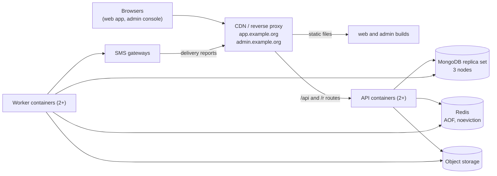
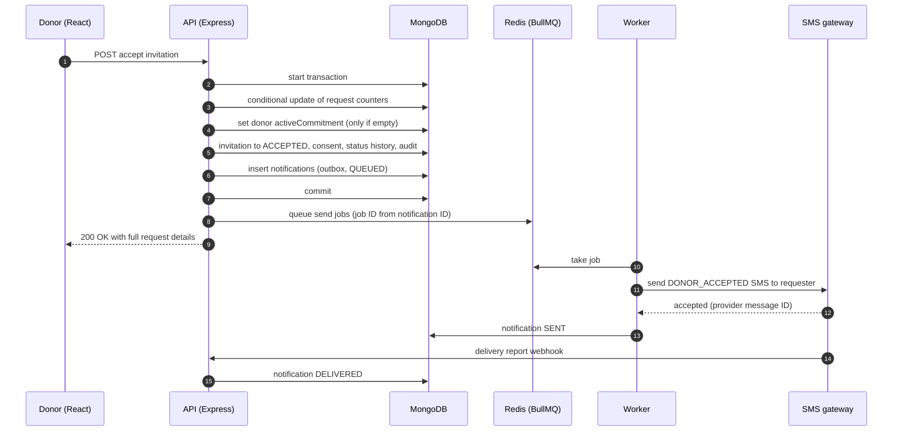
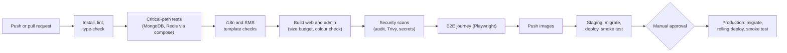

# Technical Design Document (TDD)

## Blood Donor Management System (BDMS) — MERN implementation

| Item | Detail |
|---|---|
| Document | Technical Design Document (TDD) |
| Stack | MERN — MongoDB, Express.js, React, Node.js (TypeScript) |
| Version | 1.1 — Draft for review |
| Date | 14 November 2026 |
| Owner | [Technical Lead] |
| Status | Draft |
| Related documents | [BRD](01-BRD.md) · [PRD](02-PRD.md) · [SRS](03-SRS.md) (v1.1) |

### Revision history

| Version | Date | Author | Changes |
|---|---|---|---|
| 1.0 | 14 Nov 2026 | [Author] | First MERN implementation design for SRS v1.1 |
| 1.1 | 14 Nov 2026 | [Author] | Aligned with AGENTS.md: dependency shortlist awaiting approval (§2), standard library first, CSFLE for phone numbers (§6.5), critical-path testing (§11), every environment variable documented (§9.2); roadmap moved to the build plan (§13) |

---

## Table of contents

1. [Purpose and scope](#1-purpose-and-scope)
2. [Technology stack](#2-technology-stack)
3. [Architecture and deployment](#3-architecture-and-deployment)
4. [Repository structure](#4-repository-structure)
5. [Backend design (Node.js and Express)](#5-backend-design-nodejs-and-express)
6. [Data layer (MongoDB and Mongoose)](#6-data-layer-mongodb-and-mongoose)
7. [Frontend design (React)](#7-frontend-design-react)
8. [Security implementation](#8-security-implementation)
9. [Environments and configuration](#9-environments-and-configuration)
10. [CI/CD and release](#10-cicd-and-release)
11. [Testing strategy](#11-testing-strategy)
12. [Operations](#12-operations)
13. [Implementation roadmap](#13-implementation-roadmap)
14. [Coding conventions](#14-coding-conventions)
15. [MERN-specific risks](#15-mern-specific-risks)

---

## 1. Purpose and scope

This document explains how the BDMS MVP is built with the **MERN stack** — MongoDB, Express.js, React and Node.js — in TypeScript. The [SRS](03-SRS.md) defines *what* the system must do; this document defines *how*. If the two disagree, the SRS wins and this document is corrected.

The packages in §2 are a shortlist awaiting your approval (gate G-1 in the [build plan](05-BUILD-PLAN.md)). After approval, any change of package follows the AGENTS.md shortlist-and-ask process and is recorded in the ADR table (§1.1).

### 1.1 Key decisions

| ADR | Decision | Reason |
|---|---|---|
| ADR-001 | MERN stack, TypeScript everywhere | One language end to end; Zod schemas shared by React forms and Express validation; widely available skills; open source |
| ADR-002 | Modular monolith deployed as two services (API and worker) | Simple to run for a small team; background jobs scale independently of the API |
| ADR-003 | MongoDB replica set with multi-document transactions | Atomic acceptance and donation updates (SRS DC-04, §4.6) |
| ADR-004 | Donor profile embedded in `users` | Matching filters on user and profile fields in one indexed query |
| ADR-005 | BullMQ on Redis for jobs and schedules | Retries, SMS rate limiting, cron schedules with time zones, single execution |
| ADR-006 | Transactional outbox for notifications | No lost notifications (SRS NFR-AVL-02) |
| ADR-007 | Two Vite + React SPAs: `web` and `admin` | Small bundle for donors and requesters; admin console on its own host |
| ADR-008 | Tailwind CSS with a locked palette: red, black, white | The visual identity (SRS UI-13) is enforced in code |
| ADR-009 | Server-rendered meta tags for share pages only | Social-media link previews without full server-side rendering |
| ADR-010 | Approved dependency set and versions — *pending gate G-1* | AGENTS.md: nothing is installed before the shortlist is verified on the registry and approved (§2) |
| ADR-011 | Standard library first: `node:test`, `fetch`, `--env-file`, `--watch`, type stripping | Fewer dependencies to maintain, audit and update (AGENTS.md) |
| ADR-012 | Phone numbers encrypted with MongoDB Client-Side Field Level Encryption | Field-level encryption without custom cipher code (SRS NFR-SEC-04, AGENTS.md) |

---

## 2. Technology stack

The core stack is fixed by SRS DC-09: MongoDB, Express, React and Node.js, in TypeScript. This section is the **dependency shortlist** required by [AGENTS.md](../AGENTS.md). For every need, the standard library comes first (§2.1), then the project's own code. A package is proposed only when both come up empty. For each package need, there is a recommended package and one alternative, compared on maintenance, security, adoption, size and fit.

> **Status: awaiting approval (gate G-1, build plan task S0-01).** The comparisons reflect knowledge at drafting time; the npm registry could not be reached from the drafting environment. Before approval, every recommended package must be checked as described in §2.6. Approval allows installing exactly the approved packages at the verified versions; any other package goes through the AGENTS.md shortlist-and-ask process.

### 2.1 Covered by the standard library or the platform (no package)

| Need | Use | Instead of |
|---|---|---|
| Loading `.env` files | `node --env-file` | dotenv |
| Restart on change (development) | `node --watch` | nodemon |
| Running TypeScript in development | Node.js type stripping (erasable syntax only, §14); `tsc` builds for production | tsx, ts-node |
| Random IDs, tokens, OTP codes, HMAC | `node:crypto` (`randomUUID`, `randomBytes`, `randomInt`, `createHmac`, `timingSafeEqual`) | uuid, nanoid, OTP libraries |
| Test runner (domain and integration) | `node:test` and `node:assert` | Jest, Vitest |
| HTTP calls in tests and SMS adapters | Global `fetch` | supertest, axios |
| Bundle-size budget check | `node:zlib` (gzip the built chunks) | size-limit |
| Number, date and plural formatting | `Intl` (`NumberFormat`, `DateTimeFormat`, `PluralRules`) | numeral, moment |
| Bangladeshi phone-number check | One regular expression for the single national format (SRS FR-AUTH-02) | libphonenumber-js |
| CSS modules, asset hashing | Vite built-ins | — |

### 2.2 Backend packages

| Need | Recommended | Alternative | Comparison (maintenance · security · adoption · size · fit) | Why the recommendation |
|---|---|---|---|---|
| HTTP framework | `express` 5 — the E in MERN | — | Fixed by DC-09 | — |
| MongoDB access | `mongoose` — schema-based ODM on the official driver | `mongodb` — the official driver alone | Both actively maintained · both mature · Mongoose more common in MERN teams · the driver alone is lighter · Mongoose adds schemas, defaults, enums and `sanitizeFilter` | Schema defaults and enum checks catch bugs early; familiar to MERN developers |
| Field-level encryption | `mongodb-client-encryption` — official bindings for Client-Side Field Level Encryption | No field encryption (encryption at rest only) | Official, released with the driver · proven cryptography, no custom cipher code · adds a native binary | Meets NFR-SEC-04 without hand-rolling crypto |
| Validation, shared schemas | `zod` — TypeScript-first schema validation | `valibot` — modular, much smaller bundle | Both active · Zod far more widely adopted · Valibot smaller · Zod has resolvers and OpenAPI tooling | One schema for React forms, Express validation and the API docs |
| Jobs, queues, schedules | `bullmq` — Redis-based queue | `agenda` — MongoDB-backed scheduler | BullMQ active and widely used · Agenda's maintenance has been uneven · BullMQ needs Redis · BullMQ has rate limiting and time-zone job schedulers | Meets SMS rate limits and single-execution schedules (NFR-AVL-04) |
| Redis client | `ioredis` | `redis` (official node-redis) | Both maintained · BullMQ already uses ioredis | One Redis client for queues, rate limits and cache |
| Rate limiting | `rate-limiter-flexible` | `express-rate-limit` + `rate-limit-redis` | Both maintained · one package with a Redis store and any key (phone, IP) | Per-phone and per-IP OTP limits in one place |
| JWT | `jose` — standards-based JOSE, no dependencies | `jsonwebtoken` | jose actively maintained, zero dependencies, ES256 · jsonwebtoken older API, more dependencies | Small, modern and standards-focused |
| Admin password hashing | `argon2` — Argon2id bindings | `bcrypt` | Both maintained · Argon2id is OWASP's first choice · both ship prebuilt binaries | OWASP-preferred algorithm. Check first whether the chosen Node.js release provides a stable `crypto.argon2`; if it does, use that instead (standard library first) |
| Security headers | `helmet` | — | Maintained, tiny, widely used | Correct defaults for CSP, HSTS and the rest |
| Cookies | `cookie-parser` (Express project) | — | Maintained by the Express project; tiny | Express does not parse cookies by itself |
| CSRF | `csrf-csrf` — double-submit tokens | SameSite cookies plus a required custom header (no package) | csrf-csrf maintained, small · the header-only approach has no dependency but less defence in depth · `csurf` is deprecated | Defence in depth for cookie-authenticated writes (API-02) |
| Logging | `pino`, `pino-http` | `winston` | Both maintained · pino faster, JSON-first, built-in redaction | Structured logs with PII redaction (NFR-OBS-01, FR-PRV-06) |
| Error tracking | `@sentry/node`, `@sentry/react` | Self-hosted GlitchTip (uses the same SDKs) | SDKs maintained by Sentry · the hosting choice is separate | Industry standard; can point to a self-hosted backend |
| Metrics | `prom-client` | OpenTelemetry SDK | prom-client small and stable · OpenTelemetry broader but heavier | Plain Prometheus metrics are enough for the MVP |
| Time zones | `date-fns`, `date-fns-tz` | `luxon` | Both maintained · date-fns tree-shakes and uses native `Date` · Luxon brings its own date type | Small pure functions; Asia/Dhaka calculations |
| Migrations | `migrate-mongo` | — | Maintained, small, the common MongoDB choice | No hand-written migration runner |
| Object storage | `@aws-sdk/client-s3`, `@aws-sdk/s3-request-presigner`, `@aws-sdk/lib-storage` | `minio` client | AWS SDK v3 maintained by AWS, modular · works with any S3-compatible store | Presigned URLs and streamed uploads; provider-neutral |
| File uploads | `multer` (Express project) | `busboy` (lower level) | multer maintained by the Express project · busboy is what multer uses | Size and count limits with little code |
| File-type detection | `file-type` — magic-byte detection | `mmmagic` (libmagic binding) | file-type maintained, pure JavaScript · mmmagic needs a native library | Magic-byte checks without native dependencies (FR-REQ-19) |
| Image re-encoding | `sharp` | `jimp` | sharp maintained, fast (libvips), strips metadata · jimp pure JavaScript but slow | Safe re-encoding that removes EXIF data |
| Virus scanning (Should) | `clamscan` — ClamAV client | Managed malware scanning from the storage provider | clamscan needs a ClamAV daemon · managed scanning depends on hosting (G-3) | Decide together with G-3; only needed if attachment scanning stays in scope |
| CSV | `csv-stringify` (exports), `csv-parse` (imports) — the `csv` project | `fast-csv`, `papaparse` | All maintained · the csv project streams both ways and supports a BOM | Streaming exports with BOM (FR-RPT-03) and imports (FR-ADM-07) |
| Web push (Should) | `web-push` | — | Maintained; the common choice | VAPID push (FR-NTF-12) |
| API documentation | `@asteasolutions/zod-to-openapi` | Hand-written OpenAPI file | Maintained · a generated spec cannot drift from the Zod schemas | Keeps the API docs true (API-01; AGENTS.md Docs) |

### 2.3 Frontend packages

| Need | Recommended | Alternative | Comparison (maintenance · security · adoption · size · fit) | Why the recommendation |
|---|---|---|---|---|
| UI library | `react`, `react-dom` — the R in MERN | — | Fixed by DC-09 | — |
| Build tool | `vite`, `@vitejs/plugin-react` | — | Maintained; the standard for React SPAs (ADR-007) | Fast builds, small output |
| Routing | `react-router` | `@tanstack/react-router` | Both maintained · React Router far more widely adopted · TanStack Router has stronger type safety | Familiar; its data APIs are sufficient |
| Server state | `@tanstack/react-query` | `swr` | Both maintained · TanStack Query has richer mutations, retries and polling control | Polling, retries and cache invalidation in one place |
| Forms | `react-hook-form`, `@hookform/resolvers` | Plain React state with Zod (no package) | RHF maintained, small, uncontrolled inputs · plain state needs more code | Fast on low-end phones; reuses the shared Zod schemas |
| Styling | `tailwindcss` v4, `@tailwindcss/vite` | CSS Modules (built into Vite) | Tailwind maintained, widely adopted · CSS Modules need no package | The locked palette is enforced by removing Tailwind's default colours (§7.2) |
| Accessible primitives | Radix UI primitives (`@radix-ui/react-*`, only those used) | `react-aria-components` | Both maintained · Radix packages are small per component · React Aria has wider accessibility and i18n coverage | Small, focused components with good focus management |
| i18n | `i18next`, `react-i18next`, `i18next-icu` (+ `intl-messageformat`) | `react-intl` (FormatJS) | Both maintained · i18next more widely adopted, and the same core runs on the server | One set of templates for UI and SMS (FR-NTF-04) |
| PWA | `vite-plugin-pwa` | `workbox-build` directly | Maintained; wraps Workbox for Vite | Manifest and service worker with little configuration |
| Charts (admin) | `recharts` | `chart.js`, `react-chartjs-2` | Both maintained · Recharts is React-native SVG | Simple dashboard charts in palette colours |
| Fonts | `@fontsource/noto-sans`, `@fontsource/noto-sans-bengali` | Font files copied into the repository | Fontsource maintained · copied files need no package | Ready subsets and CSS; final family depends on G-2 |

### 2.4 Tooling

| Need | Recommended | Alternative | Comparison (maintenance · security · adoption · size · fit) | Why the recommendation |
|---|---|---|---|---|
| Language | `typescript` | — | DC-09 | — |
| Formatter and linter | `@biomejs/biome` — one tool for both | `eslint`, `typescript-eslint`, `prettier` (+ React and accessibility plugins) | Both maintained · Biome is one fast dependency with built-in React and accessibility rules · ESLint has the larger plugin ecosystem | Fewer dependencies and one configuration for the AGENTS.md finishing checks |
| End-to-end tests | `@playwright/test` | `cypress` | Both maintained · Playwright covers WebKit, mobile emulation and network throttling | The critical journey on a mobile viewport (§11) |
| Load testing | k6 (command-line tool) | Artillery (npm) | k6 maintained by Grafana; not an npm dependency | Load test with 200,000 donors (NFR-PERF) |
| Package manager | pnpm (workspaces) | npm workspaces | pnpm faster, strict dependency isolation | Monorepo (§4) |

### 2.5 Deferred — no consumer in the MVP

| Package | Why it is not included |
|---|---|
| Socket.IO | Polling every 15 seconds meets NFR-PERF-03; revisit if real-time updates become a requirement |
| Test-data libraries (e.g., faker) | A small generator with fixed name lists is enough for the load-test dataset |
| Automated accessibility and Lighthouse CI packages | Manual audits before each milestone (§7.8, §7.9) |
| Coverage tools | No coverage target (SRS NFR-MNT-02) |

### 2.6 Registry verification (gate G-1)

Run this on a machine with internet access, for every recommended package:

```bash
npm view <package> name version deprecated license repository.url time.modified maintainers --json
```

Approve a package only if all of these hold:

- the name and publisher match the project's official repository;
- the version is the latest stable release and is not deprecated;
- the repository is not archived and has recent releases;
- the version has no unpatched advisories (GitHub Advisory Database or osv.dev).

Record the approved packages and versions in ADR-010 (§1.1).

## 3. Architecture and deployment

### 3.1 Logical architecture

See [SRS §2.8](03-SRS.md#28-reference-architecture-mern). The API service handles HTTP requests. The worker service runs matching waves, sends SMS and push messages, builds exports and runs the scheduled jobs. Both services import the same business modules from `packages/core`, so each rule is written once, whether it runs during a request or in a job.

### 3.2 Deployment topology



| Component | Pilot sizing (indicative) |
|---|---|
| API service | 2 containers × 1 vCPU / 1 GB RAM, autoscaling on CPU and latency |
| Worker service | 2 containers × 1 vCPU / 1 GB RAM |
| MongoDB | Atlas M10 (3 nodes), or 3 VMs with 2 vCPU / 4 GB; region per OD-05 |
| Redis | Managed, 1 GB, AOF persistence, `maxmemory-policy noeviction` |
| Object storage | Private buckets with server-side encryption and lifecycle rules |

### 3.3 Hosts and routing

| Host | Path | Routed to | Notes |
|---|---|---|---|
| app.example.org | `/`, `/assets/*` | `web` static build | Long cache for hashed assets |
| app.example.org | `/api/*` | API service | Token audience `app` |
| app.example.org | `/r/*` | API service | Share-page shell with Open Graph tags (SRS FR-REQ-17) |
| app.example.org | `/i/*` | `web` static build | `Referrer-Policy: no-referrer`, `noindex` |
| admin.example.org | `/`, `/assets/*` | `admin` static build | Optional IP allow-list at the proxy |
| admin.example.org | `/api/*` | API service | Token audience `admin`; admin routes only |

Serving each SPA and its API from the same host keeps cookies first-party and avoids CORS. The cookies are host-only (`__Host-` prefix), so admin and user sessions are isolated from each other.

### 3.4 Example flow — accepting an invitation



---

## 4. Repository structure

```text
bdms/
├── apps/
│   ├── api/                  # Express 5 HTTP layer
│   │   └── src/
│   │       ├── app.ts        # middleware pipeline (§5.2)
│   │       ├── server.ts
│   │       ├── middleware/   # auth, rbac, csrf, rate limits, validate, errors, request ID
│   │       └── routes/       # one router per module, mounted under /api/v1
│   ├── worker/               # BullMQ processors and job schedulers (src/worker.ts)
│   ├── web/                  # React PWA for donors and requesters (Vite)
│   └── admin/                # React admin console (Vite)
├── packages/
│   ├── core/                 # business logic used by api and worker
│   │   └── src/
│   │       ├── db/           # connection, models, transactions
│   │       ├── modules/      # auth, donors, search, requests, verification, matching,
│   │       │                 # invitations, donations, notifications, admin, reports,
│   │       │                 # safety, privacy, settings, audit  (= SRS §3 areas)
│   │       └── lib/          # crypto, phone, dates (Asia/Dhaka), errors, logger, queues
│   ├── domain/               # pure functions: eligibility, ranking, wave size,
│   │                         # status derivation, transition rules (no I/O)
│   ├── shared/               # Zod schemas, enums, error codes, permissions, i18n resources
│   ├── ui/                   # React components, design tokens, theme.css (§7.2)
│   └── config/               # shared tsconfig and formatter/linter presets
├── migrations/               # migrate-mongo scripts: indexes, validators, seeds
├── infra/                    # Dockerfiles, docker-compose, infrastructure as code
└── .github/workflows/        # CI/CD pipelines
```

Import rules (enforced by the linter's restricted-import rules):

- `domain` imports nothing internal.
- `shared` imports only `domain` types.
- `core` may import `domain` and `shared`.
- Apps import packages, never each other.

---

## 5. Backend design (Node.js and Express)

### 5.1 Layers

| Layer | Responsibility | Example |
|---|---|---|
| Route | Path, method and middleware chain (`validate`, `requireRole`, rate limit) | `POST /requests` |
| Controller | Maps HTTP to service calls and picks the response serializer | `createRequestController` |
| Service | Business rules, transactions, audit, outbox | `requests.create()` |
| Model | Mongoose schema definitions | `BloodRequest` |
| Domain | Pure, unit-tested functions | `deriveRequestStatus()`, `nextEligibleDate()` |

Controllers never touch models directly. Services throw `DomainError` with an SRS §11 code. Response serializers decide which fields each viewer may see (SRS API-09).

### 5.2 Middleware pipeline

```ts
// apps/api/src/app.ts (excerpt)
const app = express();
app.set('trust proxy', 1);              // real client IPs behind the proxy (rate limits, audit)
app.disable('x-powered-by');
app.use(requestId());                   // X-Request-Id → correlation ID in logs and jobs
app.use(httpLogger);                    // pino-http with PII redaction (§5.13)
app.use(helmet(helmetOptions));         // CSP, HSTS, frame-ancestors, referrer policy
app.use(express.json({ limit: '100kb' }));
app.use(cookieParser());
app.use(globalRateLimit);               // coarse per-IP limit (rate-limiter-flexible, Redis)
app.use(authenticate);                  // verifies the __Host- access cookie; sets req.user
app.use(csrfProtection);                // double-submit token for cookie-authenticated writes
app.use('/api/v1', apiRouter);          // per route: validate(schema) → requireRole → controller
app.get('/r/:slug', sharePageHandler);  // server-rendered Open Graph tags (§7.10)
app.use(notFound);
app.use(errorHandler);                  // DomainError → SRS §11 code; ZodError → VALIDATION_ERROR
```

The CSRF check is skipped for two kinds of request:

- SMS webhooks, which are authenticated by a shared secret and an IP allow-list.
- Invitation-token requests, which use the `X-Invitation-Token` header and carry no cookies.

### 5.3 Authentication

| Concern | Implementation |
|---|---|
| OTP request | Normalise the number to E.164 and compute `phoneHash = HMAC-SHA-256(PHONE_HASH_KEY, e164)`. Check the block list and rate limits. Generate the code with `crypto.randomInt(0, 1_000_000)`, padded to 6 digits. Store `HMAC(OTP_HMAC_KEY, phoneHash:code)` in `otp_challenges` and queue the SMS on the critical queue. |
| OTP verification | Take the latest unconsumed challenge and compare with `crypto.timingSafeEqual`, counting attempts. On success, consume it and find or create the user. |
| Access token | JWT signed with `jose` (ES256), valid 15 minutes; claims `sub`, `role`, `sid`, `aud` (`app` or `admin`) |
| Refresh token | 32 random bytes (base64url). The SHA-256 hash is stored in `sessions` with a `familyId`. The token is rotated on every refresh; reusing an old token revokes the whole family. |
| Cookies | `__Host-bdms_at` / `__Host-bdms_rt` on the app host; `__Host-bdms_adm_at` / `__Host-bdms_adm_rt` on the admin host; all `HttpOnly; Secure; SameSite=Lax; Path=/` |
| Admin second factor | After the OTP, `POST /auth/admin/password` checks the Argon2id hash. Lockout counters are kept in `users.admin`. |
| Admin isolation | Admin routes require an `aud: admin` token and the admin host; app tokens are rejected there |
| Invitation token | The `X-Invitation-Token` value is SHA-256-hashed and matched against `invitations.tokenHash`. It grants a scope accepted only by the allowed invitation routes. |

### 5.4 Authorization

- `requireRole('ADMIN')` and `requireRole('SUPER_ADMIN')` guard admin routes.
- Services check ownership, for example `assertCanViewRequest(viewer, request)`, which allows the owner, an admin, or an invited donor (with limited fields).
- One response serializer per viewer type implements the field rules in SRS FR-INV-01, FR-SRC-04 and FR-REQ-17.
- The permissions matrix (SRS §2.4) lives in `packages/shared/permissions.ts` and is unit-tested. The UI uses it to show or hide actions; the server always checks again.

### 5.5 Validation and errors

- Request bodies, query strings and route parameters are parsed with the Zod schemas from `packages/shared`. The React forms use the same schemas.
- `DomainError(code, status, details)` uses the SRS §11 codes. The error handler returns the SRS API-03 format, with the message localised from the shared i18n resources in the user's language.
- Express 5 forwards rejected promises from async handlers to the error handler, so no wrapper is needed.

### 5.6 Transactions and concurrency

```ts
// packages/core/src/db/tx.ts
export function withTransaction<T>(fn: (session: ClientSession) => Promise<T>): Promise<T> {
  // Mongoose retries fn on TransientTransactionError and UnknownTransactionCommitResult
  return mongoose.connection.transaction(fn, {
    readConcern: { level: 'snapshot' },
    writeConcern: { w: 'majority' },
  });
}
```

Rules (from SRS §4.6):

1. Any change to a request's invitations or donations also writes the request document in the same transaction.
2. Acceptance uses conditional updates on the request and on the donor's `activeCommitment` (code in SRS §4.6).
3. Notifications and audit records are inserted in the same transaction. The audit database is on the same replica set, and MongoDB transactions can span databases.
4. Transactions stay short (under 1 second), with no SMS, storage or other network calls inside them.
5. Daily request codes come from an atomic counter: `counters.findOneAndUpdate({ _id: 'RQ-261114' }, { $inc: { seq: 1 } }, { upsert: true, returnDocument: 'after' })`.

### 5.7 Matching engine

`packages/core/src/modules/matching/engine.ts` implements `dispatchWave` (SRS §4.3–4.4):

```ts
export async function dispatchWave(requestId: Types.ObjectId, workerId: string): Promise<void> {
  const request = await acquireLease(requestId, workerId);   // conditional update on leaseUntil
  if (!request) return;                                       // another worker holds the lease
  try {
    const plan = planWave(request, new Date());               // pure (domain): need, size, quiet hours
    if (plan.kind !== 'DISPATCH') return await applyPlan(request, plan);
    const selected = await selectCandidates(request, plan);   // stage 1 query + stage 2 exclusions, tier loop
    const outbox = await withTransaction(async (session) => {
      await Invitation.insertMany(buildInvitations(request, selected), { session });
      await BloodRequest.updateOne({ _id: request._id }, waveUpdate(request, plan), { session });
      return insertOutbox(session, selected.map((d) => invitationNotification(request, d)));
    });
    await queueNotifications(outbox);                         // after commit
  } finally {
    await releaseLease(requestId, workerId);
  }
}
```

- Matching jobs use the job ID `match-{requestId}`, so each request has at most one queued job. Triggers set `nextWaveAt` to now first, so the per-minute dispatcher catches anything that arrives while a job is running.
- If a concurrent manual invitation causes a duplicate-key error, the transaction aborts and the selection runs once more.

### 5.8 Background jobs

**Queues**

| Queue | Produced by | Work | Concurrency | Retries / limits |
|---|---|---|---|---|
| `matching` | API triggers (MT-1, 3, 4, 5), wave dispatcher | `dispatchWave` | 5 | 3 attempts, exponential backoff |
| `sms-critical` | Outbox (OTP and CRITICAL events) | Send SMS | 10 | 4 attempts (after 30 s, 2 min, 10 min); about 5 SMS/s reserved |
| `sms` | Outbox (NORMAL events) | Send SMS | 10 | Same retries; about 15 SMS/s |
| `push` | Outbox | Web push | 10 | 3 attempts |
| `exports` | Admin API | Stream CSV to storage | 2 | 2 attempts |
| `imports` | Admin API | Validate rows, create profiles | 1 | No retry; errors go to the import report |
| `eligibility` | Interval-rule changes | Recalculate stored eligibility dates in batches | 1 | Resumes from a checkpoint |
| `scheduled` | Job schedulers | Jobs in the next table | 2 | — |

OTPs and critical alerts have their own queue, so a large invitation wave never delays a login code. The provider's throughput (SRS NFR-CAP-01: 20 SMS/s) is split between the two SMS queues.

**Job schedulers**: `queue.upsertJobScheduler(id, { pattern, tz: 'Asia/Dhaka' }, template)`

| Job (SRS §4.7) | Cron pattern |
|---|---|
| wave-dispatcher, invitation-expiry, verification-escalation, review-lock-cleanup, outbox-sweeper, unverified-auto-publish (only if enabled) | `* * * * *` |
| request-expiry, accepted-donor-reminder | `*/5 * * * *` |
| request-expiry-warning, outcome-followup | `*/15 * * * *` |
| donation-confirmation-escalation | `0 * * * *` |
| availability-restore | `5 0 * * *` |
| age-out | `0 1 * * *` |
| eligibility-recompute (safety pass) | `0 2 * * *` |
| counter-reconciliation | `15 2 * * *` |
| rank-salt-refresh | `30 2 * * *` |
| retention | `0 3 * * *` |
| consent-link-expiry | `0 4 * * *` |
| quiet-hours-release | At the configured end of quiet hours (default `0 7 * * *`) |
| deferral-check | `0 9 * * *` |
| eligibility-reminder | `0 10 * * *` (configurable) |
| profile-review | `0 11 * * *` |

When a schedule-related setting changes (quiet hours, reminder time), the scheduler is updated with `upsertJobScheduler`. The SRS sms-budget-reset job needs no scheduler: segment counters are keyed by date (`sms:segments:2026-11-14`) with a 48-hour expiry, so they effectively reset each day.

### 5.9 Notifications

1. The business transaction inserts notification documents with status QUEUED (the outbox).
2. After commit, the service queues one job per notification (job ID `n-{notificationId}`). The outbox sweeper re-queues QUEUED notifications older than 1 minute.
3. The processor reloads the notification and checks quiet hours, preferences and the SMS budget. If it must not be sent now, it is marked SCHEDULED or SUPPRESSED.
4. The text is rendered from the shared i18n resources (ICU syntax) in the user's language, and the encoding (GSM-7 or UCS-2) and segment count are calculated.
5. The SMS adapter sends the message, and the status becomes SENT with the provider message ID. Temporary errors are retried; permanent errors mark it FAILED.
6. Delivery reports arrive at `/api/v1/webhooks/sms/:provider` and update the status idempotently.

```json
// packages/shared/i18n/bn/sms.json (excerpt, ICU syntax)
{
  "INVITATION_NEW_EMERGENCY": "জরুরি: {hospitalShort}-এ {bg} রক্ত দরকার ({units} ব্যাগ), {time}-এর মধ্যে। দিতে পারবেন? {link}"
}
```

- **SMS adapters:**
  - `ConsoleSmsProvider` for development and tests (logs and stores messages).
  - One adapter per contracted gateway, chosen by the `sms.primary_provider` and `sms.secondary_provider` settings.
- **SMS budget:** Redis `INCRBY sms:segments:{date}`; the 80% and 100% alerts are sent once per day (guarded by a `SET NX` flag).
- **Template check in CI:** every SMS template is rendered with maximum-length sample values. The build fails if an English template exceeds 1 segment or a Bangla template exceeds 2.
- **Web push:** `webpush.sendNotification(subscription, payload, { TTL: 3600 })`; an HTTP 404 or 410 response revokes the subscription.
- **In-app:** IN_APP documents are read through `/me/notifications`; the app polls every 15 seconds while it is visible (SRS NFR-PERF-03).

### 5.10 Files and exports

- **Uploads:**
  1. `multer.memoryStorage()` with limits (5 MB, 2 files).
  2. `file-type` magic-byte check.
  3. Images re-encoded with `sharp`, which strips metadata.
  4. ClamAV scan.
  5. `PutObject` to a private bucket, and metadata appended to `attachments`.

  Admins get 5-minute presigned URLs after an audit record is written.
- **Exports:** the worker streams a lean Mongoose cursor through a formatting transform into `csv-stringify` (with `bom: true`), and uploads the stream with `@aws-sdk/lib-storage`:

```ts
const rows = Donation.find(filter).lean().cursor()
  .pipe(new Transform({ objectMode: true, transform(doc, _enc, cb) { cb(null, toCsvRow(doc)); } }));
const csv = rows.pipe(stringify({ header: true, columns: DONATION_COLUMNS, bom: true }));
await new Upload({ client: s3, params: { Bucket: EXPORT_BUCKET, Key: key, Body: csv } }).done();

// formula-injection guard used by toCsvRow (SRS FR-RPT-04)
const guard = (v: string) => (/^[=+\-@\t\r]/.test(v) ? `'${v}` : v);
```

### 5.11 Settings and feature flags

- `settings` documents hold the SRS §8 parameters. Each key has a Zod schema (type, minimum, maximum) and a medical flag.
- Every instance caches the settings in memory. A change publishes `settings:changed` on Redis pub/sub, and all instances reload within a second (the SRS limit is 60 s).
- Side effects of a change:
  - Schedule changes update the job schedulers.
  - Changes to TTL-backed retention run `collMod` on the index.

### 5.12 Audit logging

`audit.record({ actor, action, entity, before, after, reason }, session)` writes to `bdms_audit.audit_logs` inside the business transaction. It stores only the changed fields and masks phone numbers.

```js
// run once by a database administrator (on Atlas: a custom database role)
db.getSiblingDB('bdms_audit').createRole({
  role: 'auditAppendOnly',
  privileges: [{ resource: { db: 'bdms_audit', collection: 'audit_logs' }, actions: ['find', 'insert'] }],
  roles: [],
});
// application user: readWrite on bdms + auditAppendOnly on bdms_audit
```

### 5.13 Observability

```ts
export const logger = pino({
  level: env.LOG_LEVEL,
  redact: {
    paths: ['req.headers.cookie', 'req.headers["x-invitation-token"]', '*.phone', '*.otp',
            '*.code', '*.token', '*.patientName', '*.notes'],
    censor: '[redacted]',
  },
});
```

- The correlation ID travels from the HTTP request into job data and every log line.
- Metrics (`prom-client`):
  - HTTP latency histogram;
  - queue depth and age of the oldest job;
  - SMS sent, failed and suppressed;
  - wave duration;
  - transaction retries.
- Health endpoints: `/healthz` (process alive) and `/readyz` (MongoDB and Redis reachable).
- Sentry for Node.js and React, with a `beforeSend` filter that removes PII.

---

## 6. Data layer (MongoDB and Mongoose)

### 6.1 Collections

Collections, fields, indexes and retention rules are specified in [SRS §5](03-SRS.md#5-data-requirements). Modelling rules:

- Embed bounded data that is always read with its parent (donor profile, status history, attachments). Use separate collections for unbounded data (invitations, donations, notifications).
- Update derived fields (eligibility dates, counters, `activeCommitment`) in the same transaction as their source data.
- Omit optional fields instead of storing `null` (except `activeCommitment`), because the partial indexes depend on it.
- Use snake_case plural collection names, set explicitly in each model.

### 6.2 Mongoose model example

```ts
// packages/core/src/db/models/user.ts (abbreviated)
const Commitment = new Schema(
  { requestId: Schema.Types.ObjectId, invitationId: Schema.Types.ObjectId, since: Date },
  { _id: false },
);

const DonorProfile = new Schema({
  publicId: { type: String, required: true },
  dateOfBirth: { type: Date, required: true },                 // date-only (UTC midnight)
  sex: { type: String, enum: SEX, required: true },
  bloodGroup: { type: String, enum: BLOOD_GROUPS, required: true },
  location: {
    divisionId: { type: String, required: true },
    districtId: { type: String, required: true },
    upazilaId: { type: String, required: true },
  },
  availability: { type: String, enum: AVAILABILITY, default: 'AVAILABLE' },
  availabilityUntil: Date,
  profileStatus: { type: String, enum: PROFILE_STATUS, default: 'DRAFT' },
  receiveRequestsConsent: { type: Boolean, default: false },
  contactSharePref: { type: String, enum: CONTACT_SHARE, default: 'ASK_EACH_TIME' },
  invitationSms: { type: String, enum: INVITATION_SMS, default: 'ALL' },
  nightEmergencyAlerts: { type: Boolean, default: true },
  eligibilityReminders: { type: Boolean, default: true },
  apheresisWilling: { type: Boolean, default: false },
  lastDonationDate: Date,
  nextEligibleWbDate: { type: Date, default: EPOCH },          // 1970-01-01 = eligible now
  nextEligibleAphDate: { type: Date, default: EPOCH },
  confirmedDonationCount: { type: Number, default: 0 },
  activeCommitment: { type: Commitment, default: null },
  rankSalt: { type: Number, default: () => Math.random() },
  profileConfirmedAt: { type: Date, default: Date.now },
}, { _id: false, timestamps: true });

const UserSchema = new Schema({
  phoneEnc: { type: Buffer, subtype: 6 },                    // CSFLE ciphertext (§6.5)
  phoneHash: String,
  fullName: { type: String, required: true, minlength: 2, maxlength: 100 },
  preferredLanguage: { type: String, enum: ['bn', 'en'], default: 'bn' },
  role: { type: String, enum: ROLES, default: 'USER' },
  status: { type: String, enum: USER_STATUS, default: 'ACTIVE' },
  isTrustedRequester: { type: Boolean, default: false },
  smsNonCritical: { type: Boolean, default: true },
  lastActiveAt: Date,
  donorProfile: { type: DonorProfile, default: undefined },
}, { collection: 'users', timestamps: true, strict: 'throw', autoIndex: false });

export const User = model('User', UserSchema);
```

### 6.3 Indexes as migrations

```js
// migrations/20261114120000-core-indexes.js (excerpt)
module.exports = {
  async up(db) {
    const activeDonor = {
      status: 'ACTIVE',
      'donorProfile.profileStatus': 'ACTIVE',
      'donorProfile.availability': 'AVAILABLE',
      'donorProfile.receiveRequestsConsent': true,
    };
    for (const level of ['upazilaId', 'districtId', 'divisionId']) {
      await db.collection('users').createIndex(
        { 'donorProfile.bloodGroup': 1, [`donorProfile.location.${level}`]: 1, 'donorProfile.lastDonationDate': 1 },
        { name: `match_${level}`, partialFilterExpression: activeDonor },
      );
    }
    await db.collection('invitations').createIndex({ requestId: 1, donorId: 1 }, { unique: true });
    await db.collection('donations').createIndex(
      { donorId: 1, requestId: 1 },
      { unique: true, partialFilterExpression: { notRejected: true, requestId: { $type: 'objectId' } } },
    );
    await db.collection('otp_challenges').createIndex({ createdAt: 1 }, { expireAfterSeconds: 2592000 });
  },
  async down() { /* indexes are only ever dropped deliberately, by hand */ },
};
```

- Migrations run in CI against a throwaway database, and as a release step before new code takes traffic. Changes are backward compatible (expand first, contract later).
- Key queries have tests that run `explain('executionStats')` on seeded data and fail if they cause a collection scan.

### 6.4 Dates and time zone

- Containers run with `TZ=UTC`, and server code never relies on local time.
- Date-only values are stored as UTC midnight of the Asia/Dhaka calendar date:

```ts
import { formatInTimeZone } from 'date-fns-tz';
export const DHAKA = 'Asia/Dhaka';
/** Today's Asia/Dhaka calendar date, in the form stored for date-only fields (SRS DC-03). */
export const todayDhaka = (now = new Date()) =>
  new Date(`${formatInTimeZone(now, DHAKA, 'yyyy-MM-dd')}T00:00:00.000Z`);
```

- The browser formats dates with `Intl.DateTimeFormat(lang === 'bn' ? 'bn-BD' : 'en-GB', { timeZone: 'Asia/Dhaka' })`, which gives Bangla month names and digits automatically.
- Tests cover midnight boundaries (23:59 and 00:01 in Dhaka).

### 6.5 Encryption and hashing

Phone numbers are encrypted with **MongoDB Client-Side Field Level Encryption (CSFLE), explicit encryption**, using the official `mongodb-client-encryption` library, so no cipher code is written by hand. Equality look-ups use an HMAC from the standard library.

```ts
// packages/core/src/lib/phone-crypto.ts
const encryption = new mongoose.mongo.ClientEncryption(mongoose.connection.getClient(), {
  keyVaultNamespace: env.CSFLE_KEY_VAULT_NAMESPACE,
  kmsProviders: kmsProvidersFromEnv(),
});

export const encryptPhone = (e164: string) =>
  encryption.encrypt(e164, { algorithm: 'AEAD_AES_256_CBC_HMAC_SHA_512-Random', keyAltName: 'phone' });

export const decryptPhone = (ciphertext: Buffer) =>
  encryption.decrypt(new mongoose.mongo.Binary(ciphertext, 6));

export const hashPhone = (e164: string) =>
  createHmac('sha256', env.PHONE_HASH_KEY).update(e164).digest('hex');
```

- **Data key:** created once per environment by a migration, with `encryption.createDataKey(provider, { keyAltNames: ['phone'] })`. The key vault gets a unique partial index on `keyAltNames`.
- **Master key:** in production, a cloud KMS where the hosting provider offers one (decided with G-3). Without a KMS, a 96-byte local master key is held in the secret manager. Development uses a local key.
- **Random encryption:** hides equal values, so look-ups use `phoneHash` instead. The HMAC key stays stable, because rotating it means re-hashing every number.
- **Decryption:** happens only where the plaintext is needed: sending SMS (worker) and showing a contact the viewer is allowed to see (SRS FR-INV-11, FR-SRC-11).

### 6.6 Query guidelines

- Use `.lean()` and projections for reads, and never load PII fields the caller cannot see.
- Use keyset pagination (`_id` or `createdAt`) for long admin lists.
- Dashboard aggregations read from secondaries (`readPreference: 'secondaryPreferred'`) and are cached in Redis for 5 minutes. Transactions always use the primary.
- Avoid `$lookup` on hot paths; matching and tracking queries are designed to need only one collection.

### 6.7 Seeds

`migrate-mongo` seed scripts load:

- locations, from the official geocode CSV;
- the pilot hospital list;
- interval rules (placeholders ⚕);
- settings defaults;
- demo users (non-production environments only).

---

## 7. Frontend design (React)

### 7.1 Applications

| App | Host | Users | Notes |
|---|---|---|---|
| `web` | app.example.org | Guests, requesters, donors | Bangla-first PWA; strict bundle budget; mobile-first |
| `admin` | admin.example.org | Admins, Super Admins | Desktop-first; data tables and charts |

Both apps share `packages/ui` (components and design tokens) and `packages/shared` (schemas, enums, i18n).

### 7.2 Design system

**Colours (final).** The palette from [PRD §10.6](02-PRD.md#106-visual-design-and-colour-palette) — red, black and white, plus greys and red tints — is the only set of colours available in code. Tailwind's default palette is removed completely:

```css
/* packages/ui/src/theme.css — Tailwind CSS v4 */
@import "tailwindcss";

@theme {
  --color-*: initial;          /* remove every default colour */
  --color-white: #FFFFFF;
  --color-black: #111111;
  --color-red-50: #FDECEE;
  --color-red-600: #C8102E;
  --color-red-700: #A00D24;
  --color-grey-50: #F5F5F5;
  --color-grey-200: #E6E6E6;
  --color-grey-500: #8C8C8C;
  --color-grey-700: #595959;
}
```

(With Tailwind v3, define `theme.colors` instead of `theme.extend.colors`.)

| Component | Example classes |
|---|---|
| Primary button | `bg-red-600 text-white active:bg-red-700` |
| Secondary button | `bg-white text-black border-2 border-black` |
| Destructive button (inside a confirmation dialog) | `bg-white text-red-600 border-2 border-red-600` |
| Input | `border border-grey-500 focus:border-black aria-[invalid=true]:border-red-600` |
| Focus ring (all controls) | `focus-visible:outline-2 focus-visible:outline-black focus-visible:outline-offset-2` |
| Emergency badge | `bg-red-600 text-white`, alarm icon, "EMERGENCY" |
| Emergency banner | `bg-red-50 text-black`, red alert icon |
| Status chip (outline) | `border border-black text-black`, icon and label |

- `packages/ui` exports `Button`, `Badge`, `StatusChip`, `Banner`, `Field` and other components that apply these rules. The mapping from status to style follows PRD §10.6.
- A CI check fails on colour literals (hex values, `rgb()`, arbitrary classes such as `bg-[#…]`) anywhere outside `theme.css` and `tokens.ts`.
- Charts (Recharts) take their colours from `packages/ui/tokens.ts`: black and greys, with red only for a highlighted critical value.
- The PWA uses theme colour `#C8102E` and background `#FFFFFF`. The icon is a white blood drop on red.

**Typography, shapes, spacing and motion (provisional).** These follow the design reference in [PRD §10.7](02-PRD.md#107-design-reference), which is still pending review. The tokens below are placeholders, to be replaced once the reference is captured. They live only in `theme.css`, so replacing them restyles every screen without component changes.

| Token | Provisional value | To be confirmed from the reference |
|---|---|---|
| `--font-sans` | "Noto Sans", "Noto Sans Bengali", system-ui, sans-serif | Typeface family and Bangla pairing |
| Type scale | 16 / 18 / 20 / 24 / 32 px; weights 400, 600, 700 | Heading and body sizes |
| `--radius` | 8 px (cards, inputs, buttons) | Corner style (sharp, rounded, pill) |
| Spacing | 4 px base scale | Section and card spacing |
| Shadows | None on mobile; one subtle level for cards | Depth style |
| Motion | 150–200 ms ease-out; disabled under `prefers-reduced-motion` | Transitions and hover effects |

### 7.3 Routes

**web**

| Path | Screen | Access |
|---|---|---|
| `/` | Landing | Public |
| `/login` | Phone and OTP | Public |
| `/onboarding` | Name, language, consents | New user |
| `/home` | Home dashboard | User |
| `/donor/setup` | Donor profile wizard | User |
| `/profile`, `/settings` | Profile and preferences | User |
| `/donations` | History; add a past donation | Donor |
| `/invitations`, `/invitations/:id` | Invitations | Donor |
| `/i/:token` | Invitation opened from the SMS link | Token |
| `/search` | Find donors | User |
| `/requests/new`, `/requests/:id/edit` | Request form | User |
| `/requests`, `/requests/:id` | My requests; tracking | User |
| `/notifications` | Inbox | User |
| `/r/:slug` | Shared request (meta tags injected by the server) | Public |
| `/eligibility`, `/faq`, `/privacy`, `/terms`, `/contact` | Content pages | Public |

**admin:** `/dashboard`, `/queues/:queue`, `/verification`, `/requests`, `/requests/:id`, `/donors`, `/donors/:id`, `/donations`, `/abuse-reports`, `/users/:id`, `/hospitals`, `/exports`, `/imports`, `/settings`, `/interval-rules`, `/locations`, `/admins`, `/audit`, `/sms-log`.

### 7.4 Data fetching and state

- TanStack Query holds all server state, with query keys such as `['me']`, `['request', id]` and `['invitations', filters]`. 4xx errors are not retried.
- The tracking, home and invitation pages and the notification badge refetch every 15 seconds while visible (SRS NFR-PERF-03: ≤ 30 s).
- Optimistic updates are used only for safe toggles such as availability. Acceptance always waits for the server.
- A fetch wrapper adds the CSRF token. On a 401 it runs one shared token refresh and retries; if the refresh fails, it redirects to login.
- Very little client-only state is needed; React context or Zustand is enough.

### 7.5 Forms

- React Hook Form with `zodResolver` and the shared schemas. Zod messages are mapped to i18n keys.
- The request form keeps a local draft that expires after 24 hours and is cleared when the request is submitted.
- The phone field normalises the accepted input formats. The OTP field uses the WebOTP API where available: `navigator.credentials.get({ otp: { transport: ['sms'] } })`.

### 7.6 Internationalisation and typography

- `i18next` namespaces: common, auth, donor, request, admin, errors, notifications. The `bn` and `en` resources live in `packages/shared/i18n`; the server also uses them for SMS and error messages.
- Language is chosen in this order: saved preference, then browser language, then Bangla. `<html lang>` follows the active language.
- Fonts are self-hosted with `@fontsource`, subsetted, with `font-display: swap`. The family is final once the design reference is captured (§7.2).
- In Bangla, numbers are shown with `Intl.NumberFormat('bn-BD')`. A `formatCode()` helper keeps OTPs, phone numbers, request codes and links in ASCII digits (SRS FR-NTF-04).
- CI fails if a key is missing in either language (SRS NFR-L10N-01).

### 7.7 PWA and push

```ts
// apps/web/vite.config.ts (excerpt)
VitePWA({
  registerType: 'prompt',
  manifest: {
    name: 'BDMS – Blood Donor Network',
    short_name: 'BDMS',
    lang: 'bn',
    start_url: '/home',
    display: 'standalone',
    theme_color: '#C8102E',
    background_color: '#FFFFFF',
    icons: [
      { src: '/icons/icon-192.png', sizes: '192x192', type: 'image/png' },
      { src: '/icons/icon-512.png', sizes: '512x512', type: 'image/png' },
      { src: '/icons/maskable-512.png', sizes: '512x512', type: 'image/png', purpose: 'maskable' },
    ],
  },
  workbox: { navigateFallbackDenylist: [/^\/api\//, /^\/r\//], runtimeCaching: [] }, // API responses are never cached
}),
```

- The install prompt (`beforeinstallprompt`) appears only after the first accepted invitation or the first submitted request (PRD PQ-06).
- Push permission is requested only when the user turns on push notifications in settings. The subscription is posted to `/me/push-subscriptions`, and the service worker handles `push` and `notificationclick` (deep link).

### 7.8 Performance budget

- Route-level code splitting (`React.lazy`), no heavy UI kit in `web`, subsetted fonts and SVG icons.
- A CI step gzips the initial JavaScript chunks of `web` with `node:zlib` and fails above 200 KB (SRS NFR-PERF-04).
- Before each milestone, Lighthouse (Chrome DevTools) is run on the landing, home, request-form and invitation pages, simulating a mid-range phone on 4G (LCP ≤ 2.5 s).

### 7.9 Accessibility

- Radix UI primitives provide focus management and ARIA attributes. The linter's accessibility rules run in CI.
- Before each milestone, the key screens are audited manually in both languages (Lighthouse or the axe browser extension), and critical flows are checked with TalkBack.
- The palette contrast rules (PRD §10.6) are built into the shared components.

### 7.10 Share page and invitation links

```ts
// GET /r/:slug — Open Graph tags in the SPA shell (SRS FR-REQ-17)
export async function sharePageHandler(req: Request, res: Response) {
  const r = await BloodRequest.findOne({ publicSlug: req.params.slug }, SHARE_FIELDS).lean();
  const tags = r && isShareable(r) ? ogTags(r, langOf(req)) : notActiveTags(langOf(req)); // HTML-escaped values
  res.set('X-Robots-Tag', 'noindex').type('html').send(webShellHtml.replace('<!--og-->', tags));
}
```

- `/i/:token` pages carry only generic meta tags, `noindex` and `Referrer-Policy: no-referrer`, so the token never leaks to other sites.

---

## 8. Security implementation

| SRS requirement | Implementation |
|---|---|
| NFR-SEC-01 TLS, HSTS | TLS at the proxy; `helmet.hsts({ maxAge: 15552000, includeSubDomains: true })` |
| NFR-SEC-02 ASVS Level 2 | ASVS checklist kept in the repository and reviewed every release |
| NFR-SEC-03 RBAC, IDOR | `requireRole`, ownership checks in services, IDOR tests on the routes that return personal data |
| NFR-SEC-04 Encryption | Encryption at rest (Atlas or encrypted volumes); phone numbers with MongoDB CSFLE (§6.5); master key in a KMS |
| NFR-SEC-05 Secrets | Secret manager, injected at runtime; only public `VITE_*` values in frontend builds |
| NFR-SEC-06 Headers | CSP `default-src 'self'`; `script-src 'self'`; `connect-src 'self'` plus Sentry; `img-src 'self' data:`; `frame-ancestors 'none'` |
| NFR-SEC-07 Input, NoSQL injection | Zod; `mongoose.set('sanitizeFilter', true)`; `strictQuery`; `strict: 'throw'`; reject keys that start with `$` or contain `.`; no `$where` or `$function` |
| NFR-SEC-08 Rate limits | `rate-limiter-flexible` per route group, with Redis; `trust proxy` set correctly |
| NFR-SEC-09 Dependencies | `pnpm audit`, Renovate or Dependabot, Trivy image scans |
| NFR-SEC-10 Penetration test | Before the pilot launch; retest after fixes |
| NFR-SEC-11 Admin access | Separate host, `aud: admin` tokens, OTP plus Argon2id password, optional IP allow-list |
| NFR-SEC-12 Incidents | Incident runbook; Atlas and cloud audit logs retained |

---

## 9. Environments and configuration

### 9.1 Environments

| Environment | Purpose | Data | SMS |
|---|---|---|---|
| local | Development | Seeded fake data | Console adapter |
| test (CI) | Automated tests | `mongodb-memory-server` replica set | Console adapter |
| staging | UAT, pilot rehearsal | Synthetic data | Real gateway, allow-listed numbers only (`SMS_ALLOWLIST`) |
| production | Live service | Real data | Real gateways |

### 9.2 Environment variables (validated with Zod at start-up)

The services refuse to start if a required variable is missing or invalid. `.env.example` holds development values only; this table is the one place where the variables are described.

| Variable | Required | Default | What it does |
|---|---|---|---|
| `NODE_ENV` | No | `development` | Runtime mode: `development`, `test` or `production` |
| `LOG_LEVEL` | No | `info` | Minimum log level (`fatal`, `error`, `warn`, `info`, `debug`, `trace`) |
| `TZ` | No | `UTC` | Process time zone. Must be `UTC`; the services refuse to start otherwise |
| `PORT` | No | `3000` | Port the API listens on |
| `APP_BASE_URL` | Yes | — | Public URL of the web app; used for links in SMS and host checks |
| `ADMIN_BASE_URL` | Yes | — | Public URL of the admin console; admin routes are accepted only on this host |
| `MONGODB_URI` | Yes | — | Replica-set connection string with `retryWrites=true&w=majority` |
| `MONGODB_AUDIT_DB` | No | `bdms_audit` | Database that holds the audit records (SRS FR-AUD-02) |
| `REDIS_URL` | Yes | — | Redis connection; `rediss://` (TLS) in production |
| `S3_ENDPOINT` | No | AWS endpoint for `S3_REGION` | Set for MinIO or another S3-compatible provider |
| `S3_REGION` | Yes | — | Object-storage region |
| `S3_BUCKET_ATTACHMENTS` | Yes | — | Private bucket for request attachments |
| `S3_BUCKET_EXPORTS` | Yes | — | Private bucket for exports, imports and personal data exports |
| `S3_ACCESS_KEY_ID`, `S3_SECRET_ACCESS_KEY` | Yes, unless the platform provides a role | — | Object-storage credentials |
| `JWT_PRIVATE_KEY`, `JWT_PUBLIC_KEY` | Yes | — | ES256 key pair (PEM) that signs and verifies access tokens |
| `PHONE_HASH_KEY` | Yes | — | HMAC key for phone look-ups (at least 32 random bytes; keep stable) |
| `OTP_HMAC_KEY` | Yes | — | HMAC key for stored OTP codes (at least 32 random bytes) |
| `CSRF_SECRET` | Yes | — | Secret for CSRF tokens (at least 32 random bytes) |
| `CSFLE_KMS_PROVIDER` | Yes | — | Master-key provider for field encryption: `local`, `aws`, `gcp` or `azure` |
| `CSFLE_KEY_VAULT_NAMESPACE` | No | `encryption.__keyVault` | Collection that holds the data keys |
| `CSFLE_LOCAL_MASTER_KEY` | When the provider is `local` | — | 96-byte master key, base64-encoded |
| `VAPID_PUBLIC_KEY`, `VAPID_PRIVATE_KEY`, `VAPID_SUBJECT` | When web push is enabled | — | Web push key pair and contact (`mailto:` address or URL) |
| `SMS_WEBHOOK_SECRET` | Yes | — | Shared secret checked on delivery-report webhooks |
| `SMS_WEBHOOK_ALLOWED_IPS` | Yes in production | — | Comma-separated gateway IP addresses allowed to call the webhook |
| `SMS_ALLOWLIST` | No | Not set: all numbers | Staging only. If set, SMS go only to these numbers |
| `SENTRY_DSN` | No | Not set: disabled | Error-tracking endpoint |

Variables added later, in the same change as the code that reads them:

- cloud-KMS credentials, once the KMS is chosen (G-3, task S3-06);
- SMS gateway credentials, with the gateway adapter (G-4, task S4-02).

Provider selection, the sender ID and every business parameter are settings (SRS §8), not environment variables.

### 9.3 Local development

```yaml
# infra/docker-compose.yml (excerpt)
services:
  mongo:
    image: mongo:8
    command: ["--replSet", "rs0", "--bind_ip_all"]
    ports: ["27017:27017"]
    healthcheck:
      test: ["CMD", "mongosh", "--quiet", "--eval", "try { rs.status().ok } catch (e) { rs.initiate().ok }"]
      interval: 5s
      retries: 30
  redis:
    image: redis:7
    command: ["redis-server", "--appendonly", "yes", "--maxmemory-policy", "noeviction"]
    ports: ["6379:6379"]
  minio:
    image: minio/minio
    command: ["server", "/data", "--console-address", ":9001"]
    ports: ["9000:9000", "9001:9001"]
```

The apps run on the host with `pnpm dev`. They connect with `mongodb://localhost:27017/bdms?directConnection=true`, which still supports transactions on the single-node replica set. `pnpm seed` loads reference data and demo users.

---

## 10. CI/CD and release



- Every pull request runs steps B to G. Merging to `main` deploys to staging automatically; production needs manual approval.
- Releases use semantic versioning and are tagged in Sentry. Feature flags (SRS §8.10) switch features on gradually.
- Rolling back means redeploying the previous images. Expand/contract migrations keep the previous version compatible.

---

## 11. Testing strategy

Only critical paths are tested (AGENTS.md; SRS NFR-MNT-02). A test exists because a specific behaviour must never break, and it must fail if that behaviour breaks.

| Critical path | Tests | Level |
|---|---|---|
| Eligibility and interval rules (SRS §4.2) | Table-driven cases, including the worked example, the sex fallback and the missing-rule fail-safe; AT-02, AT-03 | Domain |
| Matching filters, ranking and waves (SRS §4.3–4.4) | AT-03, AT-05, AT-06, AT-07, AT-14, AT-22; wave-size table | Domain and integration |
| Acceptance under concurrency; one commitment per donor | AT-09, AT-10 (parallel requests against the replica set) | Integration |
| Contact privacy | AT-08, AT-21 | Integration |
| Request lifecycle | AT-15, AT-16; status-derivation table (SRS §4.6) | Domain and integration |
| Donations and fulfilment | AT-11, AT-12, AT-13 | Integration |
| Authentication | AT-01, AT-24; reuse of a rotated refresh token revokes the session family | Integration |
| Notifications | AT-23; outbox: no notification lost or sent twice when a worker dies | Integration |
| Safety, privacy, audit | AT-17, AT-20; the application cannot change or delete audit records | Integration |
| Exports | AT-18 | Integration |
| Medical configuration | AT-19 | Integration |
| End-to-end journey | Register → donor profile → request → verify → invite → accept → record donation → fulfilled, in Bangla and English, on a mobile viewport | E2E |

- **Tools:** `node:test` and `node:assert` for domain and integration tests. Integration tests start the Express app on a random port and call it with `fetch`, against MongoDB and Redis from `infra/docker-compose.yml`. Playwright runs the end-to-end journey.
- **Not tested automatically:** simple CRUD screens, styling, generated code and third-party libraries.
- **Checks before launch** (not test suites):
  - load test with k6 (NFR-PERF);
  - penetration test (NFR-SEC-10);
  - accessibility audit (NFR-ACC);
  - restore drill (NFR-BAK-03).
- **Test names** start with the acceptance-test ID, e.g., `AT-09 concurrent acceptance …`.

## 12. Operations

- **Dashboards:**
  - API latency and errors;
  - queue depth and age;
  - SMS delivery and cost;
  - time to first wave;
  - MongoDB CPU, connections, operation counts and replication lag;
  - Redis memory.
- **Alerts:** the conditions in SRS NFR-OBS-02, sent to the on-call channel.
- **Backups:** Atlas continuous backup with a 7-day point-in-time window, daily snapshots kept for 30 days and monthly snapshots kept for 12 months (SRS NFR-BAK-01/02).
- **Runbooks:**
  - deploy and rollback;
  - point-in-time restore;
  - switching SMS provider (a settings change);
  - draining a queue backlog;
  - key rotation;
  - data-breach response.

---

## 13. Implementation roadmap

The sprint plan, tasks, decision gates and definition of done are kept in one place: the [build plan](05-BUILD-PLAN.md).

---

## 14. Coding conventions

- TypeScript `strict`, with `any` treated as a lint error; the formatter and linter approved in §2.4; Conventional Commits.
- Erasable TypeScript syntax only (no `enum`, `namespace` or parameter properties), so Node.js can run the sources directly in development. Use `as const` objects with union types.
- Switch over a union exhaustively and end with a `never` check, so a new variant breaks the build (AGENTS.md, Correctness).
- **Naming:**
  - camelCase for variables and document fields;
  - PascalCase for types, React components and Mongoose models;
  - UPPER_SNAKE for enum values and error codes;
  - kebab-case for file names;
  - snake_case plurals for collection names.
- **API:** plural resource nouns, camelCase JSON, ISO 8601 dates, error format as in SRS API-03.
- **Pull request checklist:**
  - tests added;
  - Bangla and English strings present;
  - accessibility checked;
  - only palette tokens used (no colour literals);
  - security impact considered;
  - migration included if needed.
- Decisions are recorded as rows in the ADR table (§1.1).

---

## 15. MERN-specific risks

| Risk | Mitigation |
|---|---|
| Lost updates or double commitments (snapshot isolation, no row locks) | Conditional atomic updates; every related transaction writes the request or donor document; concurrency tests |
| Transactions unavailable on a standalone `mongod` | Replica set in every environment (SRS DC-04); services refuse to start if the database is not a replica set |
| Schema drift in a schema-less database | Mongoose `strict: 'throw'`; `$jsonSchema` validators on the core collections; migrations for backfills |
| Missing indexes slow down matching | Index migrations; explain-plan tests; Atlas Performance Advisor |
| Redis eviction drops jobs | `noeviction` policy, AOF persistence and memory alerts; the outbox sweeper rebuilds lost notification jobs |
| NoSQL injection | `sanitizeFilter`, `strictQuery` and Zod; user input never used directly as a query object |
| Large React bundles on low-end phones | Size budget in CI; code splitting; Tailwind and Radix instead of a heavy UI kit |
| SPA invisible to social-media crawlers | Server-rendered meta tags on `/r/:slug` |
| Time-zone bugs | UTC everywhere; Asia/Dhaka helpers; date-only convention; midnight-boundary tests |
| Palette or style drift as the UI grows | Locked Tailwind theme, shared components, CI check for colour literals |
| Unverified dependency choices | Registry verification and approval before anything is installed (gate G-1, §2.6) |
